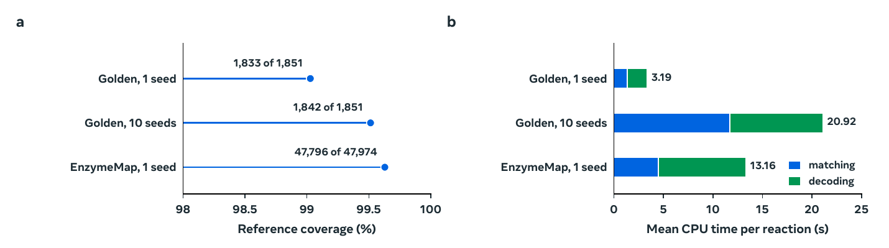
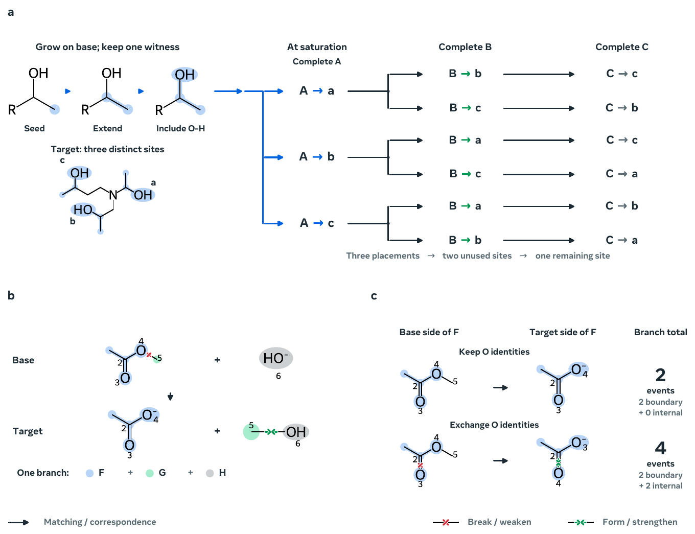
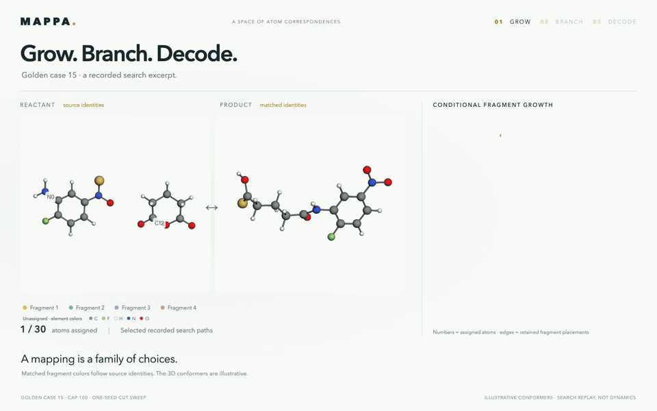
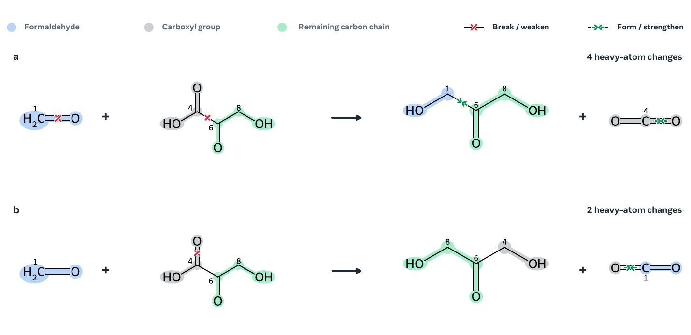
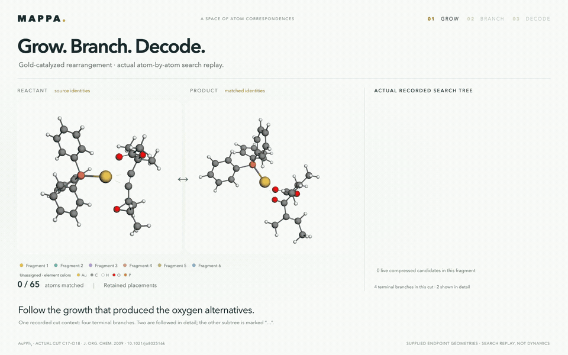
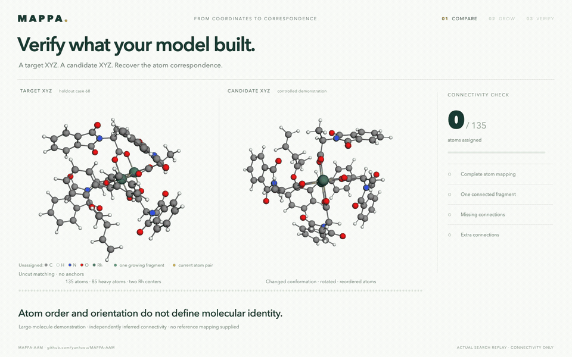
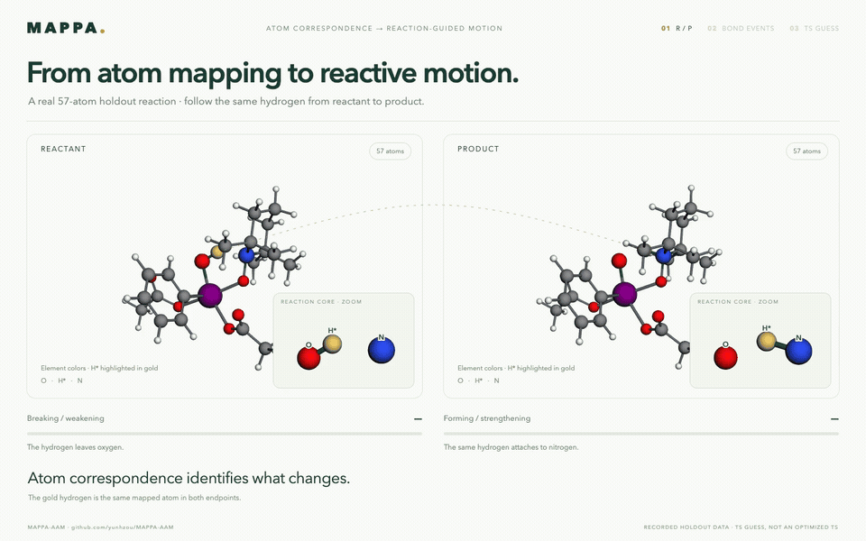

<h1 align="center">
  <picture>
    <source media="(prefers-color-scheme: dark)" srcset="docs/assets/mappa-logo-dark.svg">
    
  </picture>
</h1>

<p align="center">
  <b>Mapping of Atoms by Progressive Pattern Assembly with Molecular Symmetry</b><br>
  Match atoms. Recover alternatives. Understand structural change.
</p>

<p align="center">
  <a href="https://yunhzou.github.io/MAPPA-AAM/">Blog</a> ·
  <a href="blog/video/mappa-intro.mp4">Video</a> ·
  <a href="docs/PYTHON_API.md">Python API</a> ·
  <a href="#benchmarks">Benchmarks</a> ·
  <a href="reports/README.md">Evidence</a>
</p>

<p align="center">
  
  
  
  <a href="LICENSE"></a>
  
</p>

MAPPA is a Python library for atom–atom matching (AAM) between molecular structures. It grows matching fragments, branches over alternative placements, and keeps symmetry-related correspondences in a compressed representation. A separate decoding step counts the bond changes each alternative implies.

Use MAPPA to map reactants to products, analyze how molecular structures differ, verify generated structures against a target, or carry reaction-core correspondences into transition-state workflows. It works with molecular graphs and supplied bond-order matrices, including continuous Wiberg bond orders (WBOs).

**With its standard settings, MAPPA recovers 99.03% of the Golden and 99.63% of
the EnzymeMap reference mappings**, averaging 3.19 and 13.16 CPU seconds per
reaction. Golden contains 1,851 reactions; EnzymeMap contains 47,974. See
[Benchmarks](#benchmarks).

## MAPPA in 90 seconds

[](blog/video/mappa-intro.mp4)

[Watch the video](blog/video/mappa-intro.mp4) (MP4, 14 MB, with narration)

## Get started

```bash
git clone git@github.com:yunhzou/MAPPA-AAM.git
cd MAPPA-AAM
python -m pip install -e .
```

Building the native extensions requires a C++17 compiler. xTB is needed separately only if you want to compute WBO inputs; matching supplied arrays does not invoke it.

The pipeline has two stages: **matching**, ending with deduplication across
seeds and cuts, then **decoding**. Each call handles both search directions:

```python
from mappa import (
    AAMProblem, MolecularEndpoint, AAMSearchConfig,
    search_aam_directions, deduplicate, decode_events,
)

# Supply elements, coordinates (N × 3), and bond orders (N × N) for each endpoint.
endpoint_a = MolecularEndpoint(elements_a, xyz_a, wbo_a)
endpoint_b = MolecularEndpoint(elements_b, xyz_b, wbo_b)
problem = AAMProblem(endpoint_a, endpoint_b)
config = AAMSearchConfig(iso_tolerance=2.0, seed_count=1, branch_limit=100)

# Matching: uncut search plus the full single-edge sweep, then deduplication.
matched = search_aam_directions(problem, config, direction="both", workers=1)
catalogues = deduplicate(matched)

# Decoding: retain branches in each direction's detected minimum + 5 window.
decoded = decode_events(catalogues, event_slack=5)

print(decoded.forward.event_window)
print(decoded.reverse.event_window)
```

Forward uses endpoint A as the base and B as the target; reverse exchanges them.
`catalogues` and `decoded` expose `.forward` and `.reverse` results, with their
own atom indices and event windows. Increase `workers` to parallelize matching
cuts, or `seed_count` for more growth orders. Search and decoding remain
separate, so changing event settings does not require repeating matching.

This example selects discovery tolerance 2 and event slack 5; their defaults
are 1 and 6. Event counting uses empirical bond-order change thresholds of 0.5
for ordinary two-centre bonds and 0.3 for bonds to metals or to main-group
elements that form three-centre bonds (B, and the p-block from Si onward).

Where to go next:

- [Python API guide](docs/PYTHON_API.md): save and reload results, inspect branches, extract reaction cores, set anchors and directions.
- [Command line](docs/CLI.md): run one reaction from NPZ files and build the native engine.
- [Work pool](docs/shared-execution.md): run many reactions on local CPUs or inside one Slurm allocation.

## Benchmarks

**A reference is recovered when a verified mapping that keeps the annotated heavy-atom correspondence occurs in MAPPA's decoded output**, within five bond events of the detected minimum, in either search direction. This measures reference inclusion among the returned alternatives, not whether a ranked first candidate is correct. Every reaction stays in the denominator.



| Study | Reactions | Recovered | Coverage | Matching CPU s | Decoding CPU s | Total CPU s |
|---|---:|---:|---:|---:|---:|---:|
| **Golden, 1 seed** | 1,851 | **1,833** | **99.03%** | 1.31 | 1.88 | **3.19** |
| Golden, 10 seeds | 1,851 | 1,842 | 99.51% | 11.64 | 9.28 | 20.92 |
| **EnzymeMap, 1 seed** | 47,974 | **47,796** | **99.63%** | 4.41 | 8.75 | **13.16** |

All runs use discovery tolerance 2, branch cap 100, both directions and the full
single-edge sweep. Times are means per reaction; matching includes fragment
reduction, and publication and external verification are excluded. Ten seeds
recover nine more Golden references and lose none. On EnzymeMap the median is
5.80 CPU seconds per reaction and the 95th percentile 41.86.

[Golden report](reports/golden_native_seeds_20261106/README.md) · [EnzymeMap report](reports/enzymemap_native_20261106/README.md) · [Earlier campaigns](reports/README.md)

### Golden coverage across methods

A method that returns one mapping is treated as a candidate set of size one, so
the same check measures that mapping's accuracy.

| Method | Search setting | Output | References covered | Coverage |
|---|---|---|---:|---:|
| **MAPPA** | **1 seed, sweep** | Families | **1,833 / 1,851** | **99.03%** |
| **MAPPA** | **10 seeds, sweep** | Families | **1,842 / 1,851** | **99.51%** |
| SLAP | Expanded sweep | Candidates | 1,794 / 1,851 | 96.92% |
| SLAP | Binary, both directions | Candidates | 1,620 / 1,851 | 87.52% |
| SLAP | Binary, default | Candidates | 1,591 / 1,851 | 85.95% |
| LocalMapper | Default | Single mapping | 1,605 / 1,851 | 86.71% |
| Chython | Default | Single mapping | 1,561 / 1,851 | 84.33% |
| RXNMapper | Default | Single mapping | 1,547 / 1,851 | 83.58% |
| Reaction Decoder Tool (RDT) | Default | Single mapping | 1,030 / 1,851 | 55.65% |
| Indigo | Default | Single mapping | 692 / 1,851 | 37.39% |

Expanded SLAP combines its binary and weighted modes with both directions and
the cut sweep through our wrapper; it is not SLAP's published score. All
comparator numbers come from our own evaluation.

On the 1,834 Golden reactions completed by every protocol, on the same CPU
model, binary SLAP without the sweep averages 0.111 CPU seconds per reaction,
MAPPA 1.202 for matching plus 1.617 for decoding, and expanded SLAP 12.475.
All three use both directions.

[Paired timing study](reports/golden_slap_paired_20261108/README.md) · [Comparator audit](reports/golden_competitor_recheck_20260913/README.md)

## How it works

A reaction can admit several atom correspondences, with different bond changes or symmetry-related atom assignments. Returning one mapping hides those choices, while listing every symmetry permutation quickly becomes unwieldy. MAPPA grows matching fragments, branches when alternative placements are available, and keeps symmetry compressed. Separate decoding attaches local bond-change responses to these retained choices for inspection.



(a) A fragment grows on the base with one witness; at saturation each of its target placements becomes a branch, and each earlier placement constrains the later ones. (b) One branch pairs the base and target atom sets of its fragments, here with two boundary events. (c) Decoding compares both sides of a fragment: exchanging O3 and O4 adds two internal events to the two boundary events. These are constructed examples.

```text
Matching:  search_aam_directions -> deduplicate -> catalogues
Decoding:  decode_events(catalogues)             -> decoded
Optional:  extract_reaction_cores(decoded)       -> reaction cores
```

The search stores fragment choices and correlated symmetry operations without expanding every atom bijection. Decoding's event counts are a model: it treats fragments independently, fixes ordinary boundary counts, and couples only the single sweep correction. Default search uses one seed ordering per cut, uncut plus single-edge sweep, and branch cap 100. See [design.md](design.md) for the matching invariants, branch identity and decoding responsibilities.



This Golden example follows the growth and branching recorded with the September baseline search, then shows two distinct decoded event patterns, including one equivalent to the reference. Red × marks indicate breaking or weakening; green inward arrows indicate forming or strengthening.

[Full-resolution MP4](docs/animations/mappa_research_preview/mappa-grow-branch-decode.mp4) · [Offline interactive viewer](docs/animations/mappa_research_preview/index.html) · [Example and provenance](docs/animations/mappa_research_preview/README.md)

## Two mappings of one EnzymeMap reaction



Both mappings are saved MAPPA outputs for EnzymeMap case 13175. (a) In the annotated reference, the formaldehyde carbon 1 enters the three-carbon molecule and carboxyl carbon 4 becomes CO₂. (b) The alternative exchanges these carbon origins. The drawings show four and two heavy-atom bond changes; with the hydrogen assignments optimized for each, both need six bond events in total. Event counting therefore leaves the two atom origins tied, which is why MAPPA keeps both. Neither correspondence establishes a reaction pathway.

## What you can do with MAPPA

- **Atom–atom matching:** recover alternative reactant/product correspondences and inspect the fragments supporting each match.
- **Structure analytics:** compare bond-change patterns, locate reaction cores, and query which atom shuffles preserve a candidate's events.
- **Structure verification:** compare a generated XYZ with a target and identify missing or extra connections under a chosen connectivity rule.
- **Reaction and TS workflows:** explore correspondence-dependent pathway hypotheses, align endpoints, and score recorded modes at a TS guess.

### Explore alternative reaction pathways

The product structure alone may not tell you which reactant atom ends up at each site. MAPPA searches for alternative correspondences so you can turn those differences into concrete pathway hypotheses. These are starting points for mechanistic analysis and TS calculations; establishing whether a pathway exists requires investigating the steps between the endpoints.



In this gold-catalyzed rearrangement, MAPPA recovers two possible destinations for the original epoxide oxygen: the ester link or the ketone. They are consistent with different pathways considered in the published study.

[3D film](docs/animations/gold_rearrangement/gold-oxygen-3d.mp4) · [Film viewer](docs/animations/gold_rearrangement/index.html) · [Full growth trajectory](docs/animations/gold_rearrangement/trajectory.html) · [Published pathway schemes](docs/animations/gold_rearrangement/pathway-reference/README.md)

### Verify a generated structure

A generative model may return the target molecule with reordered atoms and a different conformation, so comparing coordinates directly does not tell you whether it has the intended connectivity. MAPPA matches the generated structure to the target and checks whether the inferred connections agree under that correspondence. Bond orders, stereochemistry and stability require separate checks.



This controlled demonstration uses a 135-atom target with a changed conformation and shuffled atom order. MAPPA matches it as one complete fragment and preserves all 148 inferred connections. In the [broken-molecule control](docs/animations/molecule_verification_broken/README.md), a 21-atom group is deliberately disconnected: MAPPA still assigns all 135 atoms, but needs two fragments and finds one missing connection.

[3D video](docs/animations/molecule_verification/molecule-verification.mp4) · [Interactive film](docs/animations/molecule_verification/index.html)

### Guide TS mode selection

A frequency calculation at a TS guess returns many vibrational modes, and a frequency value alone does not identify the motion relevant to your reaction. MAPPA maps the reactant and product to identify their bond changes, matches the reaction core into the guess, scores how well the mode displacements follow those changes, and selects among the imaginary modes.



The video illustrates an O–H → N–H transfer in a 57-atom guess. The selected imaginary mode moves the highlighted hydrogen along the mapped bond changes; a stable mode is shown for contrast. The film was recorded with an earlier scoring formula; the current scorer is described in the [TS scoring guide](docs/TS_SCORING.md). The geometry remains a **TS guess, not an optimized TS**.

[3D video and scoring evidence](docs/animations/ts_mode_selection/README.md) · [Interactive film](docs/animations/ts_mode_selection/index.html)

## Documentation

| Guide | Contents |
|---|---|
| [Python API](docs/PYTHON_API.md) | Pipeline calls, saved results, reaction cores, anchors, directions, settings |
| [Command line](docs/CLI.md) | The `mappa` command and the native engine |
| [TS scoring](docs/TS_SCORING.md) | The transition-state score and its bond-change diagnostics |
| [Viewers](docs/VIEWERS.md) and [search trajectories](docs/SEARCH_TRAJECTORIES.md) | Offline viewers for mappings and recorded fragment growth |
| [Work pool](docs/shared-execution.md) | Many reactions on local CPUs or in one Slurm allocation |
| [Benchmark launcher](bench/README.md) | Portable EnzymeMap and Golden runs |
| [Design](design.md) | Architecture and scientific contract |
| [Evidence](reports/README.md) | Saved measurements behind the benchmark numbers |

Retrosynthesis is maintained separately on [codex/retrosynthesis](https://github.com/yunhzou/MAPPA-AAM/tree/codex/retrosynthesis).

## Tests

For routine refactoring, run the smoke checks, then the tests for the module
you changed:

```bash
python -m pytest -q -m smoke
```

```bash
# Conversion/counting changes
python -m pytest -q tests/test_fragment_conversion.py tests/test_partial_event_decoding.py tests/test_relative_event_window.py tests/test_saved_fragment_anchors.py
# Full regression suite for releases or changes spanning core algorithms
python -m pytest -q
```

Matcher changes require the exhaustive compression and Python/native comparison
tests (`test_growth_compression_exactness.py`, `test_target_action_growth.py`,
`test_bond_tolerance.py`, plus the affected growth tests). Scheduling changes
require the execution tests. Documentation-only edits need link/content checks,
not molecular calculations. Passing smoke checks does not mean the full suite
passed.

## Repository layout

| Location | Contents |
|---|---|
| `src/mappa/` | `mappa_core` algorithms/I/O, `mappa_workflow` analytics, and `presentation` |
| `docs/` | Guides, README figures and the example animations |
| `bench/` | Maintained, portable experiment runners and campaign audits |
| `reports/` | Saved measurements, witnesses, provenance, and benchmark summaries |
| `tests/` | Contract checks and independent scientific oracles |
| `tools/` | Input/output utilities, including the animation renderers |
| `blog/` | Introduction video |
| `skills/` | Reusable viewer instructions |

## Authors

Yunheng Zou; Olalla Nieto Faza; Shifa Hussain; **Varinia Bernales†**;
**Alán Aspuru-Guzik†**. † Principal investigators.
