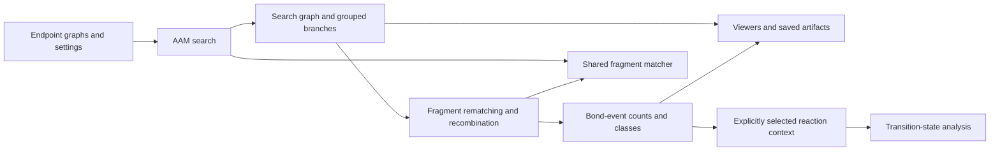
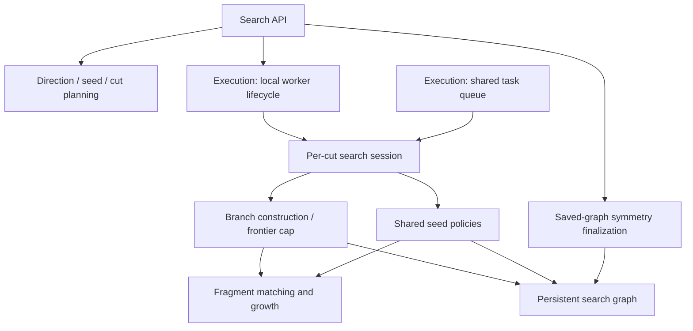
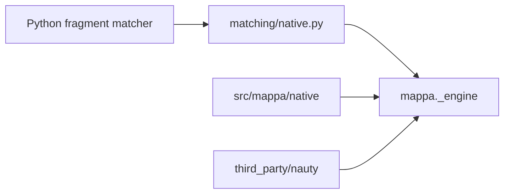

# MAPPA architecture

This is the authoritative design for the current code. Usage belongs in
[the Python guide](docs/PYTHON_API.md), [execution guide](docs/shared-execution.md),
and [viewer guide](docs/VIEWERS.md). Measurements and validation records belong
in `reports/`; historical implementations and superseded designs remain in Git.

## Workflow and ownership



| Owner | Responsibility | Current implementation |
|---|---|---|
| Graph/chemistry primitives | Endpoint graphs, bond rules, input conversion | `frag.py`, `chemistry_computations/`, `smiles.py` |
| Fragment matcher | Conditional injective matches with compressed correlated choices | `mappa_core/core/matching/`, native engine |
| AAM search | Fragment locking, completed-branch frontier, seeds and cuts | `mappa_core/core/search/` |
| Representation | Shared decisions, paths, atom-set branches, saved mapping families | `domain.py`, `mappa_core/domain.py`, `mappa_core/core/search/graph.py`, `final_branches.py` |
| Symmetry | Conditioned group reconstruction and action reduction | `mappa_core/core/matching/symmetry.py`, `mappa_core/core/search/symmetry.py`, `action_reduction.py` |
| Decoding | Anchored rematching, recombination, direct counts and event classes | `fragment_conversion.py`, `postprocessing.py`, `event_patterns.py` |
| Explicit queries | Membership of a supplied mapping in saved correlated choices | `family_query.py`, `reference_constraints.py` |
| Execution | Task dependencies, workers, budgets and verified publication | `execution/` |
| TS analysis | Supplied reaction context, endpoint-to-TS cores and scoring | `ts.py`, `mappa_core/core/search/partial.py`, `scoring.py`, `bond_diagnostics.py`, `modes.py` |
| Artifacts/presentation | Versioned persistence, molecular views and growth replay | `artifacts.py`, `viewers.py`, `search_trajectory.py`, `growth_display.py`, `static/` |
| Coordinate display | Rigid alignment and mapped-coordinate interpolation | `presentation/interpolation.py` |

CLIs, benchmark adapters and viewers consume these owners. They must not contain
another matcher or decoder. Scheduling changes do not change scientific settings.

Matching and reaction search are the completed ownership stages in
[refactor.md](refactor.md). Matching owns fragment growth and compressed choices.
Search owns direction/seed/cut plans, fragment locking, branch admission, saved
graphs and optional competition. `session.py` owns per-cut scientific operations;
`api.py` combines and persists their results. Existing local worker lifecycle and
pool loops live in `execution/local_search.py`; distributed scheduling is unchanged.



Node/bond policies and matching result records remain under matching. Search's
partial-assignment helpers replace the old mixed `alignment/sweep.py` owner.
The unused adaptive closure engine and its dedicated native adapter are removed;
shared seed policies and their condition/result records remain. Other ownership
stages are pending. These moves preserve scientific decisions and result semantics.

The old `alignment/` package is removed. Its fragment hierarchies, permutations
and bijections now belong to shared core data in `mappa_core/domain.py`;
coordinate interpolation belongs to presentation. The core data owner has no
presentation dependency. Obsolete interpolation aliases are removed. Trusted
saved checkpoints resolve the previous hierarchy class paths through the existing
explicit relocation table. Root `domain.py` still contains public endpoint,
search-result and TS types; separating those workflow responsibilities remains
part of the later shared-data stage.

## Data architecture

```text
AAMProblem
  reactant, product: MolecularEndpoint
    elements, coordinates, bond-order matrix
AAMResult
  problem, config, metrics
  graph: AAMSearchGraph
    contexts: seed/cut/settings/anchor provenance
    roots: context -> initial state
    states: cumulative mapping, island ownership, continuation position
    transitions: source/target state references and committed fragment evidence
      placement: FragmentMatch
        witness, pools, fixed assignments, automorphism domains/generators
    stops: completion, stall or explicit limit
  branches: SearchBranch[]
    unordered R/P fragment atom-set pairs
    paths: all retained alternatives referencing the graph
```

The graph shares prefixes and exact reconvergence. A path references committed
fragment decisions; it is not a list of enumerated atom bijections. A viewer may
unfold the graph into a tree without changing the stored relation.

`FragmentMatch`, `SymmetryDomain`, `PermutationGroup` and `AAMHierarchy` are
existing typed views of fragment choices. Graph parsing caches these views and
shares exact permutations. A representative is one valid witness, not the entire
represented mapping set. Encounter multiplicity is not a mapping cardinality.

`FinalBranchCatalogue` is a downstream view of saved paths. `FinalFamily` retains
a representative, required bonds, ordered pool/group actions, matching policy
and provenance. Its policy-qualified storage buckets are not the public AAM
branch identity. Reading a catalogue must preserve correlations and coverage.

## Matching and growth invariants

For a fixed fragment, locked context and retained source bonds, the compressed
candidate union must represent every permitted injective match under that
context. This is representation fidelity; it does not assert that greedy search
or a capped frontier discovers every possible fragment.

A candidate stores a witness, set-valued pools, fixed roles and exact correlated
symmetry actions. Equal per-atom orbit labels do not establish equality of whole
mapping relations. Compression requires a relation-preserving certificate and
transporter. Moving a fragment transports dependent assignments consistently;
independent Cartesian products of atom destinations are invalid.

Growth selects boundary atoms uniformly without a bond-order preference. It
extends the represented relation and locks completed fragment placements. The
branch cap applies to the completed-fragment frontier/subtrees, not intermediate
one-to-many iso matches. A cap is a recorded loss of search completeness, not
an equivalence rule or an algorithmic absence result.

Live-state sharing requires compatible continuation contexts and equal state.
It retains incoming histories. Do not merge live states solely because final
atom sets or endpoint automorphisms agree. Separate cuts and seed runs retain
provenance; their contexts are not interchangeable continuation states.

`match_fragment` is the reusable boundary. The Python and native implementations
must preserve the same mapping relation for supported inputs. Explicit native
execution requires the built engine. Node policy, pair-dependent bond tolerance
and trace requirements determine applicable implementations. No failure may
silently select another scientific policy or relax a constraint.

## Final branch identity

A fragment pair is identified by its R atom set and P atom set. A public AAM
branch is the unordered collection of these pairs. Atom ordering, island labels,
seed, history, anchors and representative mappings do not split that identity.
Different labelled atom sets or different pairings remain different branches.

`AAMResult` groups before returning and retains every path/context alternative
inside each group. `retained_branch_count` counts these groups; raw terminal/path
counts remain separate. The first representative or hierarchy is only a witness.
Grouping must not discard other allowed mappings or manufacture new ones.

## Event conversion and counting

AAM matching tolerance and bond-event thresholds serve different purposes.
`convert_fragments` rematches inside the saved R/P fragment atom sets at the event
thresholds. Only directly fixed assignments become anchors. A role moved by a
joint symmetry remains free. The matcher rediscovers free choices; it does not
pin the old representative or require the old free-choice program.

Distinct pair/anchor contexts share rematching work. Identical full conversion
inputs share recombination work and retain every source-family reference. This
work cache is not branch identity. Rematching can split a fragment; compatible
results are recombined into converted compressed branches.

The ordinary event threshold is 0.5 and the metal threshold is 0.3 by default.
An unchanged bond differs by strictly less than its threshold; equality is an
event. Count breaking/weakening and forming/strengthening differences touching
mapped atoms, including mapped/unmapped boundaries. Ignore bonds wholly between
unmatched atoms. Do not invent atoms or correspondences.

`decode_events` counts all retained converted branches, then constructs event
classes within the requested window. The minimum is the lowest count among
these branches. `event_slack=0` selects the minimum; minimum+n and absolute bounds
filter retained results. These are not hidden-bijection optimization bounds.
Identical literal mappings share count work; partition/provenance checks remain
attached to each branch.

Completeness requires uncapped completed rematches, retained mapped atoms and no
counted events internal to a converted fragment. Incomplete internal-event cases
must remain flagged. Neither completion nor `minimum_proven` establishes a global
minimum across unexplored AAM branches or exhaustive old-family enumeration.
Event-class identity uses the correlated decorated-graph relation, not a union
of per-atom orbit IDs.

A user-requested shuffle or reference-membership query is separate from decoding.
It may use the optional solver on saved choices. The public conversion/counting
path does not call solver enumeration or use a solver decoder as a fallback.

## Transition states and presentation

TS analysis requires an explicit `ReactionContext`: selected mappings and bond
events. `mappa_core/core/search/partial.py` serves endpoint-to-TS core assignment, not a replacement
full-reaction search. Raw AAM and event conversion do not select 3D orientation or
claim a general stereochemistry guarantee from element/WBO inputs.

Viewers consume recorded mappings, fragments and symmetry. Display alignment
must not alter scientific correspondences. Saved traces show actual search
choices; compressed alternatives must not be presented as independently
selectable atom pairs. Shared reaction/batch renderers own presentation.

## Execution, storage and evidence

One operation runs on a single CPU, local workers or cluster workers through
`execution/`. Decompose independent case/direction/seed/cut work using original
seed identities; do not create a second cluster implementation. Shared queues
own leases, dependencies and original case deadlines. Scheduling cannot reset
scientific budgets or silently retry completed/failed work.

Use node-local scratch and SQLite writes. Publish verified bounded bundles and
consistent queue backups; do not copy a live WAL database's main file alone or
create a shared file for every tiny intermediate. Preserve source/input hashes,
settings, timings, memory, attempts, output provenance and incomplete flags.
Execution success is not scientific completeness. Resource limits, unknowns,
missing outputs and unattempted tasks are never algorithmic negatives.

## Repository boundaries and remaining cleanup

`src/` contains the reusable Python and native algorithms; `tests/` contains their checks.
`docs/` contains current usage guides and executable examples. `bench/` owns
the current Golden pipeline and its shared evaluators; retired experiment and
campaign scripts are removed. Test-only inputs and reference oracles live under
`tests/`. `reports/` owns measurements and provenance. `tools/` provides
user adapters; cluster launch settings live under `bench/`; `manuscript/` owns paper artifacts. Historical
code is recovered from its recorded Git revision, not kept as runnable fallback
copies in the current tree. Task status belongs in the MAPPA_AAM tracker.

This document does not claim all consolidation is finished. Shared search scheduling and its supporting condition/result types
remain in use. Further consolidation must migrate their consumers together;
changing directory names does not establish equivalent behavior. New code must
use the existing owners, remove superseded paths, and update this one design.

Standalone examples are removed. Paper witness inputs stay beside the relevant
manuscript evidence. Keep `skills/` unchanged pending a separate review.

## Removed competing paths

`alignment.api` and its search/ranking wrappers are removed. The old sweep
executor, worker pool, reduction and minimum-selection entry points are removed;
the former `alignment/sweep.py` is now removed. Its live cut and partial-assignment
helpers belong to search; unused historical symmetry-completion helpers are gone.
`mappa_core/core/search/` owns reaction search and `postprocessing.py` owns
anchored conversion/counting.

The unused post-AAM chirality/RMSD selection framework is removed. Fragment,
permutation, hierarchy and branch types remain. Native selection fails explicitly
when the selected engine is missing or broken; `MAPPA_NATIVE=0` explicitly selects
Python. Capability selection for custom node policies and recorded growth traces
remains deliberate, before execution; a failed native call cannot switch engines.
Graph
validation uses one constraint checker for both shared and individual histories.

The old `group_mechanisms` pipeline and its mechanism-family compiler are removed,
along with their result types, pool reduction, event signatures and Python/native
symmetry-repair scoring. `decode_events` is the sole public event-result pipeline.
The unused analytical mapping-family compiler, historical scoring/pattern
utilities, adaptive cut/seed runners and event certificates are removed with
their obsolete exports and dedicated tests. Explicit mapping queries retain
`family_query.py`; shared fragment and hierarchy types remain in use.
Search configurations no longer accept symmetry-repair options. Exact fragment
symmetry and TS core assignment keep their shared helpers.

## Native implementation ownership

`src/mappa/native/` owns our C++ implementations, headers and engine build script.
Vendored nauty sources and licenses are isolated under
`src/mappa/native/third_party/nauty/`. There is no top-level native source tree.
The compiled interfaces are `mappa._engine` and `mappa._group_ops`.
The unused paired-mapping extension and freeze exports are removed.
`autgrp.cpp` remains required by conditioned symmetry.


