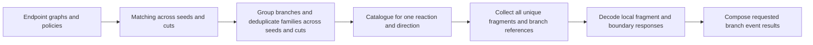
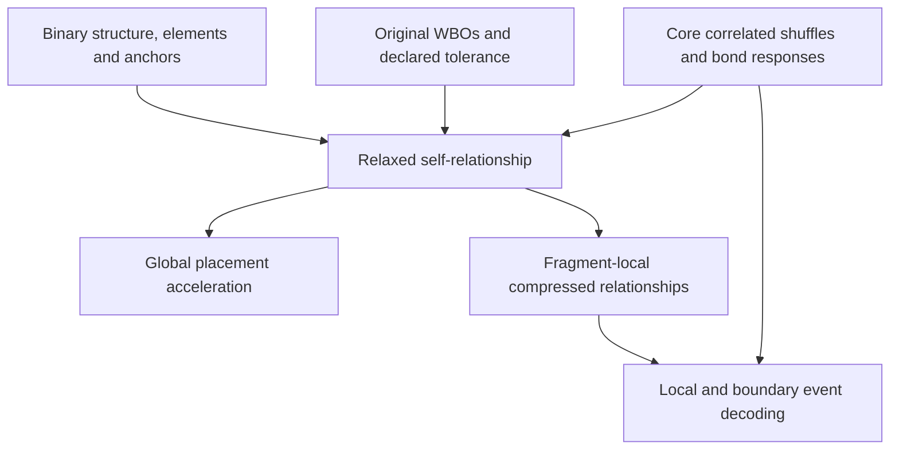
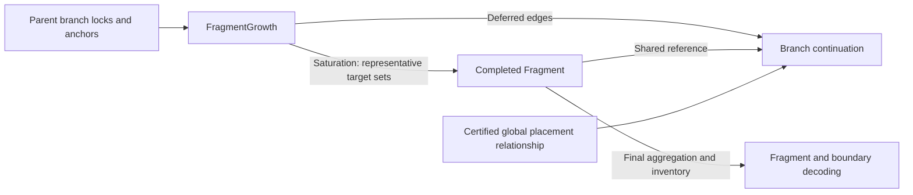
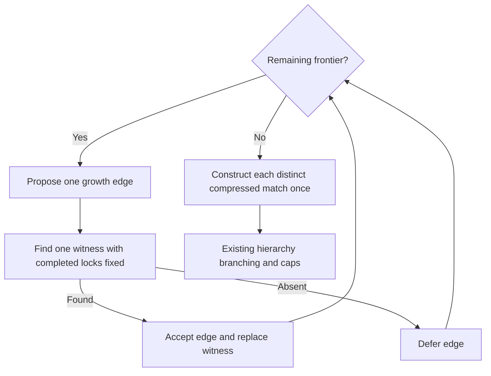
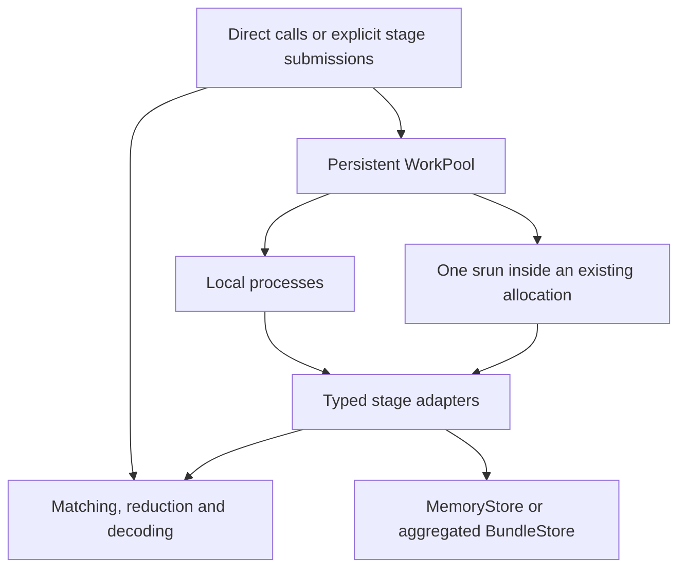

# MAPPA design

This document defines the approved scientific design and module boundaries.
The goal is fast, accurate mapping with one-witness fragment growth, direct
compressed completion, and separate matching, reduction and decoding stages.
Implementation status, measurements and repair history belong in `reports/`;
usage details belong in `docs/`.

## Scientific pipeline

A cut is a search condition and provenance field, not the unit of decoding.
A representative mapping is one witness of a compressed family. Scheduling must
preserve the scientific stages and their meaning.
Reference verification is external evaluation logic that queries the completed
catalogue; it is not a stage of the MAPPA mapping pipeline.

## Inputs and matching rules

`AAMProblem` contains reactant and product `MolecularEndpoint` records: elements,
coordinates and bond-order matrices. Matching uses those inputs and declared
policies. Preparation must state which chemical attributes are represented;
elements and WBOs alone do not establish stereochemistry, charge or isotope
coverage.

Each direction retains its own seed/cut plan and atom-index frame. Concrete
reverse-direction witnesses may be inverted into input indexing; compressed
families and event identities retain their search-frame meaning.

Growth chooses a boundary atom uniformly, then an incident frontier edge
uniformly, without WBO ranking. Only the selected growth edge adds a matching
constraint. Other molecular bonds between included atoms are not implicitly
required. Accepted edges are saved in each fragment relation; complete original
endpoint bonds remain available for event interpretation. Joining a completed
fragment retains its locked assignments and earlier constraints.

`SearchSession` owns prepared matching state. Splitting work must preserve seed
indices, seed order, random settings and the full search scope. An indivisible
cut backend cannot be split into independently reseeded searches.

## Relaxed relationships and shared symmetry core

A **relaxed global automorph** describes permitted rearrangements of one whole
endpoint. An **anchor-aware relaxed fragment self-automorph** describes permitted
rearrangements inside a selected fragment, with its anchors fixed. A **relaxed
isomorph** describes a source-to-target mapping. Discovery tolerance, relaxed-self
tolerance and event thresholds have distinct responsibilities.

Construct a relaxed self-relationship from a hyper-relaxed binary graph: bonds
above the declared presence threshold share one structural label, elements are
preserved, and each anchor is fixed. Nauty supplies compact correlated structural
generators. Retain those broad generators together with joint original-WBO
constraints; every internal pair must remain within the declared self tolerance.
Compare a final rearrangement against the original structure. The relaxed
relationship is symmetric but need not be transitive, so individually permitted
operations cannot be composed without checking the resulting arrangement.

Global construction uses the whole endpoint; fragment construction uses the
selected fragment's internal graph. External attachments do not become local
constraints. The binary graph preserves connectivity at its declared threshold;
weight comparisons also retain internal subthreshold contacts. Accepted growth
edges remain separate discovery constraints. Neither the binary graph nor its
generators alone establish the complete relaxed source-to-target relation.

`core/symmetry/` owns ordered shuffle programs, joint endpoint-pair projection,
original-weight bond responses and relaxed self-relationship construction.
It has no dependency on matching, catalogue records or postprocessing. Global
and fragment-local construction use this same owner. Decoder-specific inventory,
boundary bookkeeping and branch-event assembly consume its shared responses.
Pair projections are local response domains; choices across different pairs
remain correlated through the original joint action. No complete permutation
group is materialized.

## Fragment growth and completion

Fragment matching has two operations: find one witness during growth, then
construct the complete compressed placements when growth saturates.

### Fragment records and ownership

`FragmentGrowth` owns the changing search state. `Fragment` is the completed
source-to-target piece consumed directly by branches and decoding: the fragment
itself is one candidate placement. There is no additional candidate or
`FragmentMatch` wrapper, or separate one-sided fragment record.

| Record | Logical fields |
|---|---|
| `FragmentGrowth` | `source_atoms`, `accepted_edges`, `deferred_edges`, `frontier`, `witness` |
| `Fragment` | `source_atoms`, `target_atoms`, `accepted_edges`, `source_self_automorph`, `target_self_automorph`, `relation` |

The growth subgraph is exactly `source_atoms` with `accepted_edges`; no duplicate
subgraph representation is retained. Deferred edges are rejected extension
proposals, and the frontier contains remaining proposals. The current witness
may change its target atom set during growth. The parent branch supplies fixed
assignments and the anchor/lock context. Original molecular bonds remain in the
reaction data, separate from the accepted growth subgraph.

At saturation, source self-automorph preparation is shared across placements.
Each retained representative target atom set produces one completed `Fragment`, with its
anchor-aware relaxed target self-automorph and complete compressed relaxed
source-to-target relation. That relation owns its witness, anchor pairs and joint
mapping constraints. Accepted edges retain the discovery evidence separately
from the constraints governing retained relaxed alternatives.

When a fragment locks, deferred edges needed for further search remain with the
branch continuation. They neither constrain fragment self-automorphs nor imply
bond events. Branch state also owns cut provenance and inter-fragment boundary
context. Sharing a completed fragment does not merge these continuation states.
Cache identity and checkpoints preserve their relevant context without retaining
discarded growth histories.

Original atom lists, anchors and prepared self-relationships are stored once and
referenced where shared; the table describes logical access, not duplicate
payloads. Global relationships used to accelerate placement discovery belong to prepared
reaction search state. A completed matching operation also supplies a shared
placement relationship to its branch transitions. This relationship connects
equivalent target atom sets; it is separate from each fragment's local relation.
Scheduling, cache transport and storage policy remain outside these records.

One matching-operation result carries the fragment collection, shared deferred
continuation and completion/cap status. Each child transition references its
chosen fragment directly in the existing hierarchy. Final reduction and decoding
retain those scientific records rather than reconstructing a second fragment
representation from dictionaries.

### One-witness existence

Each proposal asks whether the enlarged fragment has an injective,
policy-compatible placement. Extend the current witness when possible; otherwise
search again with earlier assignments within the growing fragment free to change.
Assignments of previously completed fragments remain fixed.

The same exact solver finds a witness or proves absence. Degree, compatibility
and injectivity checks prune impossible choices without excluding valid mappings.
Only proven absence rejects an edge; a timeout or resource limit is not evidence
that no match exists. Accepted proposals replace the witness. Rejected proposals
are deferred while the remaining frontier is explored.

### Direct compressed completion

At saturation, completion uses the full accepted constraints and the current
witness to discover representative target atom sets within its fixed source
fragment, parent and anchor context. Distinct sets may share one continuation
only when a saved global relationship proves their remaining search problems
equivalent. Every represented placement remains recoverable through that
relationship. Overlapping sets remain eligible.

Placement compression uses a certified subgroup of the relaxed global
relationship. It preserves the full target WBO matrix, active connectivity and
all source-to-target node compatibility, and fixes every prior locked target
pointwise. Thus every later matching constraint is preserved under composition.
Callers whose continuation depends on additional target labels declare those
labels fixed for placement compression; this does not occupy them for matching.
General non-transitive relaxed relationships do not establish this stronger
condition. Uncertified rearrangements never justify dropping a continuation.

Discover one representative per target-set orbit. Compact orbit exclusions and
conditioned symmetry pruning participate in search; do not enumerate all orbit
images or internal bijections and then merge them. The branch cap counts these
representative continuations at every hierarchy level. A representative count
is not the number of labelled target placements it represents.

Search continues with one representative assignment and ordinary occupancy. The
saved placement relationship subsequently acts on the entire continuation,
moving later fragments together. It never independently moves one fragment into
another's occupied target. Each decision applies its local relation, then its
placement action; complete programs apply decisions in reverse chronological
order. Retain that order through caches, checkpoints, reduction, mapping queries
and decoding, including unmatched and cut-boundary events.

Each candidate retains its complete compressed internal mapping relationship,
using anchor-aware relaxed fragment self-automorph information. Global symmetry
does not substitute for the fragment's own relationship. Free pools are a special
case derived from that relationship, not an independent compression rule.
One witness and one structural action are not assumed to cover every permitted
mapping on a target set. The representation must establish complete coverage
while preserving correlations and avoiding full-bijection expansion.

The discovery witness satisfies the source-to-target `iso_tol`. Saved relaxed
alternatives retain their own declared constraints and may exceed that discovery
tolerance; original-WBO decoding evaluates their events. Records must distinguish
discovery evidence from constraints on the retained relationship.

For one fixed source/target atom-set pair, let D contain every mapping satisfying
the accepted discovery constraints. Retain both source and target permitted
self-rearrangements: each final mapping is beta composed with d composed with
alpha inverse, where d belongs to D and alpha/beta each satisfy their own original
fragment's self constraints. This is one two-sided expansion, not repeated
closure of a non-transitive relationship. An accepted discovery bond can become
an event after rearrangement. Decoding counts and classifies those changes under
the original endpoint WBOs; it does not rank or select mappings.

A completed fragment preserves its allowed injective mapping relation through
complete discovery constraints and both anchor-aware self relationships. Equal atom sets,
equal orbit labels or equal witnesses alone do not prove that two relations are
identical. Independent atom choices must not introduce forbidden combinations.

The replacement preserves valid mappings, accepted/deferred bonds, locks and
legitimate compressed branch choices. Duplicate records and intermediate merge
history are not scientific requirements. Regrouping choices requires the
placement-equivalence proof above; similar events, witnesses or atom labels
alone do not suffice.

For each parent branch, each retained representative completed-fragment match
produces one child continuation with its saved placement relationship. Symmetric
bijections inside that match are not separate branches.
After each completed search step, apply the cap bottom-up at every hierarchy
level. Each node counts distinct surviving continuations below it. If over the
cap, remove its largest child subtree, recount and repeat until within the cap;
ties preserve the earlier decision. Ancestors use the reduced descendant counts,
so pruning below can spare their other subtrees. A shared continuation remains
reachable through its retained parents, without retaining a rejected decision
path. Seed policies apply this rule independently even when computation is shared.
The completed-fragment limit remains an early rejection of a placement result
that exceeds the cap; it does not truncate intermediate one-witness growth.
Completion, stalls and caps remain explicit; capped search is not an exhaustive
absence proof.

| Core module | Responsibility |
|---|---|
| `growth/engine.py` and native growth loop | Select proposals and record accepted/deferred constraints. |
| `growth/existence.py` and native `fragment_query.h` | Find one witness or prove absence, reusing the current witness where possible. |
| `growth/completion.py` and native `fragment_completion.h` | Construct distinct compressed matches from the completed constraints. |
| Shared symmetry core and matching representation | Supply relaxed global and fragment-local relationships and compact result records. |
| Reaction search | Lock completed placements, form child branches and enforce hierarchy caps. |

There is one growth algorithm, with no legacy mode or error-triggered fallback.
Candidate-growth replay, generate-then-deduplicate completion, candidate-prefix
checkpoints, candidate-deduplication metadata and symmetry-certificate retention
are outside this design. Cross-seed/cross-cut family reduction is a separate,
required stage.

Python and native execution obey the same scientific contract. Native execution
is the normal path; explicit Python execution supports diagnostics and custom
policies. Unsupported capabilities and execution failures are reported, never
silently routed to another algorithm. Historical records keep their recorded
scientific meaning; loading cannot reinterpret decoding as rematching.

## Completed-fragment reuse

A bounded cache surrounds fragment matching. Reuse requires the same endpoint
problem and policies, with compatible topology, occupancy, locks, joined islands
and deferred boundaries. Cache eviction, disabled retention or an oversized
entry may increase computation but cannot change matching or caps.

The cache contains completed compressed results and their dependency evidence.
It does not retain expanded bijections, candidate prefixes or symmetry
certificates. Its budget bounds retained entries, not total process memory.
Entries share equal immutable fragment self-preparations within one reaction.
The budget counts each shared preparation once, including its ownership index;
evicting its last entry also releases that index record.
Switching reactions releases prepared reaction-specific state.

### Shared reaction cache snapshots

Shared snapshots belong to the execution layer; the matching algorithm exports
and imports cache data without scheduling workers or performing shared-file I/O.
Each reaction/configuration has an immutable first-snapshot **baseline** and a
replaceable **latest** snapshot, with separate directional content. Workers check
the latest published version at task boundaries and reuse their resident version
when current. A failed latest load may use the baseline after integrity and
context checks. This approved data-recovery path is not an algorithm fallback.
If both stored versions are unusable, the error remains explicit.

One coordinator owns publication. Only an accepted publisher writes a complete
staged snapshot; the coordinator replaces the latest snapshot atomically. Readers
retain their opened version while replacement occurs. Stale publishers cannot
overwrite newer versions. Only changed retained entries are published, with
updates coalesced to limit storage overhead. Scientific results are published
independently of cache snapshots.

Snapshot transport validates checksums, endpoint identity, policies and code
compatibility, and reapplies the resident memory budget. Cache I/O, hits and
recovery are measured. Persistent snapshot count is bounded per reaction, never
per seed, sweep or cut.

## Search records and family reduction

The retained representation has three distinct levels:

| Level | Identity and responsibility |
|---|---|
| `AAMSearchGraph` | Contexts, states, transitions, roots and stop evidence, including compressed placements and seed/cut histories. |
| `AAMResult.branches` | Paths grouped by the unordered collection of final reactant/product fragment atom-set pairs. |
| `FinalBranchCatalogue` | Saved mapping families, their alternative fragment partitions and provenance. |

Native transport returns the typed search graph with immutable shared state
blocks. Binary checkpoints and pool handoffs preserve that sharing. Explicit
record/JSON export may expand views and need substantially more memory. Storage
sharing does not merge scientific alternatives or enumerate fragment bijections.

Matching retains the full ancestry of live continuations and returned results,
including every incoming path at a join. Once a path has no surviving descendant,
its mapping, fragment and boundary payloads are released during ordinary search,
before transport or publication. Cap evidence records the context, seed, step,
stage, attempted count, limit and occurrence count without retaining rejected
child states. A cap summary is not a returned mapping. Shared-policy searches
also retain decisions still reusable by their active policies, and release that
working state when those policies finish. Incompatible historical fragment schemas are rejected; use their producing
revision to inspect them without changing their scientific meaning.

Graph combination concatenates and reindexes histories; it does not deduplicate
final families. Public branch grouping retains every path. Seed order, growth
history, island labels, anchors and witnesses do not split an atom-set branch;
different representative atom sets or fragment pairings do. Saved placement
relationships retain the additional labelled sets without expanding branch
records. Live continuation contexts
cannot be discarded merely because their final atom-set groups coincide.

One catalogue per endpoint problem and direction reduces all supplied seeds and
cuts. Its family key includes matching policies, the representative mapping and the
ordered complete fragment and placement relationships, including their discovery
and self constraints. Only proven
commuting actions may be reordered. Distinct constraints or correlations remain
distinct even when witnesses coincide. This is conservative representation-based
reduction, not a general semantic normal form for all equivalent mapping sets.

The catalogue preserves source histories, cut provenance and alternative fragment
partitions. Each provenance row associates its source partition with its own cut
context; cuts from different histories are never combined into one occurrence.
Raw paths, public atom-set branches and catalogue families are separate
counts. Completed search graphs may be ingested one at a time; the accumulated
catalogue and provenance still consume memory.
Restoring a catalogue shares equal immutable mapping, constraint and action
records while preserving every family's values, action order and provenance.

## Decoding: unique fragments first

For one reaction and direction, collect all unique saved fragments before
computing event responses. A decoding occurrence is one saved source partition
with its own cut context. Alternative partitions and cuts remain separate; their
totals are never added together.

Ordinary decoding uses the approved **independent-fragments-with-sweep
approximation** for both branch selection and reported event bins. Ordinary
inter-fragment boundaries contribute fixed source breaking and target forming
events. Unique fragments contribute independent local event spectra. Only the
saved sweep boundary couples those contributions. This is an event-model
assumption, not a proof that physical boundary events are independent. Its
minimum and bins must be labelled approximate.

The full compressed mapping catalogue is preserved. Decoding does not rematch,
replace its constraints or enumerate complete bijections. Explicit mapping
requests still apply the original ordered actions and validate their joint
discovery, self, placement and occupancy constraints. Independent composition can
combine mutually incompatible local or placement choices, so a numeric model bin
need not have a complete joint mapping witness. Results explicitly record
`bin_witnesses_guaranteed=False`; bins do not establish global physical mapping
feasibility or a physical event minimum.

Local event spectra are cached by the fragment's mapping, relevant ordered
actions and constraints. Choices affecting several endpoints inside a fragment
remain correlated. Independent fragment spectra combine by addition; counts
between a minimum and maximum are not assumed attainable. A sweep correction
keeps the affected endpoint choices together with their local costs.

Before composing a swept boundary, remove its counted source contribution and
reserve at most one counted target-boundary contribution as its potential
counterpart. The coupled sweep term restores any unused reservation and adds
the actual original-WBO event. Its contribution lies between zero and two.
Never subtract an event absent from the fixed boundary ledger. This matters
when matching weights differ from event weights: a rearrangement can introduce
a swept event without cancelling an already counted target boundary. A cut
internal to one final fragment is counted locally and receives no boundary
correction. The bound of two requires one swept correspondence per occurrence.

Let L be the remaining fixed boundary count plus the sum of local minima. The
occurrence's model minimum lies between L and L+2. Start with occurrences whose
L is at most the smallest L plus two, then resolve their coupled sweep costs to
find the model minimum. Local choices up to two events above their own minimum
may improve the result and must remain eligible.

The default event window is the model minimum plus six. A nonnegative
`event_slack` changes the allowance; `None` retains all model bins. Equality at
the limit is retained. Select occurrences and bins using the same approximate
model, and reject explicit mapping requests whose model count exceeds the
window. A retained occurrence's representative need not lie inside the window.
The model minimum is scoped to the saved catalogue, not paths lost to caps or
incomplete matching. An inconclusive local computation is an explicit failure.

Events use **original endpoint WBOs**, not cut search graphs. The ordinary
threshold defaults to 0.5 and the metal threshold to 0.3; an event requires a
strictly larger WBO change. Breaking, forming, strengthening and weakening are
exclusive categories. Matching tolerance is separate. Count changes touching
mapped atoms, including mapped/unmapped boundaries, and omit bonds wholly inside
unmatched material. No correspondence is invented for unmatched atoms.

When matching uses transformed weights, `event_problem` supplies the original
endpoints for event counting. Both problems retain the same indexed atoms and
coordinates. Discovery and self constraints remain tied to the matching problem;
event responses use the original event problem. Saved results identify both.

`EventDecodeSession` owns reusable endpoint preparation and bounded caches.
`EventInterpretation` owns the inventory, shared local responses, model window
and occurrence views. Preparation preserves action order and does not retain
complete working tables for every branch. Export processes retained occurrences
one at a time and shares equal immutable records. Derived per-atom lookup maps
remain runtime data; saved output retains the catalogue, fixed boundary pairs,
sweep context and local responses without repeating those maps.

Export uses an explicit model/version marker and separates a proved model
minimum from a physical minimum claim. Historical decoder configurations missing
the event-window policy require their producing revision. No exact-decoder mode
or error-triggered fallback is retained. Experimental rematching is separate.

## Local and distributed execution

Simple local calls remain `search_aam`, `deduplicate` and `decode_events`.
`mappa.execution.WorkPool` exposes the same separate stages through typed
`MatchingResult`, `CatalogueResult` and `DecodingResult` handoffs. Execution
strategy must not change scientific settings, task identities or results.

The pool starts persistent workers once, validates source/engine identity and
waits for every requested worker to be ready. Startup failure is explicit.
Slurm does not submit a job per scientific task. Dependencies, scheduling,
leases, budgets, transport and storage belong entirely to the execution layer.
Workers run one compute process each without nested pools and reuse prepared
state within a reaction. Affinity can prefer the same reaction while allowing
other ready work to saturate the pool; it cannot alter search order or policies.

`MemoryStore` communicates intermediates in RAM. `BundleStore` persists immutable
ranges in aggregated worker bundles, with explicit reaction indexes. Persistent
file count grows with workers and byte volume, never with seed, sweep or cut
count. Small payloads may remain in bounded memory spools; larger ones use local
scratch. Durable publication retains integrity checks and shared state.

Massive benchmarks finish and audit matching and cross-seed/cross-cut reduction
before starting decoding. This barrier is scheduling policy, not a requirement
to load the entire dataset into RAM. The decoding job is one reaction/direction
catalogue, with original endpoints, policies, integrity metadata and a manifest
of completed, capped, failed or missing search work. It loads that catalogue,
collects its unique fragments, decodes, publishes and releases the result.
A cut or isolated fragment is not an independent decoding job without a design
that preserves shared constraints and actions.

The coordinator maintains a bounded window of active reactions and an aggregated
campaign ledger. Retired task specifications and attempt histories remain
archived. Separate allocations may own disjoint reaction batches; completion of
one allocation does not imply completion of the matching pass. A fresh benchmark
starts with empty results and caches and imports immutable endpoint/reference
inputs. Re-decoding saved catalogues under a new event policy does not rerun
matching.

Recovery preserves completed outputs, original task identities, attempt history
and consumed compute budgets. Case time counts overlapping computation once;
publication and idle time do not replenish it. Extra retry time or a changed
resource allowance must be explicit. Failure, resource limits, lost leases and
incomplete scope remain distinguishable from scientific absence. Coordinator
loss requires explicit recovery.

Cross-node execution requires compatible code, inputs, artifact paths and clocks.
Storage-root relocation preserves offsets and checksums, including nested
references; it cannot change saved scientific content. Checkpoint migration stops
source writers and gives destination workers disjoint ownership.

## Verification and performance

Reference verification queries the retained mapping relation under an explicit
atom subset and endpoint-equivalence policy. One witness, element sets or event
counts cannot establish coverage of every compressed choice. Heavy-atom
references leave hydrogen correspondence unspecified. Unknown, timeout, capped
search and missing work remain distinct from proven absence.

Verification first rejects references outside conservative per-atom bounds of
the complete ordered relation, including both local self-relationships,
placements and endpoint equivalence. These bounds cannot establish acceptance;
survivors retain every joint constraint. Reuse shared immutable action preparation
and stop work once absence is proven. Construct physical output expressions only
for callers that need a mapping or an event query.

Matcher acceptance requires independent mapping-relation checks, meaningful
branch and cap checks, and Python/native agreement. Critical cases include C6
into C6 producing one compressed match, and C6 into two rings retaining both
placements: two representatives when attachments distinguish them, or one with a
certified relationship when the whole target permits their exchange. A proven
impossible query must return zero without unnecessary search.
Broader validation covers locks, tolerances, accepted/deferred edges, symmetry
correlations, transport, reduction, decoding and reference membership.

Performance is an acceptance condition alongside accuracy. Compare identical
scientific scope, measuring matching, completion, publication, scheduling and
memory separately. Resource measurements include the process tree and sampling
coverage; an unsampled short task is not evidence of zero memory use. A cache
budget does not bound total resident memory, and local tests do not establish
cluster scaling. Use the checks in [README.md](README.md); retain independent
scientific oracles and report the actual validation scope in `reports/`.

## Module ownership

Paths below are relative to `src/mappa/`.

| Owner | Location |
|---|---|
| Shared endpoint, configuration and result records | `mappa_core/domain.py` |
| Fragment growth, existence and completion | `mappa_core/core/matching/` |
| Relaxed relationships, correlated shuffles and bond responses | `mappa_core/core/symmetry/` |
| Shared mapping-relation constraints and event-count queries | `mappa_core/core/symmetry/family.py` and `event_counts.py` |
| Seed/cut planning, locking and hierarchy branching | `mappa_core/core/search/` |
| Branch grouping and family reduction | `mappa_core/post_processing/final_branches.py` |
| Unique-fragment inventory and event decoding | `mappa_core/post_processing/decoder/` |
| Persistent local/Slurm pool API | `execution/` |
| Scheduling, task handoffs, recovery and storage | `mappa_core/core/scheduler/` |
| Mapping and event-membership queries | `mappa_workflow/mapping_analytics/` |
| Native scientific implementation and transport | `mappa_core/native/` |
| Versioned persistence | `mappa_core/utils/io/` |
| Explicit reaction-to-TS analysis | `mappa_workflow/ts_analytics/` |
| Saved-result and growth views | `presentation/` |

Schedulers, CLIs, viewers and benchmark adapters consume these owners rather than
implementing competing algorithms. Matching does not depend on presentation or
benchmark orchestration. Display alignment does not change scientific atom
correspondence. Superseded implementations belong in Git, not fallback paths.

Usage guides: [Python API](docs/PYTHON_API.md),
[shared execution](docs/shared-execution.md), and [viewers](docs/VIEWERS.md).
