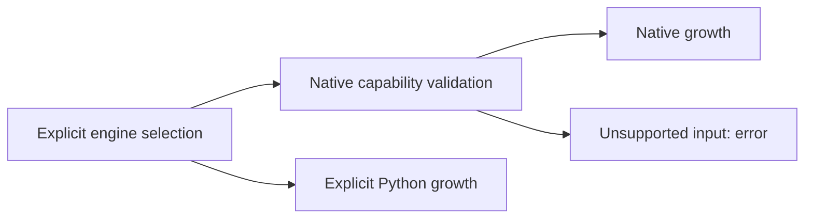
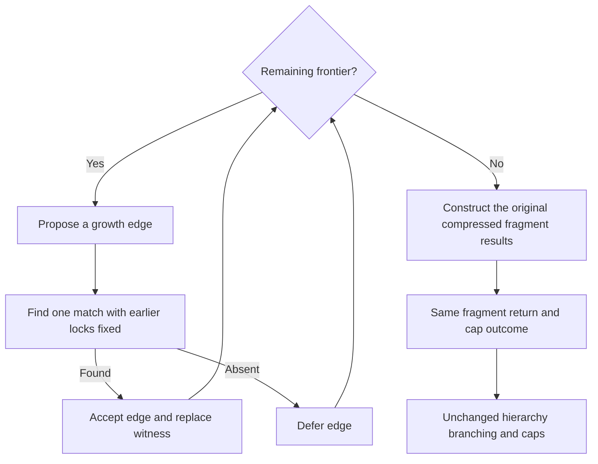
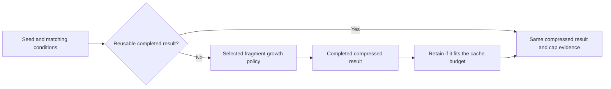
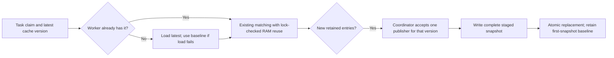
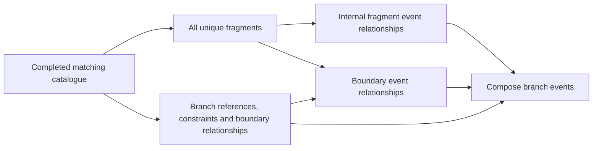
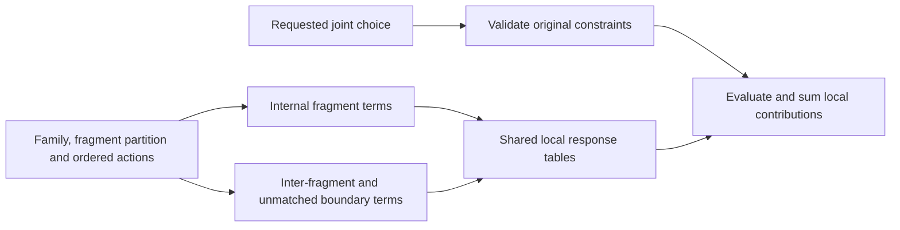
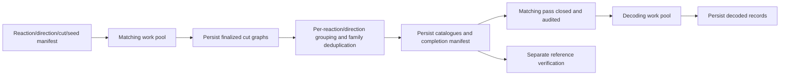
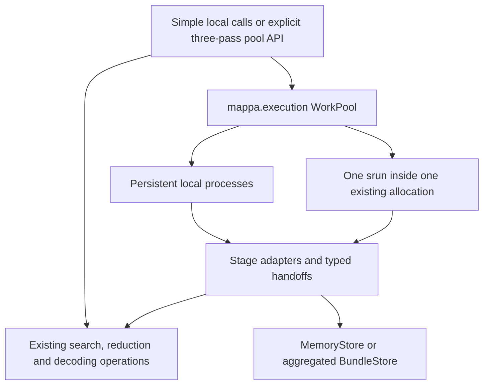

# MAPPA design

This document defines the scientific stages and their execution boundaries.
It replaces the previous mixed descriptions of event interpretation and
hierarchical rematching. Historical designs remain in Git. The scientific
contracts below define the required behavior and the implemented stage boundaries.

## Scientific pipeline

The required benchmark order is **matching → cross-seed/cross-cut grouping and
family deduplication → unique-fragment collection → local fragment/boundary decoding**.
Reference verification is a separate operation. Scheduling must preserve these stages and their meaning.
A cut is a search condition and provenance field; it is not the fundamental unit
of the decoder. A representative mapping is one witness of a compressed family.

## Inputs and matching

`AAMProblem` contains reactant and product `MolecularEndpoint` records: elements,
coordinates and bond-order matrices. Matching uses the supplied endpoint graphs
and declared policies. Element/WBO inputs alone do not establish a general
stereochemistry, charge or isotope guarantee. Preparation and reference policy
must state which information is actually represented.

Each direction has its own seed/cut plan and atom indexing. Reverse-direction
compressed families remain in their search frame; only concrete witnesses are
inverted into input indexing. Directions must not be merged by merely reversing
already reduced event identifiers.

The fragment matcher represents injective assignments using a witness, pools,
fixed roles and ordered correlated group actions. Compression must preserve the
allowed mapping relation. Equal atom orbits or equal representatives alone are
not sufficient grounds to merge alternatives. Independent Cartesian choices of
atom destinations can introduce mappings that the saved family never allowed.

Growth chooses a boundary atom uniformly and then a frontier incident
edge uniformly, without WBO ranking. Extension constrains the selected growth
edge. Other molecular bonds between included atoms are not implicitly matching
constraints. Accepted edges are saved as `preserved_bonds`; complete original
endpoint bonds remain available for event interpretation. Joining a locked
fragment retains its assignments and earlier constraints.

Reaction search locks completed fragment placements and branches over retained
alternatives. The branch cap limits the completed-fragment frontier/subtrees;
it does not convert pruning into a proof of equivalence or absence. Completion,
stalls and caps remain recorded. Exact compression within a fixed matching
context does not prove exhaustive search over every possible fragment.

`SearchSession` owns prepared matching state. Scheduling independent seed batches
must preserve the original seed indices, orders, random settings and full seed
count. Batching must not reseed separate searches. The `shared_policies` backend
is an indivisible cut operation and does not accept seed splitting.

Final symmetry is conditioned on saved candidate roles and earlier locks.
Intrinsic fragment symmetry annotations cannot enlarge the allowed saved mapping
relation. Python and native execution must obey the same scientific contracts;
unsupported capabilities or execution failure must not silently change policy.

## Fragment growth and explicit execution

On 2026-10-31 the user authorized comparing `incremental` and `existence` through
`FragmentMatchConfig.growth_policy`. The accepted Golden settings are now the
defaults: `existence` growth and `reused_native` reaction search, both directly and
in work pools. Incremental growth and reference execution remain explicit
comparison modes; execution errors never select them automatically.

Native requests reject unsupported tracing, node policies and orbit metadata.
`MAPPA_NATIVE=0` explicitly selects Python fragment growth; Python reaction search
also requires `execution='reference'`. Diagnostic trajectory replay calls the
Python trace implementation explicitly. Missing native engines and unsupported
inputs are errors. Current decoder configurations retain their own type when
loaded; historical namespace migration cannot reinterpret them as rematching.

**The replacement boundary is fragment growth, before branch formation. For the
same inputs, its final `FragmentMatchResult` must be exactly the same as before
(apart from elapsed time).**
That includes ordered results, witnesses, pools, symmetry metadata, accepted and
deferred bonds, branch counts and capped outcomes. Equal expanded mapping sets
alone do not satisfy this contract. Branch formation and branch caps at every
hierarchy level remain unchanged, including combined live leaves across parents.
For each current parent branch, each retained completed-fragment match produces
one child continuation. One match continues one branch; multiple matches offer
multiple child branches, subject to the existing deduplication and caps. Symmetric
bijections represented inside one compressed match are not separate branches.

### One witness during growth

Incremental growth carries compressed alternatives. Existence growth carries one
witness and the accepted constraints. Each proposal asks whether the enlarged
fragment has an injective, policy-compatible placement. The previous witness is
a hint: try extending it first; if that fails, search again with earlier growing
assignments free to change. Earlier completed-fragment locks remain fixed.

Accept the edge when a witness exists. Otherwise defer that edge and try the
remaining frontier. Only an exhaustive failure proves absence. Frontier selection,
random draws, occupancy, island joins and edge tolerances keep their existing
rules. Matching enforces the accepted growth edges, not all original bonds between
included atoms. For example, a three-carbon ring may grow onto a three-carbon
chain through two accepted edges.

### Completion preserves the existing representation

The implementation has three responsibilities:

| Module | Responsibility |
|---|---|
| `growth/engine.py` and the native growth loop | Select frontier proposals and record accepted/deferred edges. |
| `growth/existence.py` and native `fragment_query.h` | Maintain one concrete witness; find a replacement when the proposed edge cannot extend it. |
| `growth/completion.py` and native `fragment_completion.h` | Construct the original compressed return using the shared extension/deduplication primitives. |

A witness is a concrete assignment, not a compressed candidate. A successful local
extension checks the new edge and occupancy only: its existing assignments already
prove the accepted old edges. Locked-island joins also carry the newly joined
locked atoms. The whole-fragment query is constructed only when assignments must
be reconsidered. Failure of the local witness never proves the proposal impossible.
No canonical certificates or compressed alternatives are built during this stage.

The growth loop saves accepted extension order and boundary evidence. At saturation,
completion uses the existing compressed seed, extension and deduplication operations
in that order. It does not choose a new pool factorization or enumerate a family's
bijections. Matching primitives have no knowledge of scheduling or worker pools.

The whole finished fragment can reject intermediate candidates that cannot
complete. Those checks happen after exact deduplication: equivalent children have
the same feasibility. A sole candidate contains the already-proven match, and
completed candidates already satisfy the accepted constraints, so neither needs
another feasibility query. The completion query is created lazily, only if an
ambiguous unfinished prefix needs it. Filtering does not repack surviving
candidates. Native completion prepares its matching context once and reuses its
storage across accepted steps; only the proposal and fragment boundary change.
The ordinary final deduplication, cap and return construction are shared unchanged.

This implementation still reconstructs compressed prefixes during completion.
Consequently, one-witness growth alone does not establish a total speed or memory
improvement. Performance must include completion. A faster replacement must retain
the exact fragment return; changing its representation or cap behavior is not an
acceptable shortcut.

The direct completed-query experiment was rejected: it produced different
witnesses and pools, and changed record counts in 31 of 160 diagnostic cases.
Its approximately 2× ring speedup therefore was not a valid drop-in comparison.
That alternate completion implementation and its relaxed equality checks have
been removed.

### Scope and validation

Both Python and native fragment APIs support the switch. Custom node policies
require explicit Python selection. Trace records label growth witnesses explicitly; profiles
separate growth feasibility from final compressed reconstruction. The
`feasibility_searches` count distinguishes a whole-fragment search from a cheap
extension of the existing witness.

`AAMSearchConfig.growth_policy` selects the same policy for reaction search,
shared-seed search and work pools. The default is `existence`. Both policies
use the existing complete-fragment result cache in `reused_native` execution.
Existence still rejects candidate-prefix checkpoints and per-extension candidate
caches; those are different from reusing a completed fragment result. Scheduling
logic does not belong in the matcher.

### Bounded completed-fragment reuse

The user approved connecting existence growth to `FragmentRepair` on 2026-10-31.
The cache surrounds the growth operation; the growth algorithm does not schedule
work or manage cache entries. Each cache instance has a fixed growth policy and
source/target pair. Adapters reject a mismatched policy instead of silently changing it.

The cache validates target occupancy, relevant source topology, locked mappings,
joined islands and deferred boundaries. Unrelated earlier histories or cuts can
reuse the same local answer. Source-read tracking is separate from candidate
checkpoints, so either growth policy records its dependencies without retaining
intermediate growth states. Existence completion and finalization remain unchanged.

The default entry budget is **64 MiB per prepared search session**. Retention uses
least-recently-used eviction. Lookup checks the most recently successful entry
first within each conditional request key, avoiding repeated scans of older cut
conditions. Every candidate entry still passes the same dependency checks.
Accounting includes completed matches, preserved and deferred bonds, candidate
pools, dependency arrays, vector capacity and estimated
index overhead. An oversized result is returned normally without making a cache
copy. Eviction or disabling retention never truncates matching or changes a branch
cap. Statistics expose resident/peak accounted bytes, hits, evictions and oversized
results. This budget covers retained fragment entries, not all process RAM or the
separate symmetry-certificate cache.

### Shared reaction cache snapshots

On 2026-10-31 the user approved disk-backed reuse across pool workers, including
an explicit permanent first-snapshot fallback when a newer cache cannot load.
This is an authorized cache recovery path, not an alternative matching algorithm.
The matcher only exports/imports completed compressed entries and their dependency
evidence. It never schedules work, reads shared files, or publishes versions.

`scheduler/cache.py` owns snapshots. A BundleStore pool enables them by default;
RAM-only pools retain their existing process-local caches. `shared_cache=False`
disables snapshot exchange for measurement without disabling the native RAM cache.
The reaction key binds endpoint atom indexing/WBOs, settings and actual code/engine
identity. Forward and reverse occupy separate sections of the same two files.
Snapshots contain no expanded bijections, intermediate growth checkpoints or
symmetry-certificate memo. Element names, not process-local element IDs, establish
native graph compatibility. Native cache import is transactional and re-applies
the destination's retention budget.

Each reaction/configuration has a **baseline** and **latest** file. The first
completed cache for each direction is immutable in the baseline; adding the
other direction preserves its first section. Latest versions replace their
predecessor atomically. A reader opens once so its header and payload belong to
the same inode. Loading verifies checksums and graph/policy compatibility; a
failed latest load tries the baseline and records the failure. Both unusable
versions are an explicit error. Missing snapshots start an empty cache.

Versions ride existing task claims. Only the accepted publisher serializes and
writes; competitors skip their stale update. No merging or per-fragment network
traffic occurs at the coordinator. Snapshot import retains useful local entries
within the same memory budget and skips identical request entries; compressed
answers and scientific branches are never merged. Directional payload hashes
avoid reloading when only the other direction changed. Publication is acknowledged
through the next claim, so a worker
does not reread its own saved snapshot. Only changed retained entries cause a
save. Switching reactions releases the complete prepared session and cache.
All cache I/O time, bytes, hits, fallbacks and errors are recorded per task.
First directional snapshots are always eligible immediately. Later writes are
coalesced to at most one per second per reaction by default (`cache_publish_seconds`).
This prevents millisecond cuts from causing continuous shared-file updates.
Workers still check the latest published version at every task boundary and
accumulate new entries in RAM. Setting the interval to zero allows every eligible
publication. A snapshot is an optional reuse aid, not a complete matching checkpoint;
scientific outputs are published independently without this delay.
Snapshots use fast level-1 compression to reduce shared-file traffic. The archived
large-cut cache serialized to 20.83 MB and compressed to 2.07 MB; local median
export/compression/decompression took 7.7/37.8/7.0 ms, with native import at 6.2 ms.
The imported cache hit on all 2,476 requests and reproduced the complete raw graph.

One coordinator owns each cache directory, protected by one directory-wide
ownership lock. A publisher writes staging files; the coordinator alone replaces
the published files after accepting its task. Failed/stale publication cannot
replace a newer snapshot. The next owner removes abandoned staging files. Disk
file count is two per reaction/configuration plus temporary publication and one
ownership file, never one per seed or cut. Reading an old baseline cannot bypass
the existing occupancy, lock, boundary and topology checks.

`tests/test_existence_growth.py` compares complete ordered fragment returns
between policies and across Python/native execution. It also independently expands
small families to check their allowed mappings. Coverage includes rings, hydrogen
choices, tolerance pools, locks, accepted/deferred edges, witness reassignment,
custom node attributes, weighted random graphs and caps immediately below and at
the original result count. A regression case requires two old compressed results
to remain two even though an alternate factorization could combine them.

`reports/fragment_growth_20261031/compare.py` measures the full native fragment
operation on prepared graphs in separate single-thread processes. It requires
identical compressed-result digests and independently checks small mapping
relations after timing and memory sampling. `results.json` records the measured
implementation; a relation-only speed comparison is insufficient.

The cleaned implementation passed the full local suite: **693 tests**. Three
fresh processes per case/policy measured total native fragment matching,
including completion. All returned compressed records were identical.

| Case | Incremental CPU ms | Existence CPU ms |
|---|---:|---:|
| ring3 | 0.031 | 0.031 |
| ring6 | 0.075 | 0.074 |
| ring12 | 0.165 | 0.165 |
| ring24 | 0.399 | 0.408 |
| ring6_hydrogens | 0.152 | 0.150 |
| late_oxygen | 0.216 | 0.048 |

Ring medians ranged from 1.4% faster to 2.2% slower across separate processes.
To check the C24 difference, an additional 21 alternating pairs of 200 calls
used the same prepared target and warm cache. Existence was 1.2% faster there.
These measurements show no consistent ring slowdown after removing the earlier
10–28% overhead. The late-oxygen case was 4.5× faster: a final constraint
eliminates most of the shorter fragment placements before compression.

Total peak process RSS stayed approximately 54–55 MiB on these small cases.
Ring certificate-cache payload was unchanged. In the late-oxygen case it fell
from 24,800 to 1,240 bytes (95% less). These are local fragment measurements;
they do not establish large-reaction RAM usage or distributed throughput.

The paired check is reproducible with `compare.py --paired-worker ring24`;
`results.json` retains both the separate-process samples and the paired check.

A subsequent complete-cut diagnostic used the archived EnzymeMap 10383 forward,
cut 334 failure (374 atoms per endpoint). First matching plus symmetry finalization
fell from 438.60 to 35.54 CPU seconds and peak RSS from 4.193 to 0.586 GiB.
All complete finalized search graphs were exactly equal. However, repeating the
same cut took 12.046 seconds with existence versus 0.442 seconds with incremental:
incremental reused all 2,476 fragment results, while existence recomputed them.
That initial diagnostic exposed missing fragment-result reuse. It changed only
the growth call in a separate test build. The bounded integration above now
removes that bypass; both policies use the installed engine and the same cache.
The original measurements remain in [the large-case report](reports/fragment_growth_20261031/large-case.md).

With complete-result reuse enabled, the same large case took 32.09 CPU seconds
on its first existence run, versus 306.08 seconds for incremental in that test.
The existence cache stayed at 1,457 entries / 23.03 MiB through ten runs; total
process peak RAM settled at 0.601 GiB. All 26 raw/finalized graph comparisons
passed. A same-process alternating timing check, balanced by execution order,
measured cached calls at 0.361 seconds for incremental and 0.362 seconds for
existence (0.42% difference). The full suite passed **714 tests**, including
eviction, invalidation and RAM/bundle work-pool validation. See the
[cache integration report](reports/fragment_growth_20261031/cache-integration.md).

## Search records, grouping and deduplication

The retained representation has three distinct levels:

| Level | Identity and responsibility |
|---|---|
| `AAMSearchGraph` | Contexts, states, transitions, roots and stop evidence; retains seed/cut histories and compressed placements. |
| `AAMResult.branches` | Groups paths by the unordered collection of final reactant/product fragment atom-set pairs. |
| `FinalBranchCatalogue` | Deduplicates saved mapping families, associates them with fragment partitions and preserves provenance. |

Native matching returns the typed `AAMSearchGraph` directly. Its immutable
mapping/island sequences share unchanged atom blocks across states; the binding
does not first expand every state into a separate Python list of atom pairs.
This storage sharing preserves every state, transition, join, stop and compressed
fragment placement. It does not merge scientific alternatives or enumerate
fragment bijections. Native transport belongs in `fragment_scheduler_binding.h`,
separate from reaction branching and distributed worker scheduling.

Binary checkpoints and pool handoffs preserve shared blocks. Explicit
`to_record()`/JSON export expands sequence views only when requested, and can
therefore require substantially more RAM than normal matching/publication.
Existing record schemas and atom-pair iteration remain unchanged.

The user accepted this transport on 2026-10-31 after the Mac point comparison
and 654 passing tests. It is the sole native search transport. Historical build
selectors and the expanded exporter are retired; Git retains their evidence.
Independent Python scientific oracles remain for validation. The measured
garbage-collection overhead during deduplication remains documented in
`reports/native_transport_20261031/mac-point.md`.

`AAMSearchGraph.combine()` concatenates/reindexes graph records. **It does not
perform final-family deduplication.** Live-state sharing and final-result grouping
are different operations: continuation contexts cannot be discarded simply
because two histories eventually have the same fragment atom sets.

`AAMResult` constructs its public branch groups before returning. Seed order,
growth history, island labels, anchors and the representative mapping do not
split the atom-set branch identity. Different labelled atom sets or different
reactant/product fragment pairings do. Every retained path remains accessible
inside its branch; grouping does not select only the first representative.

`AAMResult.final_catalogue()` constructs the deduplicated catalogue explicitly.
`decode_events(aam)` also constructs it when passed an `AAMResult`. Constructing
an `AAMResult` alone does not materialize this catalogue.

The catalogue can ingest many finalized graphs for the **same endpoint problem
and direction**. Deduplication therefore spans all supplied seeds and sweep cuts.
Its family key contains:

- Matching policy, including graph floor and isomorphism tolerance.
- Representative mapping.
- Required preserved edges.
- Canonical ordered pool/group action program.

Canonicalization preserves the order of dependent actions; only proven commuting
choices may be reordered. Identical keys share a family. This is conservative
representation-based deduplication, not a general proof that every differently
represented mapping set has been reduced to one semantic normal form.

The catalogue retains each family's source histories, archive/context references
and cut provenance, plus its associated fragment partitions. Different constraints
or action correlations remain distinct families even if representatives coincide.
Policy-qualified catalogue branch keys are distinct from the public atom-set
branch grouping. Raw paths, public branches and unique families are separate
counts and must be reported separately.

The cross-cut reduction stage must use one shared catalogue per reaction and
direction. Building one catalogue per cut and concatenating their decoded outputs
does not perform that reduction. Matching graphs may be read one at a time into
the catalogue; they do not all need to reside in memory together. The accumulated
catalogue and its provenance still consume memory.

## Decoder: local responses with shared constraints

### Required ordering: collect unique fragments first

On 2026-11-01 the user explicitly required acquiring **all unique fragments
before decoding**. For one reaction and direction, first scan the completed
cross-seed/cross-cut catalogue and collect its distinct saved reactant/product
fragment pairs. Retain references from every branch occurrence to that inventory,
together with its compressed choices, constraints and cut/boundary relationships.
Collection itself does not build event tables or enumerate atom bijections.
Sharing a structural fragment does not discard occurrence-specific restrictions
or make correlated symmetry choices independent.

The required sequence is:

1. Collect all unique fragments and their branch references.
2. Decode internal symmetry/event relationships using those shared fragments.
3. Decode the relevant boundary relationships, including cut-sweep bonds.
4. Compose branch event results through references to the shared local results,
   retaining the original allowed joint choices.

`EventDecodeSession.decode()` completes `FragmentInventory` before calculating
any action/event responses. The inventory interns reactant/product atom-set pairs
and records every family's alternative partitions as references. It includes
coupled-branch partitions. The original catalogue retains all matching policies,
constraints, correlated choices and provenance.

`FragmentDecoder` owns shared local results. A `FragmentResponse` is reused only
when the structural fragment, local witness, ordered relevant actions and internal
cut annotations agree. Local action positions are bound back to each family's
original action positions. An action shared by two fragments remains one choice;
sharing a fragment cannot introduce independent symmetry choices. Boundary terms
are shared by their exact endpoint/action context. These results belong to one
interpretation and are released with it; they are not persistent worker caches.

`EventInterpretation.tables()` assembles a family/partition view from these shared
internal terms and its boundary relationships. Required-edge checks, dependencies
and target occupancy remain attached to the original family. The exporter also
shares repeated term records and lists, so binary publication preserves the
sharing instead of materializing a separate dictionary per occurrence. Explicit
JSON export expands references into the same values.

### Current interpretation API and scientific constraints

The core entry point is `decode_events(aam_or_catalogue, config)`. It interprets
original compressed mappings. It does not rematch fragments, replace their
choices, enumerate all complete bijections, select a minimum-event mapping or
claim an exhaustive list of event patterns.

`EventDecodeSession` prepares the original endpoint event index for a fixed
reaction and event policy. It reuses bounded action-response and endpoint caches.
`EventInterpretation` retains the catalogue, complete fragment inventory, action
annotations, shared local results and lazily assembled family/partition views.

The event computation is local:

1. Collect every unique saved fragment, then build its internal response terms
   once per exact local context when needed.
2. Build response terms **between fragments** and across mapped/unmapped boundaries.
3. Share equivalent bond-response tables and accumulate constant contributions.
4. For a requested valid joint choice, look up variable responses and sum each
   bond's contribution once.

“Local fragments first” describes factorized event preparation and composition.
It does not authorize choosing fragment outcomes independently. Boundary terms,
shared actions, required-edge constraints and partial target occupancy can couple
fragments. `FragmentEventTables.components` records dependency components;
separation must preserve shared action identities and feasibility constraints.
It is not currently a distributed fragment-task executor.

Preparation follows relevant original bond neighborhoods and pairs reachable
under the saved actions. A recorded cut adds its own endpoints, even when its
response is zero. Endpoint-pair projection follows ordered actions and retains
correlated motion. A constant-response certificate may avoid pair expansion;
it cannot authorize independently choosing endpoints. Pair work can still grow
quadratically in reachable atom domains, but it does not enumerate full group
elements or Cartesian combinations of complete mappings.

Event tables use **original endpoint WBOs**, not the cut search graph. Fragment
separation and cutting a bond do not themselves imply a chemical event. When
histories merge, their recorded cuts remain available for table annotation.
Alternative fragment partitions are alternative decompositions of the same
family; their totals must not be added together.

The ordinary event threshold defaults to 0.5 and the metal threshold to 0.3.
An event requires a strict WBO difference greater than the applicable threshold;
equality is unchanged. The four exclusive categories are breaking, forming,
strengthening and weakening. Matching tolerance is a separate parameter.
Count changes touching mapped atoms, including mapped/unmapped boundaries, and
omit bonds wholly within unmatched material. Do not invent correspondences for
unmatched atoms.

Actions with invariant responses remain in the ordered program because later
overlapping actions may depend on their motion. Saved constraints are checked
before evaluating a requested realization. Response invariance is not permission
to remove an action or treat its atom destinations independently.

`decoded_events_record()` saves the unchanged catalogue, partitions, shared
response tables, action dependencies and cut annotations. Normal decoding and
export do not select representatives, compute whole-reaction canonical event IDs
or run another global event-pattern deduplication pass. On 2026-11-01 the user
confirmed that event results should come from the saved fragment composition.

`EventInterpretation.contributions()` composes local responses for requested
valid joint choices. The separate `evaluate()` query explicitly requests a
whole-reaction report, including a canonical event ID for optional pattern
comparison. It is not called by normal decoding or export. Different fragment
compositions can yield the same bond changes; composition identity does not
prove globally unique event patterns. `exhaustive_event_patterns` and
`global_minimum_proven` remain false.

The v4 export removes the automatic `representatives` report from v3. Every other
record field, value and ordering is preserved apart from the schema version.
Existing saved benchmark artifacts remain intact. The removed reporting pass
cost 33.15 of 43.30 seconds on Golden 1561; see the
[measurements and validation](reports/golden_pool_20261101/decoder-refactor.md).

## Benchmark pools and their connection

The approved massive-benchmark workflow has separate matching and decoding
passes. Complete and audit the matching pass before starting the decoding pool.
A scheduling barrier is an execution decision; the event algorithm itself does
not require all reactions in the dataset to be present at once.

The benchmark coordinator feeds a bounded window of reaction/direction jobs.
After each job finishes, its task specifications and attempt history are saved
in aggregated bundles before retiring its rows from the active queue. One
checkpointed ledger records stage outputs and failures for the whole campaign.
This bounds dispatch history without dropping scientific provenance or creating
a file per cut. Campaign pass ordering belongs in `bench/`; queue retirement
belongs in the execution layer and does not change matching or decoding.

The handoff is a manifest of saved catalogue inputs. It is not a dataset-wide
collection of graphs in RAM. Each decoding job identifies:

| Input | Required meaning |
|---|---|
| Reaction and direction | Stable identity and endpoint atom-index frame. |
| Original endpoint reference | Elements, coordinates and WBO records consistent with the catalogue fingerprint. |
| Deduplicated catalogue reference | Families across the declared seeds/cuts, fragment partitions, original constraints, action programs and provenance. |
| Coverage/completion record | Planned and completed seed/cut identities, caps, failed or missing work, and explicitly restricted scope if applicable. |
| Event configuration | Ordinary and metal thresholds, independent of the search tolerance. |
| Integrity and version metadata | Input/artifact hashes, source revision and scientific settings. |

A decoder loads the assigned reaction/direction catalogue, collects its unique
fragments, computes shared local tables and saves the decoded record. It releases catalogue-specific graphs,
tables and output after publication. Prepared endpoint state and bounded caches
may be reused while processing the same reaction and policy. Switching reactions
clears derived state; changing event policy replaces the decoder.

This is the initial scheduling unit for the separated pass. Splitting a large
catalogue into smaller jobs requires an explicit design preserving family IDs,
partitions, deduplication, provenance and correlated actions. Neither a sweep cut
nor an isolated fragment should be assumed to be an independent decoder job.
There is no constant-memory guarantee: catalogue size and retained sparse tables
must be measured when choosing per-worker memory and concurrency.

Failed, missing or capped matching work must remain visible. An incomplete scope
must not be silently presented as the full benchmark input. Re-running decoding
with different event thresholds uses saved catalogues and does not rerun matching.

### Explicit execution API

The implementation exposes `mappa.execution.WorkPool` with separate `search`,
`deduplicate` and `decode` submissions. `StageResults.wait_and_validate()` closes
and checks each pass before the next is submitted. `MatchingResult`,
`CatalogueResult` and `DecodingResult` are public typed handoffs. Search settings,
cut/seed scope and scientific stop counts remain visible through decoding.

`plan_search(..., seed_batch=...)` preserves original seed indices/orders and
finalizes each cut after its seed batches complete. When a cut fits in one batch,
that task finalizes and publishes directly, avoiding an unnecessary handoff.
`reduce_matching` reads finalized graphs one at a time into the existing
`FinalBranchCatalogue.add_graph()` implementation. `decode_catalogue` consumes
that complete deduplicated catalogue through the existing event decoder.
The superseded per-cut decoding scheduling helpers have been removed.

`MemoryStore` retains intermediates in RAM and transfers worker objects through
the pool. `BundleStore` appends immutable ranges to rolling worker-owned bundles.
Persistent file count grows with workers and byte volume, never with seed/cut task
count. Ordinary single-reaction checkpoints use the same bundles plus one reaction
index. Loading one reaction is explicit. Both modes still need enough worker RAM
for that reaction's catalogue and local event tables.

Local direct calls remain `search_aam`, `deduplicate`, `decode_events`; they need
no pool. Pool entry waits for every requested compute worker to report ready;
startup has its own timeout and elapsed-time measurement. A failed startup closes
the allocation step instead of returning a partially initialized pool.
Pool workers persist across all stages. Slurm is invoked once to start
node services inside an existing allocation; no task submits jobs. Source and
compiled-engine fingerprints are checked at node-service startup. Scheduling,
leases, transport, task granularity and storage belong entirely to the execution
layer. They must never become policies inside the core scientific algorithms.

Performance is an acceptance condition: preserve direct execution and compare
identical scientific scope before and after changes. Measure task computation,
publication and scheduling separately. Do not claim an unconditional speed
guarantee from one local timing or compare per-cut decoding against a globally
deduplicated pass as though they were the same work.

## Execution and recovery

The shared scheduler owns task dependencies, leases, budgets and publication.
Workers run one compute process each without nested pools. Original seed/cut
identities and scientific settings are independent of task completion order.
Prepared search, symmetry-finalization and decoder resources are reused within
a worker. Cache reuse saves computation; it does not replace family deduplication.

Resource inspection follows a worker clock, normally every 0.2 seconds, across
task and message boundaries. Actual sample counts are recorded; an unsampled
short task's zero reported peak is not zero memory use. Memory guards cover the
compute process tree. Process-reported computation/publication CPU timings are
separate from sampled CPU measurements.

Small compressed payloads use bounded memory spools; larger payloads spill to
node-local scratch. Result bundles retain checksum verification and durable
publication. The coordinator owns its local SQLite queue; workers exchange task
metadata and artifact references. Cross-node execution requires consistent
artifact paths, code/input versions and appropriately synchronized clocks.

Case budgets count overlapping active computation once and pause when no
computation remains active. Publication and idle allocation gaps do not reset or
consume the computation allowance. Failures, resource limits and lost leases are
explicit states. Retry is deliberate and retains attempt history. Checkpoint
recovery must not silently change the scientific scope.

`WorkPool.retry_matching(case, audit)` restores a retired matching case and
retries explicitly selected failed task states. Completed cut references,
original tasks, prior attempts and consumed case time survive. An explicit
`retry_seconds` grants that much additional available time and uses the new
pool's memory allowance for failed work. The old limit, consumed time and new
allowances remain in the archived retry history. Default retries never replenish
time. The benchmark's explicit memory retry selects memory/time failures from
smaller allocations and records the previous ledger row before replacing it;
it does not recompute successful cuts or retry failures at the same memory limit.

Local multicore and localhost remote tests do not establish multi-node scaling.
Coordinator traffic, shared-storage costs and recovery must be measured on the
intended deployment. Workers first take ready work from their current reaction
and direction, then an unassigned reaction/direction, then any remaining runnable
task. This keeps prepared state local when independent reactions are available
and still saturates a pool for a single reaction or a long tail. The preference
uses task metadata only; it cannot change seed/cut identity or matching logic.
Coordinator disconnection requires explicit recovery rather than automatic
failover. Report scientific, publication and scheduling costs separately.

## Verification and acceptance

Reference verification queries the retained mapping relation under an explicitly
specified atom subset and endpoint-equivalence policy. Element sets, one
representative or its event count cannot prove coverage of all compressed choices.
Heavy-atom annotations leave hydrogen correspondence unspecified. Full explicit-H
event totals must not be compared as though they were heavy-only reference counts.
Solver unknown, timeout, search pruning and missing work remain distinguishable
from a proven absence within the retained relation.

Acceptance of an execution refactor requires more than matching representatives:

- Retained search graphs or an explicitly justified equivalent mapping relation.
- Cross-seed/cross-cut branch grouping and full family keys.
- Fragment partitions, constraints, correlated actions and source provenance.
- Shared local event responses and valid joint-choice evaluation against independent counts.
- Completion/cap metadata, reference witnesses and recovery behavior.

The separated-pool tests compare complete search graphs, catalogues and decoded
records, normalizing only archive-local provenance IDs. The saved EnzymeMap case
also compares the complete decoded record against the pre-refactor baseline and
checks exact heavy-atom reference membership and independent dense event counts.
This is one case, not a dataset-wide benchmark or a multi-node scaling claim.

Use the smoke checks and affected tests described in [README.md](README.md).
Matcher changes need the exhaustive compression/native-equivalence checks.
Scheduling changes need dependency, recovery, resource and representation checks.
Documentation-only changes need content and link verification, not another
benchmark run. State the actual validation scope.

## Module ownership

Paths below are relative to `src/mappa/`.

| Owner | Responsibility | Location |
|---|---|---|
| Shared records | Endpoints, AAM configuration and results | `mappa_core/domain.py` |
| Fragment matcher | Conditional matching, selected-edge growth and compression | `mappa_core/core/matching/` |
| Reaction search | Seed/cut planning, locking, branching and saved graphs | `mappa_core/core/search/` |
| Grouping/reduction | Final fragment pairs, family keys, partitions and provenance | `mappa_core/post_processing/final_branches.py` |
| Event decoder | Unique fragment collection, original-space local responses and composition | `mappa_core/post_processing/decoder/` |
| Execution API | Persistent local/Slurm pool and explicit stage manifests | `execution/` |
| Execution internals | Workers, dependencies, budgets, typed handoffs and bundles | `mappa_core/core/scheduler/` |
| Explicit queries | Mapping and event-membership questions on saved choices | `mappa_workflow/mapping_analytics/` |
| Native engine | Shared C++ implementation and vendored nauty | `mappa_core/native/` |
| Persistence | Versioned records and trusted checkpoint relocation | `mappa_core/utils/io/` |
| TS workflow | Explicit reaction context, endpoint-to-TS cores and scoring | `mappa_workflow/ts_analytics/` |
| Presentation | Saved-result views, growth replay and coordinate display | `presentation/` |

Schedulers, CLIs, viewers and benchmark adapters consume these owners; they do
not implement competing scientific algorithms. Matching does not depend on
benchmark orchestration or presentation. Historical implementations belong in
Git rather than fallback paths.

`mappa_core/post_processing/hierarchical_mapping.py` is an explicit experimental rematching
operation. It may change retained coverage and is separate from normal event
decoding. Rematching, recombination and minimum-event-window selection must not
be placed on the normal matching → deduplication → decoding diagram.

TS analysis requires a supplied reaction context. Display alignment does not
change scientific atom correspondence. Viewers must preserve the distinction
between recorded witnesses and correlated alternatives.

The former benchmark implementation was removed; this document records the
replacement's approved stage boundaries, not a restored benchmark framework.
Usage guides: [Python API](docs/PYTHON_API.md), [shared execution](docs/shared-execution.md),
and [viewers](docs/VIEWERS.md). Measurements belong in `reports/`; independent
scientific oracles belong in `tests/`.

Small Slurm allocations may own disjoint reaction-ID batches, each with its own
ledger and persistent worker pool. An array-wide successful matching dependency
precedes later passes; an allocation that drains early is not successful stage
completion. Original aggregated artifacts remain shared read-only inputs.

Moving aggregated artifacts between clusters may remap storage roots through
`MAPPA_BUNDLE_ROOTS` (a JSON source-root to destination-root map). Reads retain
original offsets and checksums, including nested references. Publication uses
the destination's native paths. This is a storage concern; algorithms and saved
scientific content do not change. Stop source writers before transferring a
checkpoint and give destination batches disjoint reaction ownership.
