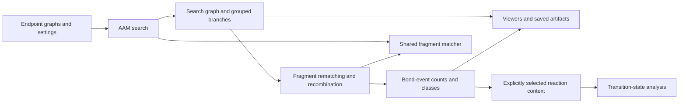
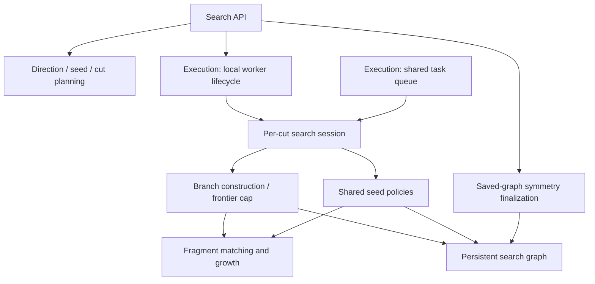
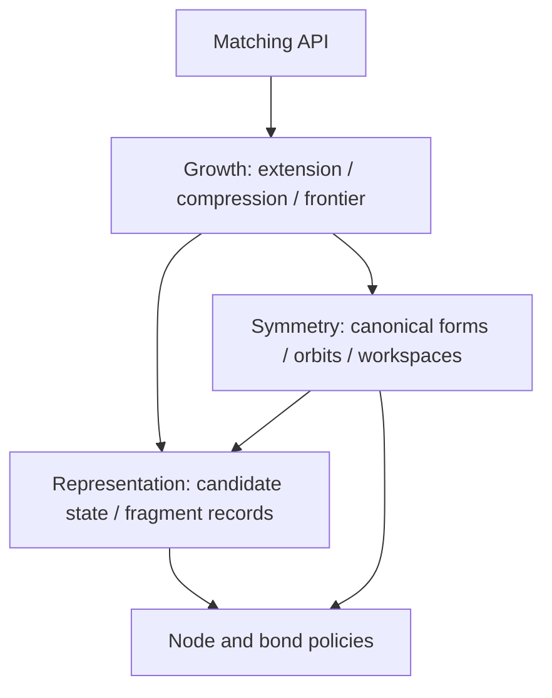
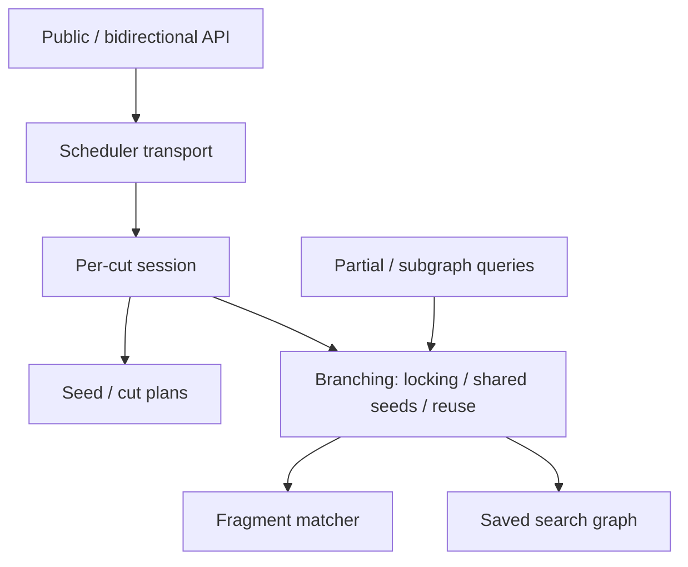
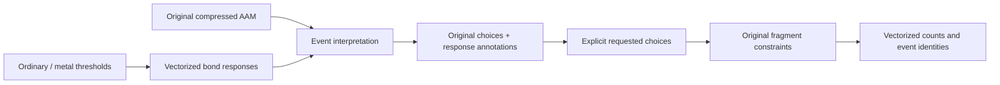
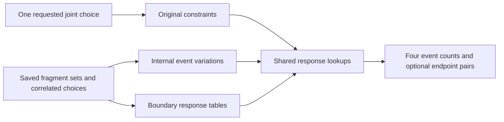
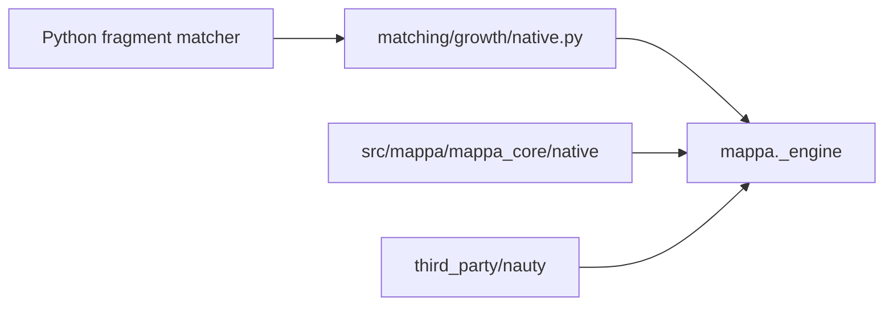
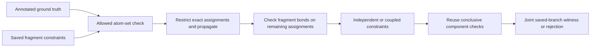
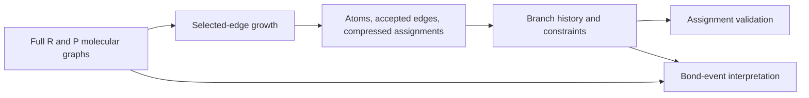
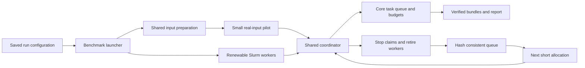

# MAPPA architecture

This is the authoritative design for the current code. Usage belongs in
[the Python guide](docs/PYTHON_API.md), [execution guide](docs/shared-execution.md),
and [viewer guide](docs/VIEWERS.md). Measurements and validation records belong
in `reports/`; historical implementations and superseded designs remain in Git.

## Source hierarchy

```text
mappa/
├── mappa_core/
│   ├── domain.py                 shared endpoint, hierarchy and result data
│   ├── core/
│   │   ├── matching/
│   │   │   ├── api.py, policy.py, graphs.py
│   │   │   ├── representation/   candidate state and fragment contracts
│   │   │   ├── symmetry/         canonical forms, orbits and workspaces
│   │   │   └── growth/           extension, compression and frontier
│   │   ├── search/
│   │   │   ├── api.py, planning.py, session.py, graph.py
│   │   │   ├── branching/        locking, branch engines, reuse and validation
│   │   │   └── queries/          partial and subgraph objectives
│   │   └── scheduler/            local and distributed task execution
│   ├── post_processing/
│   │   ├── final_branches.py
│   │   └── decoder/              records, conversion, events and public API
│   ├── utils/                    shared bond rules and file I/O
│   └── native/                   C++ engine and vendored nauty
├── mappa_workflow/
│   ├── mapping_analytics/        explicit mapping and event-membership queries
│   └── ts_analytics/             TS records, scoring and serialization
├── presentation/                viewers, trajectory, coordinates and assets
├── __init__.py                   public exports
└── cli.py
```

The subfolders express dependencies: growth uses representation and symmetry;
reaction branching uses matching; sessions combine branches and plans; the
scheduler executes sessions. Matching does not call reaction search. Core I/O
has no workflow or presentation imports. Trusted saved-data class relocation is
explicit in the checkpoint reader; no retired import modules remain.

## Workflow and ownership



| Owner | Responsibility | Current implementation |
|---|---|---|
| Graph/chemistry primitives | Endpoint graphs, bond rules, input conversion | `mappa_core/core/matching/graphs.py`, `mappa_core/utils/bonds.py`, `mappa_core/utils/io/` |
| Fragment matcher | Conditional injective matches with compressed correlated choices | `mappa_core/core/matching/`, native engine |
| AAM search | Fragment locking, completed-branch frontier, seeds and cuts | `mappa_core/core/search/` |
| Representation | Shared decisions, paths, atom-set branches, saved mapping families | `mappa_core/domain.py`, `mappa_core/core/search/graph.py`, `mappa_core/post_processing/final_branches.py` |
| Symmetry | Conditioned group reconstruction and action reduction | `mappa_core/core/matching/symmetry/`, `mappa_core/core/search/branching/symmetry.py`, private helpers in `mappa_core/post_processing/final_branches.py` |
| Decoding | Anchored rematching, recombination, direct counts and event classes | `mappa_core/post_processing/decoder/` |
| Explicit queries | Membership of a supplied mapping in saved correlated choices | `mappa_workflow/mapping_analytics/` |
| Execution | Task dependencies, workers, budgets and verified publication | `mappa_core/core/scheduler/` |
| TS analysis | Supplied reaction context, endpoint-to-TS cores and scoring | `mappa_workflow/ts_analytics/`, `mappa_core/core/search/queries/partial.py` |
| Artifacts/presentation | Versioned persistence, molecular views and growth replay | `mappa_core/utils/io/`, `presentation/`, TS workflow serialization |
| Coordinate display | Rigid alignment and mapped-coordinate interpolation | `presentation/interpolation.py` |

CLIs, benchmark adapters and viewers consume these owners. They must not contain
another matcher or decoder. Scheduling changes do not change scientific settings.

The ownership stages in [refactor.md](refactor.md) are implemented. Matching owns fragment growth and compressed choices.
Search owns direction/seed/cut plans, fragment locking, branch admission, saved
graphs and optional competition. `session.py` owns per-cut scientific operations;
`api.py` combines and persists their results. Existing local worker lifecycle and
pool loops live in `mappa_core/core/scheduler/search.py`; local and remote workers retain the same task and budget semantics.



Node/bond policies and matching result records remain under matching. Search's
partial-assignment helpers replace the old mixed `alignment/sweep.py` owner.
The unused adaptive closure engine and its dedicated native adapter are removed;
shared seed policies and their condition/result records remain. These changes
preserve scientific decisions and result semantics.

The old `alignment/` package is removed. Its fragment hierarchies, permutations
and bijections now belong to shared core data in `mappa_core/domain.py`;
coordinate interpolation belongs to presentation. The core data owner has no
presentation dependency. Obsolete interpolation aliases are removed. Trusted
saved checkpoints resolve the previous hierarchy class paths through the existing
explicit relocation table. Shared endpoint, search-result and reaction types now share the core domain
owner. TS-specific types and scoring live in the TS workflow; generic mode
parsing lives in core I/O.

## Matching dependency levels



These are dependency levels inside the fragment matcher, not new stages in the
scientific algorithm. Growth and iso matching retain their shared compressed
representation. Only the public entry and contracts are exported from matching.

## Search dependency levels



`branching/` contains the branch engines; `queries/` contains searches with partial
or subgraph objectives. Planning produces inputs and never invokes the public API.
The native and Python branch engines retain their existing policies.

## Data architecture

```text
AAMProblem
  reactant, product: MolecularEndpoint
    elements, coordinates, bond-order matrix
AAMResult
  problem, config, metrics
  graph: AAMSearchGraph
    contexts: seed/cut/settings/anchor provenance
    roots: context -> initial state
    states: cumulative mapping, island ownership, continuation position
    transitions: source/target state references and committed fragment evidence
      placement: FragmentMatch
        witness, pools, fixed assignments, automorphism domains/generators
    stops: completion, stall or explicit limit
  branches: SearchBranch[]
    unordered R/P fragment atom-set pairs
    paths: all retained alternatives referencing the graph
```

The graph shares prefixes and exact reconvergence. A path references committed
fragment decisions; it is not a list of enumerated atom bijections. A viewer may
unfold the graph into a tree without changing the stored relation.

`FragmentMatch`, `SymmetryDomain`, `PermutationGroup` and `AAMHierarchy` are
existing typed views of fragment choices. Graph parsing caches these views and
shares exact permutations. A representative is one valid witness, not the entire
represented mapping set. Encounter multiplicity is not a mapping cardinality.

`FinalBranchCatalogue` is a downstream view of saved paths. `FinalFamily` retains
a representative, required bonds, ordered pool/group actions, matching policy
and provenance. Its policy-qualified storage buckets are not the public AAM
branch identity. Reading a catalogue must preserve correlations and coverage.

## Matching and growth invariants

For a fixed fragment, locked context and retained source bonds, the compressed
candidate union must represent every permitted injective match under that
context. This is representation fidelity; it does not assert that greedy search
or a capped frontier discovers every possible fragment.

A candidate stores a witness, set-valued pools, fixed roles and exact correlated
symmetry actions. Equal per-atom orbit labels do not establish equality of whole
mapping relations. Compression requires a relation-preserving certificate and
transporter. Moving a fragment transports dependent assignments consistently;
independent Cartesian products of atom destinations are invalid.

Growth selects boundary atoms uniformly without a bond-order preference. It
extends the represented relation and locks completed fragment placements. The
branch cap applies to the completed-fragment frontier/subtrees, not intermediate
one-to-many iso matches. A cap is a recorded loss of search completeness, not
an equivalence rule or an algorithmic absence result.

Live-state sharing requires compatible continuation contexts and equal state.
It retains incoming histories. Do not merge live states solely because final
atom sets or endpoint automorphisms agree. Separate cuts and seed runs retain
provenance; their contexts are not interchangeable continuation states.

`match_fragment` is the reusable boundary. The Python and native implementations
must preserve the same mapping relation for supported inputs. Explicit native
execution requires the built engine. Node policy, pair-dependent bond tolerance
and trace requirements determine applicable implementations. No failure may
silently select another scientific policy or relax a constraint.

## Final branch identity

A fragment pair is identified by its R atom set and P atom set. A public AAM
branch is the unordered collection of these pairs. Atom ordering, island labels,
seed, history, anchors and representative mappings do not split that identity.
Different labelled atom sets or different pairings remain different branches.

`AAMResult` groups before returning and retains every path/context alternative
inside each group. `retained_branch_count` counts these groups; raw terminal/path
counts remain separate. The first representative or hierarchy is only a witness.
Grouping must not discard other allowed mappings or manufacture new ones.

## Event conversion and counting

### Lossless event interpretation of saved symmetry

`interpret_events` attaches event responses to the original `FinalBranchCatalogue`.
It retains its fragment pairs, ordered group/pool actions, fixed assignments and
required-edge constraints. Event thresholds do not restrict the matching space.
The returned `EventInterpretation` represents an event function over those saved
choices, not a list of every pattern or a claim of a global minimum.

The existing `SignedEventIndex` batches response-bound searches over unique bond
weights. Generator checks gather response labels for touched pairs in bounded
NumPy batches, including cross-fragment and unmatched boundaries. All opposite
weights of the same element pair, plus zero, enter the response certificate.
Unique actions share checks across families. This is a sufficient certificate;
failure does not establish that different events are attainable under all saved
constraints. A certificate preserves responses/counts, not the individual names
of unmatched target atoms.

Event-changing actions remain compressed with their original order and
correlations. Even invariant actions stay in place: a later overlapping action
can depend on their motion. No group closure, solver, or Cartesian expansion is
used. Explicit requests can supply a generator word or a pool permutation;
realization checks the original fragment constraints before vectorized event
counting. Shared bonds are evaluated jointly, never by adding independent swap
deltas. Complexity follows endpoint pairs and stored generators, not group order;
large endpoint graphs can still require quadratic response storage.



Internal variations and boundary responses are separate sparse tables, built
lazily for a saved fragment partition. Each bond term refers to the original
ordered action IDs. Preparation visits source bonds above the event threshold
and the source pairs that can reach product bonds above that threshold through
the saved atom domains. Pairs with both weights below or equal to their threshold
cannot contribute an event. Recorded cuts add only their own endpoint pair,
including zero-event cuts; no all-atom-pair scan is repeated for each family.
Product neighbors are projected through allowed images, not just the representative.
Endpoint-pair orbits follow those actions in saved order,
keeping correlated swaps joint. A constant-response certificate on the endpoint
domain superset is checked first; only varying responses require pair projection.
This certificate cannot authorize independent endpoint choices. Fixed–fixed, fixed–shuffle and shuffle–shuffle
are one projected-pair operation, not separate decoding modes. A group closes
its two-endpoint orbit before the next action; a k-atom pool produces at most
k*(k-1) ordered pairs, not k! permutations. Original constraints involving other
atoms remain enforced at realization, so projected pairs are not independent
mapping permissions. Different fragment partitions are alternative views.

The existing native permutation module compiles each distinct action once and
shares it between ordered pair programs. Pair traversal and pool expansion run
in C++, with a bounded pair-state bitmap; repeated pool rows/columns expand once.
Python retains bounded action/program/result caches and vectorized bond-response
classification. Each distinct ordered action sequence computes its value hash
once, so bond-level cache lookups do not repeatedly traverse full permutations. There is no alternate Python traversal.

Final family provenance retains the original sweep cuts. Cut terms use original
R/P WBOs, including zero-event cuts and cuts lying within a final fragment.
Merged histories retain the union of recorded cuts for table annotation; this
does not change their mapping space. Historical records without cut provenance
remain unlabelled and use the same exact bond calculation. Natural boundaries
are accumulated as constants only when all projected category responses agree;
the calculation never infers an event merely from fragment separation.

`tables.components` groups fragment contributions by shared action dependencies.
Variable cut terms couple their endpoint fragments; original required-edge
constraints and partial target occupancy also retain their dependencies. These
components can be processed separately while joint action IDs are preserved.
No independent selection of incompatible boundary outcomes is introduced.

A shared bond-response table stores the reachable target weights and their four
exclusive categories: breaking, forming, strengthening and weakening. Bonded
means WBO greater than the existing ordinary/metal pair threshold; an event still
requires an absolute difference greater than that threshold. Source decrease
with a remaining bond is weakening; source increase with an existing bond is
strengthening. Thus the historical decrease/increase totals equal
breaking+weakening / forming+strengthening. Signed-response action certificates
alone do not certify these finer categories; table constants are checked against
the full category responses.

Identical response tables are shared even across different endpoint domains.
Constant contributions are summed once; variable contributions use batched NumPy
lookups. Required-edge constraints are checked before any requested realization
is counted. Product-only bonds and dynamically unmatched product boundaries are
included; bonds wholly between unmatched atoms are omitted. No fictitious pairing
of unmatched material is introduced. Pair projection can be quadratic in atom
domain size; it never enumerates full group elements or fragment combinations.
Pair and response reuse caches are bounded. Selected family tables live with the
interpretation and scale with the retained sparse terms.



The anchored rematcher below remains a distinct hierarchical mapping operation.
It is not a fallback for interpretation or a lossless replacement of the original
family. Existing benchmark calls remain unchanged. Exhaustive event-pattern
listing and optimization over event-changing choices are not part of this API.

### Hierarchical rematching and retained-branch counting

AAM matching tolerance and bond-event thresholds serve different purposes.
`convert_fragments` rematches inside the saved R/P fragment atom sets at the event
thresholds. Only directly fixed assignments become anchors. A role moved by a
joint symmetry remains free. The matcher rediscovers free choices; it does not
pin the old representative or require the old free-choice program.

Distinct pair/anchor contexts share rematching work. Identical full conversion
inputs share recombination work and retain every source-family reference. This
work cache is not branch identity. Rematching can split a fragment; compatible
results are recombined into converted compressed branches.
Original fragment atom sets remain fixed; any splitting is internal to them.
Event counting caches internal contributions per converted fragment alternative
and boundary contributions per interacting pair of alternatives. Each branch
sums these contributions; only selected candidates assemble event lists for
canonicalization. Unmapped atoms form a boundary-only region. Sparse endpoint
bonds determine which fragments can interact, and identical atom-set partitions
share this topology. No complete-mapping bond scan or vector recount occurs in
the decoder. Branch records and selected event-class records are still emitted;
this removes repeated bond comparisons, not the cost of requested output.

The ordinary event threshold is 0.5 and the metal threshold is 0.3 by default.
An unchanged bond differs by at most its threshold (`<=`); an event requires
a strictly larger difference (`>`). When both requested tolerances equal the
saved uniform AAM tolerance, conversion directly reuses the saved catalogue,
fragment partitions and compressed choices without rematching or recombination.
Requested event counts are still computed. Signed-event policy v3 records this
inclusive matching convention; earlier benchmark counts retain their old policy. Count breaking/weakening and forming/strengthening differences touching
mapped atoms, including mapped/unmapped boundaries. Ignore bonds wholly between
unmatched atoms. Do not invent atoms or correspondences.

`decode_events` counts all retained converted branches, then constructs event
classes within the requested window. The minimum is the lowest count among
these branches. `event_slack=0` selects the minimum; minimum+n and absolute bounds
filter retained results. These are not hidden-bijection optimization bounds.
Identical literal mappings share count work; partition/provenance checks remain
attached to each branch.

Completeness requires uncapped completed rematches, retained mapped atoms and no
counted events internal to a converted fragment. Incomplete internal-event cases
must remain flagged. Neither completion nor `minimum_proven` establishes a global
minimum across unexplored AAM branches or exhaustive old-family enumeration.
Event-class identity uses the correlated decorated-graph relation, not a union
of per-atom orbit IDs.

A user-requested shuffle or reference-membership query is separate from decoding.
It may use the optional solver on saved choices. The public conversion/counting
path does not call solver enumeration or use a solver decoder as a fallback.

## Transition states and presentation

TS analysis requires an explicit `ReactionContext`: selected mappings and bond
events. `mappa_core/core/search/queries/partial.py` serves endpoint-to-TS core assignment, not a replacement
full-reaction search. Raw AAM and event conversion do not select 3D orientation or
claim a general stereochemistry guarantee from element/WBO inputs.

Viewers consume recorded mappings, fragments and symmetry. Display alignment
must not alter scientific correspondences. Saved traces show actual search
choices; compressed alternatives must not be presented as independently
selectable atom pairs. Shared reaction/batch renderers own presentation.

## Execution, storage and evidence

One operation runs on a single CPU, local workers or cluster workers through
`mappa_core/core/scheduler/`. Decompose independent case/direction/seed/cut work using original
seed identities; do not create a second cluster implementation. Shared queues
own leases, dependencies and remaining case budgets. A case's wall allowance
runs only while at least one of its computations is active. Overlapping tasks
count once; queue waiting, allocation gaps and publication do not consume it.
The clock pauses at the last compute completion and survives checkpoints.
Scheduling cannot reset scientific budgets or silently retry completed/failed work.

Resource stages may change pending tasks' admission estimates without changing
their immutable scientific specifications. A higher estimate can drain existing
workers through normal retirement; lower-memory workers then consume the same
queue. An explicitly authorized larger-memory stage retries only failures from
the specified smaller guard, retaining original attempts and remaining budgets.
Record the actual worker guard with every outcome. Completed work is never
repeated, and unrelated errors are not promoted to memory retries.

Use node-local scratch and SQLite writes. Publish verified bounded bundles and
consistent queue backups through a separate read connection so publication cannot
block worker heartbeats. Pin one read transaction during each local backup so
concurrent updates cannot restart it; copy only the completed file to shared storage.
Queue maintenance starts from expired cases and dependency edges, rather than
scanning large task payloads on every heartbeat or result submission.
Serialize queue closure with active requests. Do not copy a live WAL database's main file alone or
create a shared file for every tiny intermediate. Preserve source/input hashes,
settings, timings, memory, attempts, output provenance and incomplete flags.
Execution success is not scientific completeness. Resource limits, unknowns,
missing outputs and unattempted tasks are never algorithmic negatives.

## Repository boundaries

`src/` contains the reusable Python and native algorithms; `tests/` contains their checks.
`docs/` contains current usage guides and executable examples. `bench/` owns
the current Golden pipeline and its shared evaluators; retired experiment and
campaign scripts are removed. Test-only inputs and reference oracles live under
`tests/`. `reports/` owns measurements and provenance. `tools/` provides
user adapters; cluster launch settings live under `bench/`; `manuscript/` owns paper artifacts. Historical
code is recovered from its recorded Git revision, not kept as runnable fallback
copies in the current tree. Task status belongs in the MAPPA_AAM tracker.

Shared search scheduling and its supporting condition/result types remain in
use. New code must use these owners, remove superseded paths and update this
one design. The refactor retains one scientific implementation per selected
engine and one shared task executor.

Standalone examples are removed. Paper witness inputs stay beside the relevant
manuscript evidence. Keep `skills/` unchanged pending a separate review.

## Removed competing paths

`alignment.api` and its search/ranking wrappers are removed. The old sweep
executor, worker pool, reduction and minimum-selection entry points are removed;
the former `alignment/sweep.py` is now removed. Its live cut and partial-assignment
helpers belong to search; unused historical symmetry-completion helpers are gone.
`mappa_core/core/search/` owns reaction search and `mappa_core/post_processing/decoder/` owns
anchored conversion/counting.

The unused post-AAM chirality/RMSD selection framework is removed. Fragment,
permutation, hierarchy and branch types remain. Native selection fails explicitly
when the selected engine is missing or broken; `MAPPA_NATIVE=0` explicitly selects
Python. Capability selection for custom node policies and recorded growth traces
remains deliberate, before execution; a failed native call cannot switch engines.
Graph
validation uses one constraint checker for both shared and individual histories.

The old `group_mechanisms` pipeline and its mechanism-family compiler are removed,
along with their result types, pool reduction, event signatures and Python/native
symmetry-repair scoring. `decode_events` is the public original-space event interpreter.
The unused analytical mapping-family compiler, historical scoring/pattern
utilities, adaptive cut/seed runners and event certificates are removed with
their obsolete exports and dedicated tests. Explicit mapping queries retain
`mappa_workflow/mapping_analytics/family.py`; shared fragment and hierarchy types remain in use.
Search configurations no longer accept symmetry-repair options. Exact fragment
symmetry and TS core assignment keep their shared helpers.

## Native implementation ownership

`src/mappa/mappa_core/native/` owns our C++ implementations, headers and engine build script.
Vendored nauty sources and licenses are isolated under
`src/mappa/mappa_core/native/third_party/nauty/`. There is no top-level native source tree.
The compiled interfaces are `mappa._engine` and `mappa._group_ops`.
The unused paired-mapping extension and freeze exports are removed.
`autgrp.cpp` remains required by conditioned symmetry.




Reference coverage uses ground-truth-first compatibility in `mapping_analytics`.
Reject impossible annotated atom sets before constructing fragment choices.
Apply exact reference assignments, with the declared endpoint equivalence, and
propagate them before constructing fragment bond tables. Fixed choices settle
directly. Only unresolved choices connected by a shared constraint enter one
feasibility query; independent components reuse conclusive checks keyed by their
complete reduced constraints and reference restrictions. Never enumerate full
bijections or rerun growth. Atom sets alone cannot prove compatibility, and a
fragment's literal representative set is not invariant when saved actions move it.

Golden and EnzymeMap compare heavy-atom relations modulo endpoint chemical
symmetry, including their declared charge/stereo/unmatched policy. A comparable
heavy-bond event count rejects concrete representatives before chemical graph
comparison. A representative's count cannot reject all compressed choices when
those choices can change that count. Hydrogen correspondence is unannotated;
full all-H decoded counts are not comparable to the heavy reference count.

Stop at a verified witness for each direction/cut scope and seed prefix. Raw AAM
membership and membership in all retained converted branches remain distinct
from event-window representative accuracy. Report verification time separately
from original matching, conversion, publication and scheduling time.



## Dataset-independent benchmark planning

The shared benchmark adapter plans Golden and EnzymeMap through the same public
search, conversion and execution queue. Dataset parsing stays in this adapter;
parallel preparation reuses one bounded bundle writer per process. EnzymeMap
inputs come only from its unmapped reaction column. Reference molecules and
annotations are prepared separately and never change search inputs. A reference
whose atom coordinate system differs is explicitly unresolved until aligned.

The 2026-10-29 EnzymeMap run uses one seed, both directions and the full cut sweep.
Headline coverage queries the original compressed ISO1 AAM, independently of
conversion. Lossy conversion investigation is pending in tracker ticket38.
The scheduler locates failed parents through the task-state index before looking
up dependent children; successful dependency graphs incur no full edge scan.


## Growth subgraph and molecular connectivity

Greedy extension tests only the selected active source edge to the new atom.
Other bonds between included atoms remain in the molecular endpoints for event
interpretation; they are not implicitly matching constraints. A ring and an
opened chain can therefore share a six-atom fragment through five matched edges.

`preserved_bonds` stores accepted growth edges on fragment placements and search
transitions. Checkpoint replay carries these edges. Catalogue and reference
queries consume their union along the saved path, rather than reconstructing an
induced graph from atom sets. Equal atom sets may share a branch index, but their
different edge constraints remain distinct families. Joining a locked island
checks the selected joining edge, carries its fixed assignments and retains its
earlier path constraints. It does not retest unselected cross-bonds.



Full-target automorphism compression remains conditioned on candidate roles and
earlier locks. Optional intrinsic fragment symmetry annotations are not used as
matching permissions. No new local group replaces the saved correlated actions.
The growth policy is `growth_edge_splitmix64_v2`; old scientific checkpoints are
not resumable under this policy. Historical saved results retain their original
explicit preserved bonds and can still be read.


## Event decoding and hierarchical mapping separation (2026-10-30)

```text
mappa_core/post_processing/
  final_branches.py       original compressed AAM families
  decoder/
    api.py                decode_events, no matching calls
    records.py            policy and compressed event result
    events.py             sparse local event tables and exact counts
  hierarchical_mapping.py experimental anchored rematching and its records
```

Search → final branches → decode_events → original-space event tables.
Explicit hierarchical refinement → separate catalogue, with changed coverage possible.
CLI events, shared scheduler and fresh benchmarks call the original-space decoder.
JSON v3 records retain the original catalogue, response tables, action correlations,
manual-cut provenance and separate representative counts. They do not claim full
pattern enumeration or a minimum across unrequested symmetry choices.

### Benchmark submission ownership

`bench/rebenchmark/launch.py` owns Slurm submission, stage dependencies, resource
fitting and renewal of retired worker allocations. `shared.py` owns immutable
scientific task planning and execution; the core scheduler owns task claims,
budgets, publication and checkpoints. `run_conversion.sbatch` is the single
allocation wrapper. Run folders contain configuration and evidence, not alternate
launcher implementations. Dataset preparation, pilot and production are submitted
in one command; a failed pilot blocks production automatically. Renewal never
requeues a completed/live task. Explicit larger-memory recovery retains prior
attempts and remaining budgets.



The benchmark wrapper puts queues, checkpoints and worker scratch on verified
node-local disk (`/var/tmp` on NRT), not RAM-backed `/tmp`. A local checkpoint
requires a second queue-sized file. The launcher can reuse a prepared index and
passed pilot after confirmed pre-worker startup failure; it validates source,
settings, index hash and retired ownership before submitting a fresh controller.
It never treats an attempted production queue as unstarted preparation.

Coordinator lifetime follows its actual Slurm allocation. The launcher reserves
time for active computations, publication and a final disk checkpoint. Only after
worker retirement may it hand the same queue to an `afterok` successor. Queue
identity, accepted results, attempts and charged budgets survive unchanged. This
lifecycle belongs to the benchmark launcher, not chemistry or task planning.

The launcher sizes worker allocations from the explicit throughput target and
physical node limits. Current occupancy affects admission, not the requested
capacity or renewal size. With 96-CPU/202GiB nodes and 2GiB guards, a target of
800 produces three independently scheduled groups of three nodes ×89 workers
(801 compute processes). This resource change never modifies scientific tasks.


### Fresh cluster benchmark lifecycle

The maintained `bench/rebenchmark/launch.py` owns submission, clean handoff and
status collection. One pipeline runs input preparation, a real-input pilot,
node-local queue construction, then the serving coordinator and worker groups.
Queue construction does not consume the coordinator allocation. Workers request
the configured compute target from eligible physical capacity, including busy
nodes; running capacity and actual CPU use are reported separately.

Failed-run result reassignment and preparation-recovery entry points are removed.
An explicitly authorized fresh run gets its own identity and budgets; old logs
and outputs remain immutable evidence. Normal continuation restores the same
verified queue with attempts and remaining budgets intact. Scheduler transport
timeouts on idempotent requests retain the service; submissions are never blindly
retried. Failed services retain their local SQLite database and WAL. The reusable
`status` command reads compact receipts and scheduler accounting without archive
scans. Scientific operations stay in the existing shared pipeline.
