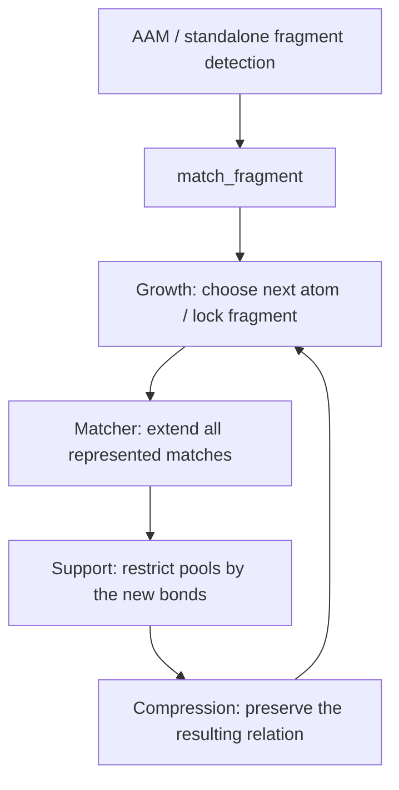

# Fragment matching: preservation under growth

The existing public boundary is `mappa.match_fragment`, implemented in
`src/mappa/fragment.py`. AAM and standalone fragment detection compose this
same primitive. `src/mappa/matcher/` owns the incremental isomorphism relation;
`growth/island.py` chooses the next atom and decides when to lock a fragment.
The native engine implements the same operations. This repair does not change
node compatibility, bond acceptance, random growth, seed selection, cuts,
branch admission, or event scoring.

## Invariant and induction

For a fixed source fragment F, locked assignment L, and retained source bonds E,
let M(F,L,E) be every injective mapping satisfying the configured node policy,
target availability, and the existing WBO test on E. Source nonedges impose
no induced-isomorphism condition. Let R(C) be the relation represented by the
candidate collection C, including its pools and automorphism actions.
The invariant is **R(C) = M(F,L,E)**, conditional on the chosen fragment and
locked context. It does not assert that greedy growth discovers every possible
fragment, or that a capped search is exhaustive.

**Base.** Seed initialization includes every compatible unlocked target.
Grouping a single source atom into a pool preserves exactly that union.

**Extension.** Every mapping of F plus atom n restricts to a mapping of F.
For each permitted target v for n, restrict old pool domains by all new active
bond checks and injectivity. Enumerate all constrained support assignments;
leave unrestricted pool assignments symbolic. Thus every returned child is
valid, and every valid extension has a supporting child. Equal support
assignments can share a new target pool. Enlarging an existing pool is allowed
only when *every* target choice is interchangeable and the source atoms have
identical external bond requirements. Otherwise refine that pool by the
supported assignments. An exhausted support budget raises an error, never an
empty match relation.

**Locked islands.** Add their fixed atom images through the same restriction
operation, one atom at a time, checking every newly introduced bond. Induction
therefore covers the whole island; a representative-only check is unnecessary.

**Compression.** A target automorphism used during growth must preserve exact
active WBOs, locked images, and every target outside the fixed occupied set
pointwise. Pool targets are fixed too: their permutations already belong to
the pool representation. Such an automorphism fixes every future target choice,
so extending a representative commutes with its action. Its inverse gives the
reverse inclusion. Consequently quotienting cannot remove an extension or add
an invalid match. Tolerance buckets remain coarse grouping hints; they are not
proof that a permutation preserves the source-target tolerance predicate.

## Implementation and evidence

- `matcher/support.py`: one support calculation shared by ordinary extension,
  locked-island extension, and trace witness selection.
- `matcher/extend.py`: support refinement, independent pools, and safe pool joins.
- `matcher/canonical.py`: exact continuation-preserving compression.
- `native/src/engine.cpp`: the corresponding native implementation; extension
  caching retains the same result and topology dependencies.
- No alternate deduplication mode remains in the matcher.

New symmetry records carry `compression_version: 2`. Reading an unversioned
historical record retains its historical group interpretation; it does not
rerun the old matching algorithm or silently promote the record to corrected
evidence. Existing finalized generators and benchmark artifacts are preserved.
Both finalizers interpret version-2 records with the same exact edge colors and
continuation roles. The reused native workspace keeps the two record versions
in separate bounded caches. Checkpoint manifests identify the repaired matching
policy and reject resuming pre-repair searches as corrected runs.

`tests/test_growth_compression_exactness.py` checks equality of the *complete
represented relation* with independent injective enumeration after each step.
It covers all connected unlabelled graph topologies through five vertices,
weighted source-target fixtures, correlated pools, locked islands, duplicated
components, and retained hydrogen compression. Native differential tests and
standalone API tests cover the execution boundary. Case 31164 evidence is kept
separately from the historical benchmark. Publication validation is recorded in
`reports/exact_fragment_publication_20261027/report.txt`.

## Search policies carried with this publication

Growth samples boundary atoms uniformly, without a bond-order priority. The
branch cap applies to completed fragment placements and the combined live
frontier, rather than intermediate embedding counts. These are the previously
approved policies; the matching repair above preserves them. The seed-order
generator already on GitHub main is retained: later seeds use its shared shuffled
pool. Earlier local experiments with independently reshuffled seed orders are
historical evidence, not timings for this published revision.

## Exact boundary-profile reuse

For each immutable target, cache the ordered nonzero pairs `(q, W[p,q])` for
every atom p. A candidate's boundary profile filters this row to its outside
atoms. This equals the original operation of scanning the sorted outside atoms
and excluding zero weights: the same pairs appear in the same order. We retain
all nonzero values, including below-threshold weights; no rounding, bond cutoff,
or symmetry approximation enters this cache. Thus candidate colors, generators,
and the represented relation are unchanged. Direct full-matrix comparisons
cover sparse atom indices, pools, and weak bonds.

## Identity groups during finalization

In version-2 records, every atom outside the occupied non-pool set has a unique
pointwise-fixed role. If no automorphism block exists, each remaining atom also
has a unique mapped-source role. Every target atom is therefore fixed, so the
conditioned automorphism group is identity. Returning its empty generator list
directly is exact. Local pool permutations remain in the pool records and are
not removed. Legacy records and nonempty automorphism blocks still use the
exact conditioned solver. The standard finalizer remains an independent oracle.

## Cyclic collection during native record construction

The native exporter creates nested acyclic containers, and `from_record` turns
them into an acyclic decision graph. Cyclic garbage collection is suspended only
across these two operations, avoiding repeated scans of previously retained cut
graphs while allocating the next record. Reference counting remains active. The
record wrapper is released before restoring the caller's collection state in a
`finally` block, including on exceptions. Normal collection remains enabled
between calls when it was enabled on entry. This changes neither graph contents
nor matching, branching, decoding, or memory limits.

Fresh-process measurements, full graph comparisons, peak process memory, and
validation are recorded in `reports/revision_cpu_audit_20261027/report.txt`.

## Rebenchmark evidence and scheduling

The benchmark uses the public disk-checkpoint search, with eight cut workers per
claimed reaction/direction and up to 100 simultaneous claims on NRT CPU-short.
A shared claim list balances reactions across allocations; cut workers balance
sweep work inside each reaction. Numerical libraries use one thread. Search
semantics, branch cap, cut order identities and seed generation are unchanged.

One ten-seed archive retains ten independent contexts per cut. Prefix reports
select the first n contexts; this is validated against independent n-seed runs.
Per-seed CPU reflects shared runtime caches, not independent-run latency. Total
CPU includes children and reports persistence separately from computation.

Node-local raw cuts, seed records, finalized cuts, ranking, exact reference
queries and outcomes are verified into per-direction archives after each stage.
A resource interruption preserves saved work and remains incomplete. The input
manifest retains all 1,851 Golden rows and separates preparation errors. Raw
family membership, representative ranking, and completed event decoding remain
distinct metrics. Historical campaigns are immutable. A pilot must pass full
serial/parallel graph equality, seed-prefix equality and archive restore before
any full run is submitted.

Each directional task has a 3,600-second work budget shared by search and
analysis. After a limit, the supervisor publishes saved evidence and releases
the worker for another task. Archive publication may finish after the work
deadline; it is allowed to preserve evidence. The thirty-minute monitor checks
stalls, memory failures and publication failures but does not enforce timing
in place of the worker. Limited tasks remain unresolved and require separate
diagnosis before continuation; they must not hold up the rest of Golden.
