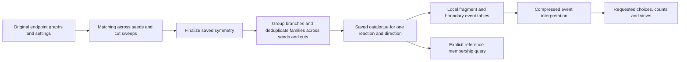
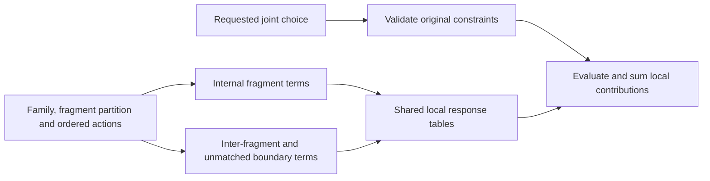
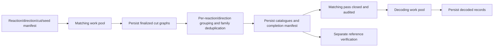
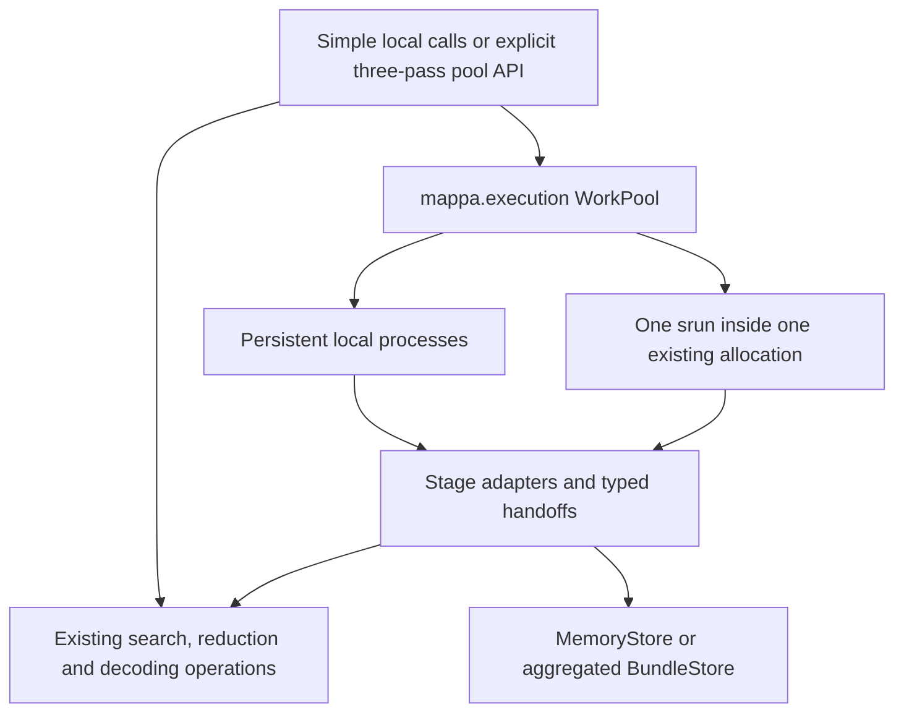

# MAPPA design

This document defines the scientific stages and their execution boundaries.
It replaces the previous mixed descriptions of event interpretation and
hierarchical rematching. Historical designs remain in Git. The scientific
contracts below describe the current core; the benchmark orchestration section
separately identifies the approved workflow and remaining implementation work.

## Scientific pipeline

The required benchmark order is **matching → cross-seed/cross-cut grouping and
family deduplication → local fragment/boundary decoding**. Reference verification
is a separate operation. Scheduling must preserve these stages and their meaning.
A cut is a search condition and provenance field; it is not the fundamental unit
of the decoder. A representative mapping is one witness of a compressed family.

## Inputs and matching

`AAMProblem` contains reactant and product `MolecularEndpoint` records: elements,
coordinates and bond-order matrices. Matching uses the supplied endpoint graphs
and declared policies. Element/WBO inputs alone do not establish a general
stereochemistry, charge or isotope guarantee. Preparation and reference policy
must state which information is actually represented.

Each direction has its own seed/cut plan and atom indexing. Reverse-direction
compressed families remain in their search frame; only concrete witnesses are
inverted into input indexing. Directions must not be merged by merely reversing
already reduced event identifiers.

The fragment matcher represents injective assignments using a witness, pools,
fixed roles and ordered correlated group actions. Compression must preserve the
allowed mapping relation. Equal atom orbits or equal representatives alone are
not sufficient grounds to merge alternatives. Independent Cartesian choices of
atom destinations can introduce mappings that the saved family never allowed.

Growth chooses a boundary atom uniformly and then a frontier incident
edge uniformly, without WBO ranking. Extension constrains the selected growth
edge. Other molecular bonds between included atoms are not implicitly matching
constraints. Accepted edges are saved as `preserved_bonds`; complete original
endpoint bonds remain available for event interpretation. Joining a locked
fragment retains its assignments and earlier constraints.

Reaction search locks completed fragment placements and branches over retained
alternatives. The branch cap limits the completed-fragment frontier/subtrees;
it does not convert pruning into a proof of equivalence or absence. Completion,
stalls and caps remain recorded. Exact compression within a fixed matching
context does not prove exhaustive search over every possible fragment.

`SearchSession` owns prepared matching state. Scheduling independent seed batches
must preserve the original seed indices, orders, random settings and full seed
count. Batching must not reseed separate searches. The `shared_policies` backend
is an indivisible cut operation and does not accept seed splitting.

Final symmetry is conditioned on saved candidate roles and earlier locks.
Intrinsic fragment symmetry annotations cannot enlarge the allowed saved mapping
relation. Python and native execution must obey the same scientific contracts;
unsupported capabilities or execution failure must not silently change policy.

## Search records, grouping and deduplication

The retained representation has three distinct levels:

| Level | Identity and responsibility |
|---|---|
| `AAMSearchGraph` | Contexts, states, transitions, roots and stop evidence; retains seed/cut histories and compressed placements. |
| `AAMResult.branches` | Groups paths by the unordered collection of final reactant/product fragment atom-set pairs. |
| `FinalBranchCatalogue` | Deduplicates saved mapping families, associates them with fragment partitions and preserves provenance. |

`AAMSearchGraph.combine()` concatenates/reindexes graph records. **It does not
perform final-family deduplication.** Live-state sharing and final-result grouping
are different operations: continuation contexts cannot be discarded simply
because two histories eventually have the same fragment atom sets.

`AAMResult` constructs its public branch groups before returning. Seed order,
growth history, island labels, anchors and the representative mapping do not
split the atom-set branch identity. Different labelled atom sets or different
reactant/product fragment pairings do. Every retained path remains accessible
inside its branch; grouping does not select only the first representative.

`AAMResult.final_catalogue()` constructs the deduplicated catalogue explicitly.
`decode_events(aam)` also constructs it when passed an `AAMResult`. Constructing
an `AAMResult` alone does not materialize this catalogue.

The catalogue can ingest many finalized graphs for the **same endpoint problem
and direction**. Deduplication therefore spans all supplied seeds and sweep cuts.
Its family key contains:

- Matching policy, including graph floor and isomorphism tolerance.
- Representative mapping.
- Required preserved edges.
- Canonical ordered pool/group action program.

Canonicalization preserves the order of dependent actions; only proven commuting
choices may be reordered. Identical keys share a family. This is conservative
representation-based deduplication, not a general proof that every differently
represented mapping set has been reduced to one semantic normal form.

The catalogue retains each family's source histories, archive/context references
and cut provenance, plus its associated fragment partitions. Different constraints
or action correlations remain distinct families even if representatives coincide.
Policy-qualified catalogue branch keys are distinct from the public atom-set
branch grouping. Raw paths, public branches and unique families are separate
counts and must be reported separately.

The cross-cut reduction stage must use one shared catalogue per reaction and
direction. Building one catalogue per cut and concatenating their decoded outputs
does not perform that reduction. Matching graphs may be read one at a time into
the catalogue; they do not all need to reside in memory together. The accumulated
catalogue and its provenance still consume memory.

## Decoder: local responses with shared constraints

The core entry point is `decode_events(aam_or_catalogue, config)`. It interprets
original compressed mappings. It does not rematch fragments, replace their
choices, enumerate all complete bijections, select a minimum-event mapping or
claim an exhaustive list of event patterns.

`EventDecodeSession` prepares the original endpoint event index for a fixed
reaction and event policy. It reuses bounded action-response and endpoint caches.
`EventInterpretation` retains the catalogue, action annotations and lazily built
tables for each family's saved fragment partition.

The event computation is local:

1. Build response terms for bonds **within each saved fragment**.
2. Build response terms **between fragments** and across mapped/unmapped boundaries.
3. Share equivalent bond-response tables and accumulate constant contributions.
4. For a requested valid joint choice, look up variable responses and sum each
   bond's contribution once.

“Local fragments first” describes factorized event preparation and composition.
It does not authorize choosing fragment outcomes independently. Boundary terms,
shared actions, required-edge constraints and partial target occupancy can couple
fragments. `FragmentEventTables.components` records dependency components;
separation must preserve shared action identities and feasibility constraints.
It is not currently a distributed fragment-task executor.

Preparation follows relevant original bond neighborhoods and pairs reachable
under the saved actions. A recorded cut adds its own endpoints, even when its
response is zero. Endpoint-pair projection follows ordered actions and retains
correlated motion. A constant-response certificate may avoid pair expansion;
it cannot authorize independently choosing endpoints. Pair work can still grow
quadratically in reachable atom domains, but it does not enumerate full group
elements or Cartesian combinations of complete mappings.

Event tables use **original endpoint WBOs**, not the cut search graph. Fragment
separation and cutting a bond do not themselves imply a chemical event. When
histories merge, their recorded cuts remain available for table annotation.
Alternative fragment partitions are alternative decompositions of the same
family; their totals must not be added together.

The ordinary event threshold defaults to 0.5 and the metal threshold to 0.3.
An event requires a strict WBO difference greater than the applicable threshold;
equality is unchanged. The four exclusive categories are breaking, forming,
strengthening and weakening. Matching tolerance is a separate parameter.
Count changes touching mapped atoms, including mapped/unmapped boundaries, and
omit bonds wholly within unmatched material. Do not invent correspondences for
unmatched atoms.

Actions with invariant responses remain in the ordered program because later
overlapping actions may depend on their motion. Saved constraints are checked
before evaluating a requested realization. Response invariance is not permission
to remove an action or treat its atom destinations independently.

`decoded_events_record()` saves the unchanged catalogue, partitions, shared
response tables, action dependencies, cut annotations and separately labelled
representative counts. `exhaustive_event_patterns` and `global_minimum_proven`
remain false. Representative agreement alone cannot establish equivalence of
complete decoded records.

## Benchmark pools and their connection

The approved massive-benchmark workflow has separate matching and decoding
passes. Complete and audit the matching pass before starting the decoding pool.
A scheduling barrier is an execution decision; the event algorithm itself does
not require all reactions in the dataset to be present at once.

The benchmark coordinator feeds a bounded window of reaction/direction jobs.
After each job finishes, its task specifications and attempt history are saved
in aggregated bundles before retiring its rows from the active queue. One
checkpointed ledger records stage outputs and failures for the whole campaign.
This bounds dispatch history without dropping scientific provenance or creating
a file per cut. Campaign pass ordering belongs in `bench/`; queue retirement
belongs in the execution layer and does not change matching or decoding.

The handoff is a manifest of saved catalogue inputs. It is not a dataset-wide
collection of graphs in RAM. Each decoding job identifies:

| Input | Required meaning |
|---|---|
| Reaction and direction | Stable identity and endpoint atom-index frame. |
| Original endpoint reference | Elements, coordinates and WBO records consistent with the catalogue fingerprint. |
| Deduplicated catalogue reference | Families across the declared seeds/cuts, fragment partitions, original constraints, action programs and provenance. |
| Coverage/completion record | Planned and completed seed/cut identities, caps, failed or missing work, and explicitly restricted scope if applicable. |
| Event configuration | Ordinary and metal thresholds, independent of the search tolerance. |
| Integrity and version metadata | Input/artifact hashes, source revision and scientific settings. |

A decoder loads the assigned reaction/direction catalogue, computes its local
tables and saves the decoded record. It releases catalogue-specific graphs,
tables and output after publication. Prepared endpoint state and bounded caches
may be reused while processing the same reaction and policy. Switching reactions
clears derived state; changing event policy replaces the decoder.

This is the initial scheduling unit for the separated pass. Splitting a large
catalogue into smaller jobs requires an explicit design preserving family IDs,
partitions, deduplication, provenance and correlated actions. Neither a sweep cut
nor an isolated fragment should be assumed to be an independent decoder job.
There is no constant-memory guarantee: catalogue size and retained sparse tables
must be measured when choosing per-worker memory and concurrency.

Failed, missing or capped matching work must remain visible. An incomplete scope
must not be silently presented as the full benchmark input. Re-running decoding
with different event thresholds uses saved catalogues and does not rerun matching.

### Explicit execution API

The implementation exposes `mappa.execution.WorkPool` with separate `search`,
`deduplicate` and `decode` submissions. `StageResults.wait_and_validate()` closes
and checks each pass before the next is submitted. `MatchingResult`,
`CatalogueResult` and `DecodingResult` are public typed handoffs. Search settings,
cut/seed scope and scientific stop counts remain visible through decoding.

`plan_search(..., seed_batch=...)` preserves original seed indices/orders and
finalizes each cut after its seed batches complete. When a cut fits in one batch,
that task finalizes and publishes directly, avoiding an unnecessary handoff.
`reduce_matching` reads finalized graphs one at a time into the existing
`FinalBranchCatalogue.add_graph()` implementation. `decode_catalogue` consumes
that complete deduplicated catalogue through the existing event decoder.
The superseded per-cut decoding scheduling helpers have been removed.

`MemoryStore` retains intermediates in RAM and transfers worker objects through
the pool. `BundleStore` appends immutable ranges to rolling worker-owned bundles.
Persistent file count grows with workers and byte volume, never with seed/cut task
count. Ordinary single-reaction checkpoints use the same bundles plus one reaction
index. Loading one reaction is explicit. Both modes still need enough worker RAM
for that reaction's catalogue and local event tables.

Local direct calls remain `search_aam`, `deduplicate`, `decode_events`; they need
no pool. Pool entry waits for every requested compute worker to report ready;
startup has its own timeout and elapsed-time measurement. A failed startup closes
the allocation step instead of returning a partially initialized pool.
Pool workers persist across all stages. Slurm is invoked once to start
node services inside an existing allocation; no task submits jobs. Source and
compiled-engine fingerprints are checked at node-service startup. Scheduling,
leases, transport, task granularity and storage belong entirely to the execution
layer. They must never become policies inside the core scientific algorithms.

Performance is an acceptance condition: preserve direct execution and compare
identical scientific scope before and after changes. Measure task computation,
publication and scheduling separately. Do not claim an unconditional speed
guarantee from one local timing or compare per-cut decoding against a globally
deduplicated pass as though they were the same work.

## Execution and recovery

The shared scheduler owns task dependencies, leases, budgets and publication.
Workers run one compute process each without nested pools. Original seed/cut
identities and scientific settings are independent of task completion order.
Prepared search, symmetry-finalization and decoder resources are reused within
a worker. Cache reuse saves computation; it does not replace family deduplication.

Resource inspection follows a worker clock, normally every 0.2 seconds, across
task and message boundaries. Actual sample counts are recorded; an unsampled
short task's zero reported peak is not zero memory use. Memory guards cover the
compute process tree. Process-reported computation/publication CPU timings are
separate from sampled CPU measurements.

Small compressed payloads use bounded memory spools; larger payloads spill to
node-local scratch. Result bundles retain checksum verification and durable
publication. The coordinator owns its local SQLite queue; workers exchange task
metadata and artifact references. Cross-node execution requires consistent
artifact paths, code/input versions and appropriately synchronized clocks.

Case budgets count overlapping active computation once and pause when no
computation remains active. Publication and idle allocation gaps do not reset or
consume the computation allowance. Failures, resource limits and lost leases are
explicit states. Retry is deliberate and retains attempt history. Checkpoint
recovery must not silently change the scientific scope.

Local multicore and localhost remote tests do not establish multi-node scaling.
Coordinator traffic, shared-storage costs and recovery must be measured on the
intended deployment. Current worker assignment has no reaction-affinity policy,
and coordinator disconnection requires explicit recovery rather than automatic
failover. Report scientific, publication and scheduling costs separately.

## Verification and acceptance

Reference verification queries the retained mapping relation under an explicitly
specified atom subset and endpoint-equivalence policy. Element sets, one
representative or its event count cannot prove coverage of all compressed choices.
Heavy-atom annotations leave hydrogen correspondence unspecified. Full explicit-H
event totals must not be compared as though they were heavy-only reference counts.
Solver unknown, timeout, search pruning and missing work remain distinguishable
from a proven absence within the retained relation.

Acceptance of an execution refactor requires more than matching representatives:

- Retained search graphs or an explicitly justified equivalent mapping relation.
- Cross-seed/cross-cut branch grouping and full family keys.
- Fragment partitions, constraints, correlated actions and source provenance.
- Shared local event responses and valid joint-choice evaluation against independent counts.
- Completion/cap metadata, reference witnesses and recovery behavior.

The separated-pool tests compare complete search graphs, catalogues and decoded
records, normalizing only archive-local provenance IDs. The saved EnzymeMap case
also compares the complete decoded record against the pre-refactor baseline and
checks exact heavy-atom reference membership and independent dense event counts.
This is one case, not a dataset-wide benchmark or a multi-node scaling claim.

Use the smoke checks and affected tests described in [README.md](README.md).
Matcher changes need the exhaustive compression/native-equivalence checks.
Scheduling changes need dependency, recovery, resource and representation checks.
Documentation-only changes need content and link verification, not another
benchmark run. State the actual validation scope.

## Module ownership

Paths below are relative to `src/mappa/`.

| Owner | Responsibility | Location |
|---|---|---|
| Shared records | Endpoints, AAM configuration and results | `mappa_core/domain.py` |
| Fragment matcher | Conditional matching, selected-edge growth and compression | `mappa_core/core/matching/` |
| Reaction search | Seed/cut planning, locking, branching and saved graphs | `mappa_core/core/search/` |
| Grouping/reduction | Final fragment pairs, family keys, partitions and provenance | `mappa_core/post_processing/final_branches.py` |
| Event decoder | Original-space local event responses and composition | `mappa_core/post_processing/decoder/` |
| Execution API | Persistent local/Slurm pool and explicit stage manifests | `execution/` |
| Execution internals | Workers, dependencies, budgets, typed handoffs and bundles | `mappa_core/core/scheduler/` |
| Explicit queries | Mapping and event-membership questions on saved choices | `mappa_workflow/mapping_analytics/` |
| Native engine | Shared C++ implementation and vendored nauty | `mappa_core/native/` |
| Persistence | Versioned records and trusted checkpoint relocation | `mappa_core/utils/io/` |
| TS workflow | Explicit reaction context, endpoint-to-TS cores and scoring | `mappa_workflow/ts_analytics/` |
| Presentation | Saved-result views, growth replay and coordinate display | `presentation/` |

Schedulers, CLIs, viewers and benchmark adapters consume these owners; they do
not implement competing scientific algorithms. Matching does not depend on
benchmark orchestration or presentation. Historical implementations belong in
Git rather than fallback paths.

`mappa_core/post_processing/hierarchical_mapping.py` is an explicit experimental rematching
operation. It may change retained coverage and is separate from normal event
decoding. Rematching, recombination and minimum-event-window selection must not
be placed on the normal matching → deduplication → decoding diagram.

TS analysis requires a supplied reaction context. Display alignment does not
change scientific atom correspondence. Viewers must preserve the distinction
between recorded witnesses and correlated alternatives.

The former benchmark implementation was removed; this document records the
replacement's approved stage boundaries, not a restored benchmark framework.
Usage guides: [Python API](docs/PYTHON_API.md), [shared execution](docs/shared-execution.md),
and [viewers](docs/VIEWERS.md). Measurements belong in `reports/`; independent
scientific oracles belong in `tests/`.
