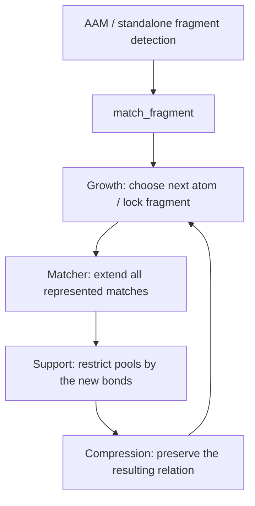
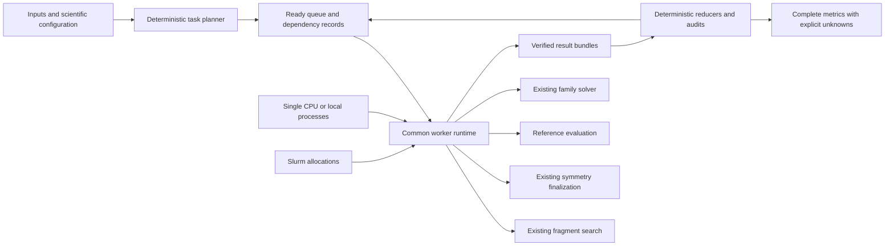

# Fragment matching: preservation under growth

The existing public boundary is `mappa.match_fragment`, implemented in
`src/mappa/fragment.py`. AAM and standalone fragment detection compose this
same primitive. `src/mappa/matcher/` owns the incremental isomorphism relation;
`growth/island.py` chooses the next atom and decides when to lock a fragment.
The native engine implements the same operations. This repair does not change
node compatibility, bond acceptance, random growth, seed selection, cuts,
branch admission, or event scoring.

## Invariant and induction

For a fixed source fragment F, locked assignment L, and retained source bonds E,
let M(F,L,E) be every injective mapping satisfying the configured node policy,
target availability, and the existing WBO test on E. Source nonedges impose
no induced-isomorphism condition. Let R(C) be the relation represented by the
candidate collection C, including its pools and automorphism actions.
The invariant is **R(C) = M(F,L,E)**, conditional on the chosen fragment and
locked context. It does not assert that greedy growth discovers every possible
fragment, or that a capped search is exhaustive.

**Base.** Seed initialization includes every compatible unlocked target.
Grouping a single source atom into a pool preserves exactly that union.

**Extension.** Every mapping of F plus atom n restricts to a mapping of F.
For each permitted target v for n, restrict old pool domains by all new active
bond checks and injectivity. Enumerate all constrained support assignments;
leave unrestricted pool assignments symbolic. Thus every returned child is
valid, and every valid extension has a supporting child. Equal support
assignments can share a new target pool. Enlarging an existing pool is allowed
only when *every* target choice is interchangeable and the source atoms have
identical external bond requirements. Otherwise refine that pool by the
supported assignments. An exhausted support budget raises an error, never an
empty match relation.

**Locked islands.** Add their fixed atom images through the same restriction
operation, one atom at a time, checking every newly introduced bond. Induction
therefore covers the whole island; a representative-only check is unnecessary.

**Compression.** Fix one target group G for the growing fragment: automorphisms
of the full exact weighted matrix and active adjacency, preserving node labels,
each target component, and all locked images. A candidate denotes G applied to
its witness and local pools. For extension E, **E(G C) = G E(C)**: transport both
the existing mapping and the next target atom by the same action. The inverse
action proves completeness. Thus we extend the representative pools and keep
G symbolic; neither group elements nor complete bijections need enumeration.

Equivalent candidate relations have equal exact colored-graph certificates.
Mapped source roles and local pool roles identify the relation for this test;
past moved-atom summaries are metadata, not restrictions on the group. The
group is independent of which duplicate witnesses happened to be encountered.
At fragment locking, exact generators are recorded. Later fragments are grown
in that witness frame; existing reverse-order decoding transports the whole
later assignment through the earlier action, including its outside atoms.
Different target components remain separate placements. Locks fix individual
atoms; tolerance buckets never prove symmetry. Exact weak weights below the
active threshold are retained in the target symmetry graph too.

## Implementation and evidence

- `matcher/support.py`: one support calculation shared by ordinary extension,
  locked-island extension, and trace witness selection.
- `matcher/extend.py`: support refinement, independent pools, and safe pool joins.
- `matcher/canonical.py`: exact continuation-preserving compression.
- `native/src/engine.cpp`: the corresponding native implementation; extension
  caching retains the same result and topology dependencies.
- No alternate deduplication mode remains in the matcher.

New symmetry records carry `compression_version: 3`. Version 3 records the
fixed target action above; old version-1/2 archives retain their historical
group interpretation. Reading those archives does not rerun an old matcher.
The standard and reused native finalizers use the same version-specific graph
and roles, with separate bounded caches. Checkpoint manifests identify
`exact_fragment_target_action_v3` and reject mixing old searches into new ones.

`tests/test_growth_compression_exactness.py` checks equality of the *complete
represented relation* with independent injective enumeration after each step.
It covers all connected unlabelled graph topologies through five vertices,
weighted source-target fixtures, correlated pools, locked islands, duplicated
components, and retained hydrogen compression. Native differential tests and
standalone API tests cover the execution boundary. Case 31164 evidence is kept
separately from the historical benchmark. Publication validation is recorded in
`reports/exact_fragment_publication_20261027/report.txt`.

## Search policies carried with this publication

Growth samples boundary atoms uniformly, without a bond-order priority. The
branch cap applies to completed fragment placements and the combined live
frontier, rather than intermediate embedding counts. These are the previously
approved policies; the matching repair above preserves them. The seed-order
generator already on GitHub main is retained: later seeds use its shared shuffled
pool. Earlier local experiments with independently reshuffled seed orders are
historical evidence, not timings for this published revision.

## Historical archive interpretation

Version-2 groups fixed every outside/pool target pointwise. Their saved records
still use those roles and exact active-edge colors. Their empty-automorph-block
identity shortcut is restricted to version 2. Version 3 always derives the
locked target group, including actions moving future atoms. Version 1 retains
its original colors. This compatibility exists only for reading evidence;
there is one live matching policy.

## Cyclic collection during native record construction

The native exporter creates nested acyclic containers, and `from_record` turns
them into an acyclic decision graph. Cyclic garbage collection is suspended only
across these two operations, avoiding repeated scans of previously retained cut
graphs while allocating the next record. Reference counting remains active. The
record wrapper is released before restoring the caller's collection state in a
`finally` block, including on exceptions. Normal collection remains enabled
between calls when it was enabled on entry. This changes neither graph contents
nor matching, branching, decoding, or memory limits.

Fresh-process measurements, full graph comparisons, peak process memory, and
validation are recorded in `reports/revision_cpu_audit_20261027/report.txt`.

## Rebenchmark evidence and scheduling

The benchmark uses the public disk-checkpoint search, with eight cut workers per
claimed reaction/direction and up to 100 simultaneous claims on NRT CPU-short.
A shared claim list balances reactions across allocations; cut workers balance
sweep work inside each reaction. Numerical libraries use one thread. Search
semantics, branch cap, cut order identities and seed generation are unchanged.

One ten-seed archive retains ten independent contexts per cut. Prefix reports
select the first n contexts; this is validated against independent n-seed runs.
Per-seed CPU reflects shared runtime caches, not independent-run latency. Total
CPU includes children and reports persistence separately from computation.

Node-local raw cuts, seed records, finalized cuts, ranking, exact reference
queries and outcomes are verified into per-direction archives after each stage.
A resource interruption preserves saved work and remains incomplete. The input
manifest retains all 1,851 Golden rows and separates preparation errors. Raw
family membership, representative ranking, and completed event decoding remain
distinct metrics. Historical campaigns are immutable. A pilot must pass full
serial/parallel graph equality, seed-prefix equality and archive restore before
any full run is submitted.

Each directional task has a 3,600-second work budget shared by search and
analysis. After a limit, the supervisor publishes saved evidence and releases
the worker for another task. Archive publication may finish after the work
deadline; it is allowed to preserve evidence. The thirty-minute monitor checks
stalls, memory failures and publication failures but does not enforce timing
in place of the worker. Limited tasks remain unresolved and require separate
diagnosis before continuation; they must not hold up the rest of Golden.

## Shared execution across single CPU, local pools and Slurm

Design accepted 2026-10-27. The shared execution layer, prepared search sessions
and independent seed evaluation are implemented; validation is recorded in
[shared execution](docs/shared-execution.md) and tracker ticket 7. Running Golden
jobs retain their frozen code. An EnzymeMap production launch still needs explicit
permission after Golden completion.

The scientific task and its implementation must be identical in every environment.
Only worker allocation and connection change. Do not maintain separate local and
cluster matching or evaluation implementations.

Responsibilities:

- Planner: derive directions, cuts and the full ordered seed list once, assign
  stable task identities, and declare dependencies. A search task contains explicit
  seed indices/orders; independently rerunning seed_count=1 with different random
  seeds is not equivalent to splitting the existing ten-seed run.
- Scientific operations: expose prepared-session search of a cut/seed batch,
  finalization of the merged cut, evaluation of one seed context, and existing
  family scoring/decoding. Extract these from current orchestration, without
  changing matching, locking, symmetry, branching or solver semantics.
- Worker runtime: claim ready work, reuse bounded local preparation/matching
  caches, enforce resources, checkpoint completed units, and publish verified
  bundles. Related tasks have a locality preference, not exclusive ownership by
  one worker. Unstarted work can be claimed elsewhere.
- Queue: own dependencies, leases, heartbeats and completed task identities.
  Duplicate execution after a worker failure must not duplicate accepted results.
  Keep one writer for queue metadata on a local filesystem; do not put a shared
  SQLite writer or millions of claim files on Lustre. Local execution accesses the
  same queue operations directly; cluster workers use a coordinator connection.
- Reducers: restore canonical direction/cut/seed order and verify expected
  coverage. Completion order must not affect seed prefixes, representative order,
  event minima or the interpretation of missing results.
- Storage: retain inputs once, cache materialized inputs per worker, and publish
  bounded bundles containing many task results. Keep individual temporary files
  node-local. Record hashes and task-to-bundle indexes in queue metadata.

Initial work units and boundaries:

| Stage | Claimable work | Dependency and reuse |
| --- | --- | --- |
| Search | reaction × direction × cut × seed batch | Explicit original seed orders; reuse prepared matching session |
| Finalization | merged cut graph | All required seed batches for that cut; finalize once |
| Reference evaluation | cut × seed context | Read finalized cut; reuse immutable graph preparation locally |
| Family minimum | retained family | Same production family solver |
| Event-window enumeration | retained family and declared bound | Verified minimum/bound reduction for every requested seed prefix |
| Reporting | case or bounded case batch | Audit expected task identities and completion evidence |

A seed batch is a scheduling choice, not a scientific policy. Start by measuring
1, 2, 5 and 10 seeds per search batch on fixed controls. Compare total CPU, wall,
peak memory and data transfer. Single-seed tasks offer more parallelism but may
repeat expensive preparation or lose useful caches. Never promise that the
smallest unit has the best throughput. Split pending batches to reduce the tail;
do not interrupt a running solver merely to redistribute work.

Workers must not launch nested CPU pools. The outer scheduler owns concurrency
and admits work against both available CPUs and measured memory. Numerical
libraries use one thread unless explicitly budgeted. Preserve a case deadline
across redistributed tasks rather than granting each task a fresh hour. Record
queue wait, setup, compute, I/O, retries and allocated resources separately.

Prepared computation now lives in `aam.SearchSession`, shared by existing public
APIs and `execution.search` tasks. `rebenchmark.analysis.analyze_seed` is the one
reference evaluator used by both campaign frontends. `execution.queue` owns
metadata/dependencies, `execution.runtime` owns supervision/transport and
`execution.bundles` owns publication. Single-CPU and remote queue workers call
the same runtime. Existing standalone cut-pool APIs remain convenience entry
points to the same scientific session, not a second matcher. Slurm submission is a launcher for that same worker, not a scientific
backend or a fallback. Campaign adoption and full report/decoder task planning remain integration gates;
historical frozen job code is not a second supported implementation.

Acceptance gates: identical canonical search graphs and seed prefixes for one
CPU/local pool/multiple workers; identical family membership, scores and decoded
sets on finite controls; bounded caches and memory admission; safe worker loss,
resume and duplicate claims; no repeated completed work; verified bundled storage;
and measured end-to-end overhead/throughput including a deliberately uneven tail.
A Slurm pilot must pass before this becomes the production EnzymeMap runner.
