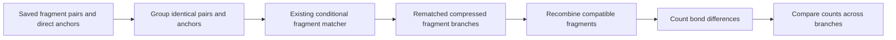

# Anchored fragment event decoding

The decoder resolves the difference between the AAM matching tolerance and the bond-event criterion. Starting from saved fragment pairs, it rematches inside their original reactant/product atom sets using the event thresholds: ordinary 0.5 and metal 0.3 by default. An unchanged bond must differ by strictly less than its threshold; equality is an event.



Only assignments fixed by the saved compressed representation are anchors. Jointly moving atoms are free. The old representative and its correlated free-choice program do not constrain the rematch; the existing matcher rediscovers admissible assignments and symmetry. A fragment may split. Original atom sets stay fixed, and distinct anchor contexts are cached separately.

```python
from mappa.postprocessing import EventDecodeConfig, decode_events
from mappa.artifacts import decoded_events_record

result = decode_events(aam, EventDecodeConfig(event_slack=5))
print(result.observed_minimum, result.complete)
for candidate in result.candidates:
    print(candidate.total, candidate.mapping, candidate.endpoint_events)
record = decoded_events_record(result)
```

`aam` can be an `AAMResult` or a `FinalBranchCatalogue` with recorded fragment pairs. A flattened family list alone does not contain the required fragment atom sets and is rejected. `convert_fragments(aam)` exposes the same reusable conversion without event grouping. The experiment and shared execution adapter call this public implementation; there is no cluster-specific decoder.

`result.conversion.rematches` retains the compressed rematched graphs. `result.conversion.branches` links each recombined branch to its saved family and fragment paths. `result.catalogue` contains the converted mapping families. Event records use schema `mappa.decoded_events/v2` and preserve this representation and the explicit scope.

The event count is the number of bond differences touching mapped atoms, including mapped/unmapped boundaries. Bonds wholly between unmatched atoms are ignored. No atoms are invented. Identical literal mappings share classification work; branch partitions and provenance remain distinct. Event-class grouping does not enumerate symmetry bijections.

`max_events` and `event_slack` filter the converted branch results; they are not solver search bounds. The minimum is the lowest count among these branches. `complete` requires completed uncapped rematches, retained mapped atoms, and no counted events internal to a new fragment. `minimum_proven` uses this same converted-branch scope. Neither flag certifies exhaustive original-family decoding or global AAM search.

`result.symmetry(candidate)` returns compressed choices from the converted catalogue. `result.query(...)` is a separate, explicitly requested constraint query over those choices. Only that query requires the optional solver dependency. Conversion does not call it or use it as a fallback.

The executable solver decoders and their launch scripts are removed. A test-only oracle verifies historical signed-event certificates; production code never imports it. Historical benchmark proofs use their recorded source revisions; the old proof auditor rejects converted-branch records rather than interpreting them as solver certificates.
