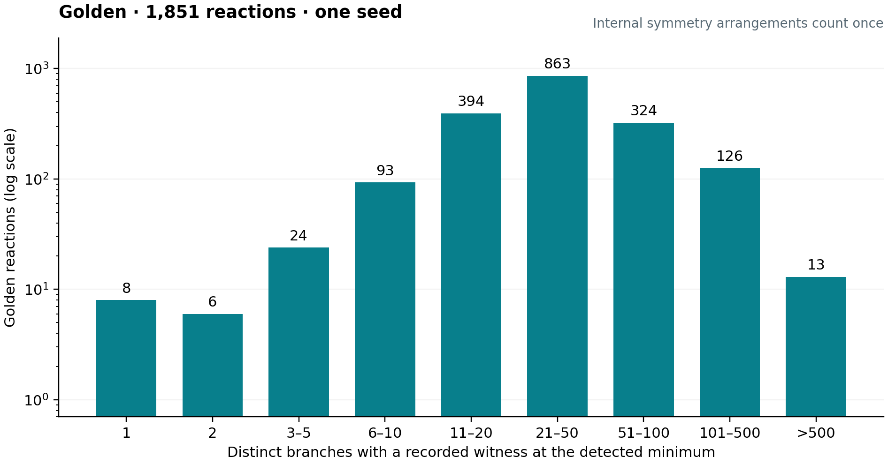
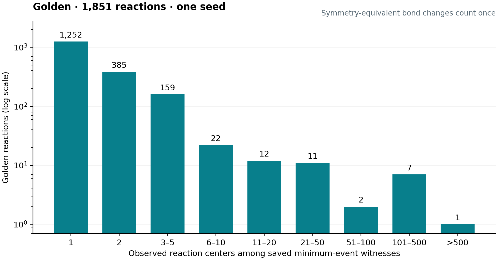

# Minimum-event choices in Golden

The current manuscript uses **reaction cores**, reported below. The earlier
branch-composition tally is retained here as a representation-level comparison.

All **1,851 reactions** have at least one recorded fragment composition at the
saved detected minimum. Both directions are included and normalized to the same
endpoint indexing. No additional matching, optimization or symmetry search was
performed. The count pass took **36.665 seconds** with eight processes.

| Statistic | Branch compositions |
|---|---:|
| Median | 31 |
| Mean | 51.06 |
| 95th percentile | 120 |
| Maximum | 2,250 |
| Reactions with one composition | 8 |

A branch is identified by its sorted collection of base/target fragment atom-set
pairs. Repeated histories and internal atom permutations count once. Different
fragment partitions remain different branches, including when they can realize
the same complete atom mapping. Consequently these are composition counts, not
chemically inequivalent mapping counts or random-selector accuracy.

## Calculation

Use the original one-seed Golden decoded outputs (tolerance 2, branch cap 100,
both directions and cut sweep). Keep their saved global detected minima fixed.
The older archives retain local optimized witnesses and event responses but not
the attained count of every branch. Replay those saved local choices in their
recorded action order, leave global placement choices unchanged, and directly
count internal events plus the saved boundary contribution and sweep correction.
Keep a composition only if that actual count equals the saved detected minimum.
This counts recorded choices; it does not establish every further symmetry tie.

The pass examined 244,386 retained contexts. No replay produced a count below
the saved detected minimum. No reaction is omitted from the figure. The original
input index, plan and result ledger hashes match the previous Golden analysis.
The sanitized per-reaction evidence includes the original decoded-output hashes.

## API and validation

Analysis revision: `8cf8392`. Decoder query revision: `8614e42`.

New decoder outputs retain the branch witnesses already computed during window
selection, using shared action references. `decoded.saved_branches()` queries
recorded compositions at the detected minimum; `event_count=5` selects another
count. `decoded.saved_minimum(...)` retrieves a branch witness and bound.
Neither lookup starts a search. Older archives explicitly lack the new saved
branch-count lookup; the read-only analysis above recounts their preserved local
choices rather than inventing branch minima.

Validation: 23 decoder-window tests, three branch-count tests and 26 smoke tests
passed. Tests cover duplicate compositions, internal shuffles, reverse indexing,
save/load and sweep corrections; solver calls are forbidden during lookup tests.
One hundred saved duplicate branch records returned one composition in 2.92 ms
per lookup on the local Mac. The four-reaction data check took 1.50 seconds.

Reproduce from saved data with `bench/minimum_branches.py`; its `--plot` command
uses the aggregate JSON. Operational configuration is private. The raw source
archive remains on its original host; no benchmark is rerun.

## Reaction-core result (current Figure 8)

Across all **1,851 Golden reactions**, **1,252 (67.64%)** have one observed
reaction core among their saved minimum-event mappings. The complete local pass
took **15.66 seconds** with eight processes, including data loading and saved
witness replay. Data transfer is excluded. There were no missing reactions.

| Statistic | Observed reaction cores |
|---|---:|
| Median | 1 |
| Mean | 2.97 |
| 95th percentile | 4 |
| Maximum | 522 |
| Reactions with one core | 1,252 |
| Reactions with at most four cores | 1,787 (96.54%) |

The analysis in revision `c035d9a` groups the same saved minimum-event witnesses
using MAPPA's existing `SignedEventIndex.describe` operation. A core identifies
which bonds decrease or increase in order, modulo its existing source
event-equivalence rule. Hydrogen events are included. Different fragment
partitions with the same pattern count once. These endpoint change patterns are
reaction cores, not complete mechanisms. The tally does not search unrecorded
symmetry alternatives or measure top-1 accuracy.

Both search directions are normalized to the original endpoint indexing.
Minimum-event selection uses the original saved decoder count. For every pattern
observed in this study, direct physical whole-reaction counting also equals that
saved minimum. All 3,702 decoded-output checksums, the original input/index/ledger
hashes, and all previously measured branch counts and minima were verified.
Matching and decoding were not rerun. The earlier heavy-atom mapping-class
analysis and this all-atom bond-pattern count measure different choices: hydrogen
assignments can change a reaction core without changing the heavy-atom mapping.

The initial remote pilot stalled before computation because its shared runtime
was unreadable. The user requested local execution; the saved outputs were
copied into the ignored private area and checksum-verified. The final analysis
completed locally. Operational details remain private.

Five focused tests and 26 smoke tests passed for the analysis implementation,
including equal event totals with different patterns and equivalent hydrogen
exchanges. The controlled 384-mapping check grouped five event patterns in
0.0402 seconds. Full-dataset evidence and validation are in
`reaction-centers/summary.json`, `reaction-centers/reactions.json.gz` and
`reaction-centers/validation.json`. The manuscript uses the same evidence.

Reproduce from a saved campaign or transferred manifest with
`bench/minimum_branches.py --reaction-cores`; its `--plot --reaction-cores`
command publishes the distribution. No additional mapping search is performed.
