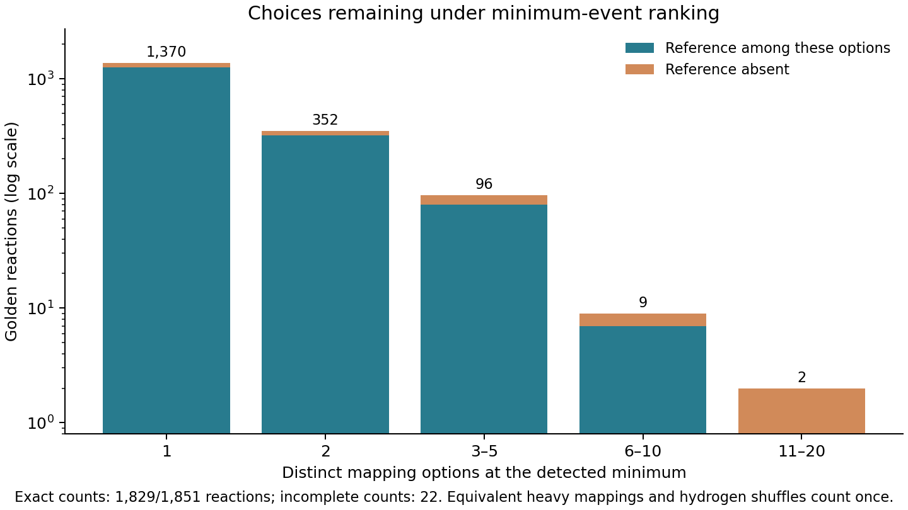

# Golden choices at the detected minimum

The bounded scan covered all **1,851 Golden reactions / 3,702 directions**.
Counts are certified for **1,829 reactions (98.81%)**; **22 remain incomplete**.
This concerns choices among saved decoded outputs, not a new matching or
decoding benchmark. Scientific inputs and every previously certified count
remained unchanged.

## Results

| Minimum-event options | Reactions with an exact count | Reference included | Reference absent |
|---|---:|---:|---:|
| 1 | 1,370 | 1,264 | 106 |
| 2 | 352 | 320 | 32 |
| 3–5 | 96 | 80 | 16 |
| 6–10 | 9 | 7 | 2 |
| 11–20 | 2 | 0 | 2 |
| Count incomplete | 22 | 20 known included | 2 membership unknown |

- **Full-dataset median: 1 option; 95th percentile: 3 options.** These quantiles
  are determined even with the 22 incomplete counts: 1,370 reactions have exactly
  one option; at least 1,785 have at most three, while at most 1,744 could have at
  most two, even assigning every unknown to that group.
- **Mean on the 1,829 certified cases: 1.358 options.** There is no certified
  full-dataset mean. The largest certified count is 13; unknown cases could be
  larger.
- **Reference at the detected minimum: 1,691 confirmed, 158 absent, 2 unknown.**
  Full-scope recovery is therefore **91.36–91.46%**. This includes the 20
  incomplete-count reactions with an independently witnessed reference class.
- **Expected uniform-choice accuracy: 78.31–79.45% over all 1,851 reactions.**
  The certified subset alone gives 79.25%. The full-scope interval keeps
  unfinished counts uncertain, rather than treating their observed choices as
  complete.

**Golden 1694 has exactly eight options, including the reference: uniform choice
therefore succeeds with probability 1/8 = 12.5%.**



These measurements support a compact-shortlist claim. They do not establish
superior top-1 accuracy against another mapper; that requires the same ranking,
equivalence and tie policy on the comparator. The reference can also lie above
the minimum, or outside the selected decoded response. Catalogue coverage is a
different measurement.

Artifacts: [summary](summary.json), [per-reaction evidence](reactions.json.gz),
[PDF figure](minimum-choices.pdf), [SVG figure](minimum-choices.svg).

## Measurement

For each Golden reaction, take the lowest saved detected model event count over
both directions. Count the distinct heavy-atom mapping classes that have at
least one full valid realization at that count, anywhere in either saved decoded
response. Alternative branches, partitions and sweep histories form a union.

Use the existing benchmark's paired chemical-graph certificate to identify
equivalent mappings. It preserves endpoint chemistry and unmatched heavy atoms.
Hydrogen assignments must admit a valid completion, but their permutations do
not multiply the number of choices. The ranking score remains the saved
all-atom decoder score; this analysis does not substitute a heavy-only score.

If K is the number of minimum-event choices and the reference class is present,
uniform selection succeeds with probability 1/K. If it is absent, the probability
is zero. Average those probabilities over reactions to obtain expected random
selection accuracy. This is distinct from reference inclusion among all returned
families and from a deterministic or learned top-1 ranking.

Neither reference assignments nor reference recovery select the score or its
alternatives. Endpoint chemical labels define equivalence equally for every
candidate. A GT-containing branch can have a minimum attained by a different
mapping; the earlier branch-offset statistic does not establish this metric.

## Scope and limitations

- Golden: 1,851 reactions, both saved directions, one seed, discovery tolerance
  2, branch cap 100, and the retained minimum-plus-five decoded window.
- Count choices at the saved **detected** minimum. Preserve the saved minimum's
  proof status; do not search for a different minimum.
- Scores follow the approved independent ordinary-boundary model and joint
  sweep correction. They are not claims of globally optimal physical events.
- Exhausting all eligible contexts certifies K. Resource-limited counts remain
  lower bounds, not small exact shortlists. Distribution summaries must state
  the complete-count denominator and keep unresolved cases separate.
- The analysis reads immutable outputs. No scientific stage, tolerance,
  branching policy or verifier is changed.

## Reproduction and validation

The portable runner is [`bench/minimum_choices.py`](../../bench/minimum_choices.py).
Measured analysis revisions: `6d81e788`, `e53133cb`, and `1376732c`.
Later changes export full-scope bounds, adjust the plot, and require the exact
heavy-atom reference policy used here; they do not alter Golden counting.

```bash
PYTHONPATH=src:bench python bench/minimum_choices.py /path/to/saved/batch \
  /path/to/separate-analysis --slurm --workers 16 \
  --seconds 120 --task-seconds 240 --memory-gib 4

PYTHONPATH=src:bench python bench/minimum_choices.py /path/to/saved/batch \
  /path/to/remaining-analysis --slurm --workers 16 \
  --remaining-from /path/to/separate-analysis/results.json \
  --seconds 600 --task-seconds 720 --memory-gib 4

PYTHONPATH=src:bench python bench/minimum_choices.py \
  /path/to/remaining-analysis/results.json /path/to/report --plot
```

The bulk analysis used one pool with 64 registered workers. A continuation
preserved the first 887 exact counts, and the final pass preserved all 1,768
then-certified counts while processing only the remaining 83 reactions with
80 workers. The final allowance was 600 seconds per reaction within a 720-second
external task guard, retaining the 4 GiB memory guard. One earlier analysis task
hit its 240-second external guard; the final pass ended normally, with every
task returning an explicit result and 22 soft counting limits. There were no
mapping/decoding reruns or memory-limit failures.
Operational configuration and raw infrastructure records remain private.

Eleven focused tests check exhaustive small symmetry groups, differing endpoint
connectivity, ordered placements, sweep coupling, hydrogen projection, partial
mapping identity, cross-branch and cross-direction duplicates, absence of the
reference at the minimum, and honest incomplete counts. Every generated full
mapping is replayed through the saved action program and checked against the
saved event response. Small chemical equivalence checks use an independent VF2
oracle. The completed pilot counts agree with the initial direct enumeration.
The final local checks passed: 11 focused counting tests and 26 smoke tests.
Published artifacts passed the repository privacy scan and report link checks.

Input hashes, source revision, per-reaction status and resource measurements are
retained with the analysis. An independent scope check established exactly the
1,851 expected reaction IDs, checked 11 source/report hashes, confirmed identical
scientific code identity across passes, and verified every carried exact row was
unchanged. One saved detected minimum (case 956) lacks an optimality proof; its
count also remains incomplete. This analysis does not upgrade that claim.

Incomplete counts: 194, 289, 372, 607, 616, 671, 682, 768, 824, 842, 851, 852,
854, 862, 956, 1702, 1716, 1799, 1800, 1801, 1816, 1823. Cases 851 and 1799
also have unresolved reference-at-minimum membership; the other 20 have a
reference witness but an unfinished total count.

The reported analysis wall time sums published pass durations and excludes
pilots, development, and time after the stopped pass's last checkpoint. It is
not MAPPA matching or decoding performance. Only sanitized evidence is published
here; original catalogues and aggregate witness bundles remain with the saved
campaign.
