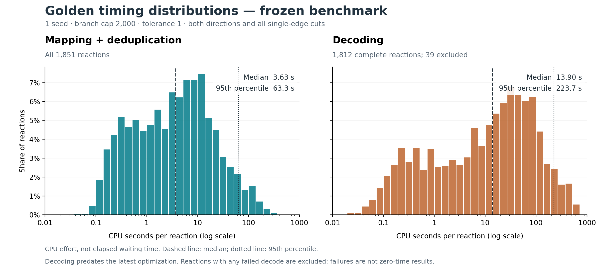

# Full Golden benchmark with placement compression

A fresh full Golden rerun was submitted at **2026-11-03 06:19:04 UTC** for
[`1710f69`](https://github.com/yunhzou/MAPPA-AAM/commit/1710f690f5c49b34d11de69782aa54b1f4d79304).
The first campaign exposed a slow symmetry-membership check and was intentionally
stopped before decoding. The repaired implementation has passed **883/883 Mac
tests**, **79/79 Linux tests** and five targeted matching probes. The matching
pools registered all **141 compute workers** at **06:20:04 UTC**. All **3,702
directions have completed matching and family aggregation/deduplication**, called
reduction below. It combines each direction's
seed/cut results into one catalogue while preserving distinct relationships and
provenance. At **08:03:31 UTC**, the frozen pass has **3,655 successful decodes and 47
remaining memory-limit errors**. Reference verification has **3,696 completed
results and six timeouts** out of 3,702. All required direction-stage records are
terminal, with no active task attempts or original finish allocations remaining.
The pass has ended with unresolved failures; it is not a successfully completed
benchmark. Final audited resource and reference comparisons remain pending.

The separate reference-recovery investigation is complete: tolerance 2 recovers
four of the 20 unresolved reactions with one seed and another nine with ten
seeds, all at cap 2,000. The selected recovery union is **1,844/1,851 (99.62%)**;
seven reactions remain unrecovered. All 32 ten-seed direction checks now have
conclusive outcomes. This does not resolve the frozen full run's decoding errors.

## Scope and settings

The full benchmark covers **1,851 reactions, 3,702 directions and 177,552 matching
cuts**, including the uncut condition. Each reaction runs in both directions.
The input audit found every expected reaction/direction exactly once and verified
all **5,553 unique input/reference blobs** against their checksums. The replacement
run uses fresh results and caches, reusing only immutable inputs and references.

| Setting | Value |
|---|---|
| Seed count | 1 |
| Branch cap | 2,000 representative continuations at each hierarchy level |
| Discovery / relaxed-self tolerance | 1 / 1 |
| Random seed | 42 |
| Graph / cut presence threshold | 0.2 / 0.2 |
| Ordinary / metal event threshold | 0.5 / 0.3 |
| Search scope | Both directions; uncut plus every single-edge cut |
| Input weights | Original prepared endpoint WBOs |
| Initial worker memory guard | 2 GiB for 129 workers; 4 GiB for 12 workers in the batch containing case 1561 |

The user explicitly selected cap 2,000. Placement compression retains equivalent
labelled target sets through shared joint actions; representative branch counts
are distinct from the number of mappings represented. Fragment-local relaxed
relationships remain part of the saved result. The
[integration report](../relaxed_fragments_20261102/README.md) records the approved
design and independent mapping/event checks.

Ten disjoint persistent pools request **141 compute workers** and **171 CPUs
in total**, including execution overhead. They share reaction caches.
All matching and reduction must
finish across the entire campaign before decoding begins. Reference verification
is a separate evaluation of the reduced catalogues. Requested workers, actual
readiness and measured utilization will be reported separately. Operational
configuration and raw scheduler records remain private.

| Stage | Full denominator | Status at 08:03:31 UTC |
|---|---:|---|
| Matching | 3,702 directions / 177,552 cuts | All directions complete; no errors |
| Reduction | 3,702 directions | All complete; two earlier publication failures recovered |
| Decoding | 3,702 directions | 3,655 complete; 47 memory-limit errors remain |
| External reference verification | 3,702 directions / 1,851 reactions | 3,696 complete; six compute timeouts |

Two reductions in this fresh run exceeded their 2 GiB guard during publication:
**1799 forward** reached **2.298 GiB**, and **852 reverse** reached **2.043 GiB**.
Both completed with isolated **4 GiB** retries using their original remaining
budgets. Their original task specifications, failed attempts and all other
completed results were preserved; no fresh retry time or scientific change was
introduced. Final resource totals will include both attempts for each case.
The original dependent finish submissions were replaced only after matching and
reduction were complete and their owners had released the work. New finish-pool
readiness was not inferred from submission.

The first decoding pass produced **3,639 outputs and 63 failures**. Of those
failures, **61 occurred at 2 GiB**. The other two, **1561 forward
and 830 forward**, exceeded **4 GiB during publication**. Planned recovery uses
4 GiB and 8 GiB respectively, retaining original remaining budgets and attempt
histories. Seventeen failed directions have since been retried at 4 GiB after
their original owners released the work: **16 succeeded**, while **852 forward**
exceeded 4 GiB during publication. Remaining errors and consumed budgets are
preserved. The cluster implementation remains frozen during local repair work.

Decoder-stage computation includes catalogue loading and output preparation.
Static review found extra representation cost: distinct numeric weight matrices
expand into Python lists while the original catalogue remains resident, and
shared working indexes persist across the catalogue. These costs have not been
profiled per failed case. A compute-phase memory failure therefore does not, by
itself, identify local event evaluation as the cause.

At **07:47:20 UTC**, the **3,655 successful decodes** used 91,822.40 compute CPU
seconds. Their per-direction compute CPU distribution was **4.24 s median,
70.60 s p90, 122.74 s p95, 257.29 s p99 and 538.52 s maximum**. This success-only
distribution excludes the 47 directions still carrying decode errors. Successful
worker CPU totalled 93,345.92 seconds; the 64 failed attempts had consumed another
24,806.21 sampled CPU seconds. Successful full-benchmark completion remains outstanding.

### Per-reaction CPU distribution of the frozen run

These measurements belong to the full `1710f69` campaign above, **before the
later decoder preparation repair**. They do not measure the latest decoder.
No search or decoding was rerun to construct this distribution.



Each reaction sums both directions and every cut. Mapping includes search and
final family aggregation/deduplication. Values are successful-operation CPU
seconds, including input loading and decoder assembly/export preparation;
they exclude result publication, external verification and failed attempts.
They measure computational effort, not parallel elapsed time.

| Stage | Reactions | Median (s) | 90th percentile (s) | 95th percentile (s) | 99th percentile (s) | Maximum (s) |
|---|---:|---:|---:|---:|---:|---:|
| Mapping + deduplication | 1,851 | 3.63 | 32.80 | 63.27 | 151.41 | 297.00 |
| Decoding, both directions successful | 1,812 | 13.90 | 124.26 | 223.67 | 454.85 | 697.84 |

Decoding excludes **39 reactions with at least one failed direction**: together
they contain the 47 failures and 31 successful opposite directions. Their partial
times are not substituted for completed reaction timings. The slowest 10% of
reactions account for **60.9% of mapping CPU** and **55.6% of successful paired
decoding CPU**, within each plotted scope.

Successful mapping operations used 24,458.175 CPU seconds. The two failed
reduction attempts add 229.258 exact compute CPU seconds, reconciling with the
earlier all-attempt total of 24,687.433 seconds. Failed decoding attempts retain
their exact or sampled measurements separately; sampled CPU is never added to
an exact measurement of the same attempt.

The read-only audit checked all 11,106 relevant terminal stage rows and 184,975
unique attempts across ten unchanged ledgers, verifying each archived audit's
checksum and deduplicating repeated attempt records across retries. Per-reaction
values, coverage, failed-attempt measurements and provenance are in
[timing-distribution.json](timing-distribution.json); the figure is also
available as [SVG](timing-distribution.svg). Percentiles use empirical nearest
ranks; the median averages the two middle values for an even sample.

## Full measurement of the latest decoder

A separate decoding-only measurement was submitted on **2026-11-03 at
22:09:50 UTC**, using
[`119dca4`](https://github.com/yunhzou/MAPPA-AAM/commit/119dca46af5d911071b656edba8998afef78ad7d).
It includes the later shared-preparation decoder repair and reuses all **3,702
completed catalogues**, covering **1,851 reactions** at the original seed 1,
cap 2,000 and tolerance 1 settings. Matching, reduction and reference verification
are not repeated. Every catalogue passed a compressed-range checksum audit;
all original stage ledgers remain unchanged.

The new measurement has independent outputs and explicit fresh 1,800-second
compute budgets per direction. Ordinary directions use a **4 GiB worker guard**;
all 63 directions with any historical decoding memory failure, including the
16 that subsequently succeeded, use **8 GiB**. These allowances do not change
the retained mapping relation or event thresholds.

The initial large requests were cancelled before any task started and replaced
with smaller allocations that fit available resources. The replacement requests
**194 compute workers across ten disjoint pools**. At **22:14:58 UTC**, nine pools
had registered **181 workers**; the final 13-worker pool was still pending.
This is startup evidence, not completion or proof that every worker was busy.

The runner executes only decoding from saved catalogue references. Local
validation passed **37 campaign tests**, **12 preparation tests** and **26 smoke
tests**. Linux validation passed **19 decoding-only checks** and **26 smoke
tests**; the unrelated publication-test module was excluded from Linux collection
because its optional PDF dependency was absent. No core algorithm was changed
to launch this measurement.

Full timing and output comparison remain pending. The fair speed comparison uses
the same previously successful directions and reports computation and publication
separately. The 47 previously unsuccessful directions have no successful baseline
output and will be reported separately. Output-content validation is outside the
timed decoding stage.

## Matching repair and local validation

The original full run exposed a bottleneck in checking whether two selected
target atom sets belong to the same certified placement relationship. A bounded
Mac probe of **case 1801, reverse, uncut** did not finish within **30 seconds**,
using **29.80 sampled CPU seconds** and peaking near **57 MiB**. A separate native
profile concentrated in recursive set-membership checks during saturation.

The repair rejects an impossible comparison earlier: every remaining symmetry
action preserves the number of selected atoms within each of its point orbits.
Unequal counts therefore prove that the two sets cannot be related. Equal counts
still require the existing exact correlated check. This necessary condition
removes redundant search without changing the retained mappings, branch cap,
tolerances or decoder.

All five isolated cold Mac probes now finish:

| Case / direction / cut | Matching CPU seconds | Matching elapsed seconds | Families |
|---|---:|---:|---:|
| 1410 / reverse / 40 | 0.200953 | 0.233380 | 1,997 |
| 1606 / reverse / 1 | 0.056183 | 0.057017 | 1,136 |
| 1799 / reverse / uncut | 0.007319 | 0.008104 | 1 |
| 1799 / reverse / 1 | 0.007511 | 0.008424 | 2 |
| 1801 / reverse / uncut | 0.006416 | 0.006879 | 1 |

For a real output-preservation check, the completed **1410 reverse cut 40** from
the original campaign was reduced and decoded using the same consumers as the
repaired probe. Both produce **1,997 families and an identical complete decoded
record**, verified by SHA-256. The saved old search took 362.10 seconds on Linux;
the repaired timings above are from the Mac, so these are not a controlled
cross-version speedup measurement. This cut records branch-cap stops; successful
execution does not establish exhaustive coverage.

The repaired implementation passed **49 focused tests in 7.06 seconds** and all
**883 Mac tests**, comprising 880 existing tests and three new regressions.
Operating-system access was required to rerun 56 process/socket tests after
sandbox permission failures; the other 827 tests had already passed. The measured
Mac source/engine identity is
`c557077902062d7a0e08940544f1f4e0d57b92ce56d9e31b1413ff40acba6f4a`.
The Linux build passed **79/79 tests in 16.80 seconds** before submission; its
pinned source/engine identity is
`62a8c461df57aaab40c69057008443210ef205cfd8d2c0665f090c9c3eed50ab`.
[Point evidence](point-evidence.json) records inputs, stage timings, memory,
cache measurements, cap stops, output equality and evidence hashes. These probes
do not measure full Golden reference recovery.

## Local reduction analysis

Two Mac diagnostics separate family aggregation from loading and publication.
They use seed 1, cap 2,000 and tolerance 1; these are local measurements, separate
from the campaign CPU totals.

| Scope | Matching CPU (s) | Reduction CPU (s) | Publication CPU (s) | Catalogue reload CPU (s) |
|---|---:|---:|---:|---:|
| 1518 forward, all 104 cuts | 5.092 | 2.623 | 0.440 | 1.170 |
| Saved 1410 reverse cut 40, median of three runs | Not rerun | 0.257 | 0.009 | 0.168 |

Case 1518 retains **31,687 paths and families across 31,676 distinct fragment
compositions**. Its 1,814 full fragment keys correspond to 1,701 atom-set pairs;
removing only the witness field leaves 1,749 keys. The outer composition grouping
already places equal final atom-set compositions in one branch. That branch can
retain several compact alternative relationships; grouping the composition does
not require proving those alternatives equivalent. Equal atom sets do not
authorize dropping their different constraints or choices.

A second 1518 probe changes only the cap under the current implementation:

| Cap | Matching CPU (s) | Reduction CPU (s) | Families | Distinct compositions |
|---|---:|---:|---:|---:|
| 100 | 0.869795 | 0.274304 | 3,553 | 3,542 |
| 2,000 | 5.092056 | 2.622537 | 31,687 | 31,676 |

The cap-100 run has 1,407 fragment records and reports 3,553 stalled and 12,150
capped stops. The higher cap expands retained families almost ninefold on this
case, while only 11 family records exceed the number of compositions. This
isolates the cap setting on one case: more retained families increase aggregation
work. It is neither a historical-version comparison nor a reference-accuracy
measurement.

The saved 1410 cut has **1,997 families with 1,997 distinct compositions**.
Its 15,976 fragment occurrences share 58 unique fragment keys. Profiling found
**29,955 prepared-action constructions for 204 retained actions**, identifying
repeated preparation despite existing storage sharing. Loading that cut costs
0.039 CPU seconds. Historical revision `06f7941` already grouped compositions
and families and reused prepared actions per transition; the current path lost
that preparation reuse, a concrete preparation regression. This supports
investigating shared preparation while preserving each family's relationship,
order and provenance.

In three paired 1518 repetitions, a temporary in-process action-reuse diagnostic
reduced median reduction CPU from **2.637507 to 2.254886 seconds (14.51%)**.
Every pair preserved the complete family mappings, edges, actions, policy,
provenance, branch membership and counts exactly. Production source remained
unchanged. This identifies a useful preparation cost, but does not account for
all of the campaign slowdown or establish a dataset-wide speedup.

## Decoder preparation repair

For the frozen **1518 forward catalogue** (104 cuts, seed 1, cap 2,000,
tolerance 1), a Mac diagnostic measured **1.646 CPU seconds for decoder
preparation and 31.089 seconds for lazy assembly/export**, totalling **32.736
seconds**. Assembly/export performs the local and boundary event work as well as
record conversion; it is not just file I/O. These timings exclude catalogue
loading, construction and file publication.

A separate profiled pass found **1,457,602 per-atom preparation calls**,
**39,529,272 set intersections**, 45,169 neighboring-pair calls and 31,687
dependency-component constructions for 31,687 exported family tables. The export
retains **22 shared numeric responses**. This identifies substantial repeated
ordered-program preparation across compositions, although their complete
contexts are not necessarily identical. Final per-program atom rows had no
reuse during that pass; caching those finished rows alone would not eliminate
the first calculation.

The local repair removes that final-row cache and the repeated whole-program
walk for every atom. Each distinct local relationship retains its prepared
reachable sets. Branch assembly binds those shared sets only to affected atoms,
preserving the original ordered joint choices. Overlapping relationships reuse
bounded intermediate sets; each relationship is applied once, without assuming
transitivity. The obsolete checkpoint relocation for the removed cache was also
deleted. Matching, family content and event rules are unchanged.

Both saved catalogues were compared in separate fresh processes, once per
implementation. Historical versions of the two changed modules were loaded in
memory from the recorded commit; the inputs and all other code were identical.
The order was old/fixed for 1518 and fixed/old for 1410.

| Saved catalogue | Families | Old decode CPU (s) | Repaired decode CPU (s) | CPU reduction | Old / repaired peak RSS (MiB) |
|---|---:|---:|---:|---:|---:|
| 1518 forward, all 104 cuts | 31,687 | 32.433454 | 24.137587 | 25.6% | 1,017.59 / 1,012.91 |
| 1410 reverse, cut 40 | 1,997 | 3.441205 | 2.980039 | 13.4% | 120.02 / 116.13 |

Decode CPU includes preparation and complete lazy assembly/export; catalogue
loading and binary publication are measured separately in the
[decoder evidence](decoder-evidence.json). RSS includes import, load, decoding
and publication in each fresh process, measured before validation loads a second
full record. The earlier profiler's process peak included matching and is not
used for this memory comparison. Profiler overhead is excluded from the timings.

All four executions preserved **every field of the complete decoded record**,
verified by both canonical SHA-256 and deep value equality. The catalogues retain
31,687/1,997 family tables and 22/5 shared numeric responses respectively.
The measured repaired source/engine identity is
`e065f2765298deff05b5cb72a5b6521b4d656fef650dad479d1044bdb8fdb6af`.
The evidence records the baseline identity, exact module hashes and output
digests. Validation passed 15 inventory tests, including preparation sharing,
ordered placement/cut-boundary preservation and non-transitive relationships;
64 event checks, 68 related checks, 26 smoke checks and five post-cleanup
checkpoint checks also passed. These groups overlap and are not a unique total.

These two local comparisons establish a CPU improvement with exact saved-output
preservation on their measured scope. The large case's memory is essentially
unchanged; this repair does not demonstrate recovery of the campaign's memory
failures. The cluster implementation and results remain frozen, and these
measurements are not a full Golden rerun or a universal no-regression claim.

## Tolerance-2 recovery of the remaining reactions

The frozen full run recovered **1,831/1,851 reactions (98.92%)**, counting either
direction. Nineteen reactions had two completed negative reference checks;
case 1799 remained unresolved because both checks timed out. These 20 reactions
were tested locally with **one seed, cap 2,000 and matching tolerance 2**.
Only matching tolerance changed: self tolerance remained 1, with the original
inputs, full bidirectional cut sweep, random seed 42 and reference policy.

All 20 reaction outcomes are now determined: **four recovered and 16 did not**.
Cases **1553, 1739 and 1740** were completed misses at tolerance 1; **1799** resolves
a previous timeout. The combined recovery is **1,835/1,851 (99.14%)**. This is the
union of the baseline and a selected follow-up, not the accuracy of a full run
at tolerance 2. A capped miss does not establish mapping absence.

The [saved evidence](recovery-evidence.json) now contains all 40 terminal
reference records: **six recovered, 33 not recovered and one execution timeout**.
Case 1799 forward exhausted its original 3,600-second budget; its completed
reverse check establishes reaction recovery. The 39 completed checks used
4,230.08 compute CPU seconds; the timeout retained 3,430.32 sampled CPU seconds.
The verification runner elapsed time was 3,906.22 seconds, including its long
tail; all 20 reaction outcomes were known after 1,204.59 seconds of verification.
No event decoding or verification retry was run.

The Mac study used six workers with a 4 GiB guard and fresh results and caches.
All **2,033 matching cuts and 40 reductions** completed without failures or retries.
Their task spans were **23.70 seconds** and **65.72 seconds**, respectively;
compute CPU totals were 112.61 and 137.20 seconds, excluding publication.
Peak sampled reduction memory was **3.03 GiB**, during publication.
Native task, cache and saved-fragment checks confirmed discovery tolerance 2
and self tolerance 1; all 685 inspected case-7 fragment witnesses remained valid.

This is separate from the historical
[13/21 recovery study](../golden_seed_scaling_20261102/README.md), which used
**ten seeds**, cap 2,000 and adaptive tolerances under the earlier implementation.
That study recovered eight cases at tolerance 1, one additional case at 1.5 and
four at 2. Its seed count and cohort differ from the current one-seed follow-up.
The proposed cap-100 speed comparison has not been started.

### Ten-seed follow-up

The 16 remaining misses were tested with **ten seeds, cap 2,000 and
matching tolerance 2**, retaining self tolerance 1, random seed 42, both
directions and the full cut sweep. Only seed count changes from the preceding
one-seed study. The four recovered reactions are excluded from this follow-up.
The study uses the same scientific source identity, six local workers, a 4 GiB
worker guard and fresh shared reaction caches. Matching and reduction precede
external reference verification; event decoding is not part of this recovery
test. The one-seed verification tail overlapped this launch, so elapsed time is
not an isolated machine benchmark.

The initial follow-up confirmed **seven additional recoveries**: **20, 44, 867, 964,
1034, 1228 and 1314**. Cases **7, 986 and 1285** had two completed negative checks.
Cases **19, 1358, 1377, 1475 and 1568** were unresolved after interrupted
verification; **590** was unresolved after memory failures. The initial union with
the baseline and one-seed follow-up was **1,842/1,851 (99.51%)**. This is a selected
recovery union, not a completed full benchmark at one setting.

All 32 initial verification records were terminal: **13 recovered, eight not recovered,
nine lost task leases and two dependency errors** for unavailable catalogues.
The 21 completed checks used 2,403.48 compute CPU seconds. Lost attempts returned
no CPU or memory measurements, so this is not the total verification cost.
Power logs record sleep intervals of 5,286 and 910 seconds; the wake times,
11:19:59 and 11:35:54 UTC, coincide with lost-lease records. These interruptions
are separate from compute timeouts.

An eight-check continuation reused saved catalogues and preserved the original
identity, 4 GiB guard and consumed budgets. It confirmed **1568** as one further
recovery, bringing that intermediate cohort to **eight recovered**, **five completed
misses** (7, 986, 1285, 1377 and 1475), and **three unresolved reactions**.
Cases **19 and 1358** have one negative direction and one execution timeout;
**590** had no published catalogue. The intermediate selected recovery union was
**1,843/1,851 (99.57%)**. Five continuation checks completed and two exhausted
their remaining original budgets. The last check, 1568 forward, was deliberately
stopped before the repaired validation below. Its continuation consumed
3,189.352 seconds, leaving 247.606 seconds of its original allowance; the
supervisor archived the interruption and the pool drained. No fresh retry time
was granted to that continuation. It used the frozen pre-repair verifier, so its
cost does not measure the repair below. Original failure records remain preserved.

All 14,950 seed searches and 1,495 cut combinations completed. Search computation
used **401.13 CPU seconds**, compared with **39.43 seconds** for the same 32
directions with one seed; combining seed results added **179.61 seconds**.
The fragment cache was active: **47,619,130 of 50,647,079 requests (94.02%)**
reused a saved result, with zero cache errors, 459 successful snapshot publications
and 75 snapshot loads. These are per-task counter differences, not accumulated
worker totals counted repeatedly. Recorded publications and loads demonstrate
reuse between workers. The 16 reactions retain 32 snapshot files, one baseline
and one latest file per reaction, totalling 52.87 MB.

The corresponding one-seed searches already had a **92.42%** hit rate.
Ten seeds generated 10.24 times as many requests and 8.07 times as many misses.
Cache reuse is established, but this execution strategy did not demonstrate
sublinear search CPU scaling. No cache-disabled timing control was run here.

Thirty catalogues completed at 4 GiB. Both directions of case 590 exceeded that
guard during catalogue construction. An isolated one-worker 8 GiB continuation
reused all matching and preserved consumed reduction time. Both computations
finished, but publication exceeded the guard: sampled compute/publication peaks
were **5.44/9.32 GiB forward** and **5.07/8.77 GiB reverse**. Neither catalogue was
published, so neither reference check ran. No further memory retry was attempted.
These failures remain distinct from negative reference checks. The runner verifies
available catalogues after all reductions have terminal outcomes, preserving failed
rows and reporting dependency errors for unavailable catalogues. This orchestration
change passed 30 campaign tests and 26 smoke checks; MAPPA's scientific identity
and Golden reference verifier are unchanged.

### Verification cost before repair

More families alone do not explain the slowdown. The following historical and
current trials use the same cases, ten seeds, cap 2,000 and discovery tolerance 2,
but retain different mapping relationships. Historical CPU measures the query
only; current task CPU includes catalogue loading. The separate current load
measurement was warm and cannot be subtracted to reconstruct an exact query time.

| Direction | Historical → current families | Historical query CPU (s) | Current task CPU (s) | Separate current load CPU (s) |
|---|---:|---:|---:|---:|
| 1228 forward | 33,865 → 28,025 | 3.489 | 27.052 | 0.793 |
| 1228 reverse | 293,377 → 322,957 | 18.642 | 16.518 | 11.268 |
| 1314 forward | 51,525 → 38,826 | 5.910 | 89.328 | 2.161 |
| 1314 reverse | 167,376 → 130,351 | 10.361 | 41.349 | 6.198 |

The family loop and query wrapper are unchanged from revision `06f7941`.
The old compiler rejected impossible source–target assignments earlier and
applied the reference before preparing remaining bond constraints. The current
compiler first builds the local discovery and both relaxed self-relationships,
then applies the reference; its early rejection uses a broader target union.
This exposes avoidable preparation work. The two-sided joint constraints also
represent required additional coverage and must be preserved. The downstream
component cache cannot remove preparation already performed. These source
findings identify optimization targets; they do not quantify each target's share
of the measured cost. Saved catalogue counts and measurement scopes are in the
[recovery evidence](recovery-evidence.json); no verification repair or rerun was
performed for this comparison.

A separate bounded profile examined the first 500 current families for case
1314 forward. All rejected the reference. Preparation used **10.895 CPU seconds
(98.25% of measured query phases)** and the solving phase used 0.194 seconds,
with **zero SMT solver calls**: propagation rejected these queries. Catalogue
loading separately used 2.109 CPU seconds. Profiling includes instrumentation
and cold imports, covers only this prefix and is not a historical speed ratio.
It locates the measured cost in preparation; it does not establish that all of
that preparation is avoidable.

A second instrumented probe examined the first **100 families**, all rejected.
It found **4,800 expression-building calls after rejection was already known**,
including 2,932 nonconstant expressions. These calls used **0.456 CPU seconds,
35.2% of measured preparation CPU**; no SMT solver was called. In the first
family, source atom 15 could reach only target 23 after both endpoint-equivalence
actions, while the reference required target 24. This contradiction was checked
after six fragment relations and twelve self-relationships had been compiled;
another 48 expression-building calls followed the known failure.

The same probe compiled fragment relations 1,147 times for 109 distinct complete
definitions, and self-relationships 2,294 times for 83 definitions. Discovery-pair
tables, self-compatibility tables and inverse factors are reconstructed by the
current compiler. Immutable preparation can be shared; family-specific variables
and joint choices cannot be shared blindly. The historical compiler also built
expressions after some failures, but its per-source early rejection could return
before constructing choices or expressions. The repair targets are early per-source reference bounds over
the complete ordered relation, immediate termination of known failures, and
reuse of immutable fragment preparation. Both relaxed self-relationships and all
joint constraints must remain. These counters include diagnostic overhead and
cover only the selected prefix; they do not attribute the full-run slowdown or
measure a repaired implementation.

### Repaired verification: original speed baseline

The verifier now checks conservative per-source reachability before preparing
joint choices, reuses the core's immutable action bounds, and constructs output
expressions only when a caller needs them. A known-impossible assignment also
stops before event-query composition. Bounds can reject a reference but cannot
accept one: the complete discovery relation, both relaxed self-relationships,
ordered placements and endpoint-equivalence constraints remain unchanged.
Matching and event decoding were not changed or rerun for this repair.

The original query speed is the acceptance baseline. All four comparable
directions use ten seeds, cap 2,000 and discovery tolerance 2. The original
revision `06f7941` retained different scientific families; its timings are a
speed target, not a controlled estimate of this repair's effect.

| Direction | Original query CPU (s) | Repaired query CPU (s) | Repaired load CPU (s) |
|---|---:|---:|---:|
| 1314 forward | 5.910 | 1.974 | 2.271 |
| 1314 reverse | 10.361 | 3.051 | 6.637 |
| 1228 forward | 3.489 | 0.899 | 0.973 |
| 1228 reverse | 18.642 | 7.570 | 11.894 |

All four recover the reference in the same first successful family as the
pre-repair current verifier. An additional paired comparison uses the exact
same current saved catalogues and family order, with old and repaired code
loaded in separate fresh processes. Query CPU falls from **136.679 to 1.974
seconds for 1314 forward (69.2 times faster)** and from **40.768 to 0.899 seconds
for 1228 forward (45.3 times faster)**. Each process checks 1314 then 1228;
catalogue loading is measured separately. These single measurements establish
the observed improvement on these cases, not a full-dataset speed ratio.

Negative controls also retain their results: **7 forward** checks all **19,218
families in 2.481 query CPU seconds**, and **1377 reverse** checks all **470,474
families in 38.200 seconds**. Their separate load CPU is 2.063 and 20.569 seconds.
These use discovery tolerance 2; the available historical negative controls use
tolerance 1.5 and are not identical-setting speed baselines.

Across **208 deterministic family checks** from the two paired catalogues,
the old and repaired verifiers agree on all **205 misses and three recoveries**,
with zero unknowns. For the two paired forward cases, independent replay validates
both old and repaired positive witnesses against discovery, both self constraints,
placements, injectivity, elements and reference equivalence. The solver can return different valid
symmetry-related witnesses; byte-identical mappings are not required.

Validation passed **92 focused tests** covering reference membership, partial
and unmatched atoms, ordered actions, two-sided non-transitive relations,
projection, local/event queries and anchors, plus **26 smoke tests**. New guards
require rejection before unnecessary relation compilation or output/event
construction. No full Golden rerun or exhaustive matching suite was performed;
the matching implementation is unchanged.

Shared preparation retains at most one endpoint-size action index with **1,024
action-domain entries**, plus 256 endpoint-orbit entries. Keys include complete
immutable scientific content. This is an entry limit, not a byte or process-RAM
limit. Measured process peaks include catalogue loading: the paired forward
process peaked at 0.389 GiB, while fresh reverse/negative processes ranged from
0.400 to 2.675 GiB. No before/after memory-reduction claim is made.
Settings, hashes, separate timing scopes and validation evidence are in
[recovery-evidence.json](recovery-evidence.json).

### Completed remaining reference checks

The six missing checks were completed with repaired revision `a597111`, with
limits tied to the original speed. The separate validation keeps the saved matching at ten
seeds, cap 2,000, discovery tolerance 2 and self tolerance 1. It preserves the
original failed attempts and consumed budgets instead of resetting them.
All original matching and reference input hashes remain unchanged.

Four checks reuse complete saved catalogues. Each query has a hard wall-time
limit of **five times its original measured query wall time**, with loading
timed separately and a 4 GiB process-tree memory guard. Those historical trials
used tolerance 1 and the older scientific representation: they are explicit
speed targets, not identical-input comparisons of the algorithm. No new
one-hour verification task was launched.

| Direction | Original query wall (s) | Query limit (s) | Repaired query wall (s) | Load wall (s) | Result |
|---|---:|---:|---:|---:|---|
| 19 reverse | 44.262 | 221.312 | 18.529 | 12.118 | Not recovered |
| 1358 forward | 55.527 | 277.636 | 13.721 | 11.123 | Not recovered |
| 867 forward | 38.884 | 194.423 | 19.729 | 10.013 | Recovered |
| 1568 forward | 78.330 | 391.650 | 34.515 | 18.814 | Not recovered |

All four finished faster than their original query targets, with no timeout,
memory failure or unknown verdict. Independent replay validates 867's positive
witness, including both local self-relationships, ordered placements and endpoint
reference equivalence. Its reverse direction already established reaction
recovery, so this forward result does not increase the reaction-level score.
Cases 19 and 1358 now have completed negative checks in both directions.

Case 590 required catalogue construction from its completed matching: **58 cuts
and 580 seed searches forward**, **56 cuts and 560 seed searches reverse**.
The maintained reduction adapter can pass its complete catalogue directly to
the verifier in memory. This avoids serializing the large intermediate catalogue;
only the reference result, proof, scope and measurements are saved. The prior
publication failures remain recorded and this validation does not establish
successful catalogue publication or event decoding.

The two directions ran sequentially with the existing 8 GiB guard. The original
successful reverse-direction reduction and query took 222.296 and 186.839 wall
seconds respectively. Five-times limits are therefore **1,111.479 seconds for
reduction** and **934.195 seconds for verification**. Forward had no successful
original query, so it explicitly uses reverse as its budget proxy. No automatic
budget extension is permitted. Results are recorded separately in
[recovery-evidence.json](recovery-evidence.json).

| 590 direction | Families | Construction elapsed / CPU (s) | Query elapsed / CPU (s) | Peak RSS (GiB) | Result |
|---|---:|---:|---:|---:|---|
| Forward | 1,071,522 | 271.606 / 271.401 | 118.114 / 116.980 | 6.193 | Not recovered |
| Reverse | 1,014,562 | 293.514 / 277.646 | 352.155 / 329.720 | 5.296 | Recovered |

Construction includes loading saved cuts, which took 81.677 seconds forward
and 102.291 seconds reverse. Forward checked every retained family; reverse
recovered at zero-based family 649,600 after 649,601 checks. Independent replay
validated all 13 local relationships, 11 placement actions and 42 accepted
edges in the reverse witness, including both self constraints and complete
heavy-atom reference equivalence. All expected cuts and seed searches were
consumed, with no incomplete retained paths.

Elapsed times and guards use the host's monotonic clock, which pauses during
Mac sleep. Power logs confirm suspension during reverse: its construction and
query UTC spans were 4,304.400 and 2,984.033 seconds. Those calendar spans are
not compute durations. Both directions stayed within the declared five-times
stage limits and memory guard; there was no budget extension. After each complete
result was saved, the supervisor terminated the child during interpreter cleanup.
Those cleanup exits occurred after the scientific checks, not during them.

The completed ten-seed cohort has **nine recovered reactions** (20, 44, 590,
867, 964, 1034, 1228, 1314 and 1568) and **seven with two negative directions**
(7, 19, 986, 1285, 1358, 1377 and 1475). All **32 direction checks** are conclusive:
16 recovered and 16 negative, with zero unknowns or outstanding checks. The
baseline plus selected recovery studies now recover **1,844/1,851 reactions
(99.62%)**. This is a union across settings, not a full benchmark at one setting.
Original execution failures and consumed budgets remain unchanged; a negative
result describes the retained capped catalogue, not all possible mappings.

The local MAPPA viewer contains ground-truth mappings for all 20 original
unresolved reactions, labelled by their final recovery setting. It preserves
all 1,000 endpoint heavy atoms and 440 reference pairs, including unmatched
atoms. At the user's request, generated 3D conformers replace the initial flat
layouts. All 40 endpoints were reconstructed in their exact original atom order,
including charges and stereochemical labels. RDKit ETKDGv3 generated three
conformers per nontrivial connected component; UFF relaxation selected the
lowest-energy converged conformer. All 94 components completed, with hydrogens
included during geometry generation. Separate molecules are translated for
display, not optimized as a complex. These are generated, not experimental,
geometries. Hydrogen identities are unannotated and omitted from the reference
display. Reference pairs, original WBOs, events and recovery labels are unchanged.
Independent coordinate checks confirmed all ten specified E/Z bonds and
nonplanarity at all 338 tetrahedral carbon/silicon centers. The 91 components
requiring optimization converged; the remaining three are isolated atoms.

The shared viewer now supports partial correspondences without inventing pairs.
All 20 cases passed browser checks for endpoint connectivity, atom counts,
mapping labels, boundary highlights, controls and rotation, with zero JavaScript
errors or external requests. Eleven presentation tests and 26 smoke checks
passed. The viewer and its input-bound audit remain in the private campaign
artifacts; no scientific search or verification was run to generate the display.

## Audit of the seven remaining reference disagreements

All seven archived original mapped reactions reproduce the current prepared
elements, full bond-order matrices, chemical/stereochemical features and reference
pairs. This independently rechecks the conversion against the
[previous original-RDF audit](../golden_miss_analysis_20260913/original-reference-audit.json);
it does not claim a new read of the original RDF file. No viewer or atom-index
conversion error was found.

A read-only inspection covered every family in all 14 saved ten-seed,
cap-2,000, discovery-tolerance-2 catalogues. Self tolerance remains 1. The table
counts paired heavy atoms, not hydrogens or events. Every retained family in
each row has the stated pair count, in both directions.

| Case | Reference pairs | Saved pairs | Forward / reverse families | Observation in the original annotation |
|---|---:|---:|---:|---|
| 7 | 29 | 30 | 19,218 / 7,220 | Ester oxygen label 3 disappears; product hydroxyl oxygen 33 has no reactant counterpart. |
| 19 | 23 | 23 | 64,428 / 227,157 | Complete correspondence with substantial bond rearrangement; no unmatched-atom explanation. |
| 986 | 16 | 16 | 4,678 / 2,464 | Adjacent pyridine labels 15/16 exchange, introducing four additional shared-pair bond changes. |
| 1285 | 14 | 14 | 697 / 2,219 | Oxygen 3 changes its carbon attachment from 2 to 4; oxygen 6 changes from 4 to 2. |
| 1358 | 36 | 37 | 122,090 / 81,870 | A terminal methyl has label 35 in the reactant and 38 in the product, attached to shared carbon 34 on both sides. |
| 1377 | 22 | 23 | 402,233 / 470,474 | Product ring oxygen 26 has no annotated reactant counterpart. |
| 1475 | 18 | 19 | 28,134 / 22,434 | Product cyclopropyl labels 19–21 have no annotated reactant counterparts. |

The strict verifier requires both the specified pairs and the specified absence
of other heavy-atom pairs, modulo endpoint chemical symmetry. Local and placement
rearrangements preserve paired-heavy-atom cardinality. Thus the extra pair alone
proves strict non-recovery for **7, 1358, 1377 and 1475** in these saved catalogues.
For **19, 986 and 1285**, the counts agree; their negative joint-reference queries
cannot be explained by cardinality. Neither conclusion proves absence from an
unbounded search.

A separate diagnostic query asked only whether case 7's 29 specified pairs
occur, without requiring other atoms to remain unmatched. The first saved
forward family passed: its realized mapping contains all 29 pairs modulo
endpoint chemical symmetry, plus exactly one extra pair, **O3 → O33**
(viewer **R2 → P27**). Independent replay checked the local and placement
choices. The query used 0.978 CPU seconds and 1.921 elapsed seconds within its
15-second guard. This subset check is diagnostic evidence, not strict reference
recovery or permission to change the benchmark metric.

Case 7 is not established to have a chemically wrong reference. Its labels are
consistent with an ester-hydrolysis interpretation in which the acid's hydroxyl
oxygen comes from omitted water and the ester oxygen leaves in omitted ethanol:

```text
R–C(=O5)–O3–Et + H2O33  →  R–C(=O5)–O33H + HO3–Et
```

Numbers here are original atom-map labels, not viewer indices. Water and ethanol
are illustrative missing species, not supplied benchmark inputs or an inferred
experimental record. Isotope experiments establish that such oxygen provenance
is possible in ester hydrolysis ([Polanyi and Szabo, 1934](https://doi.org/10.1039/TF9343000508)).
The Golden authors explicitly include reactions without full stoichiometry
([Lin et al., 2022](https://doi.org/10.1002/minf.202100138)). The endpoint graphs
alone cannot establish the actual mechanism or justify correcting any reference.
Likewise, the label exchanges in the table are annotation facts requiring source
review, not automatic evidence of chemical error.

The inspection covered **1,455,316 families** with no invalid heavy-element
pairs. Loading used 78.846 CPU seconds and scanning used 10.429 CPU seconds.
Each catalogue finished within its 60-second inspection guard; the largest
observed process peak was 2.670 GiB under a 4 GiB guard, with one process at a
time. No matching, reduction or decoding was rerun. Strict outcomes and the
**1,844/1,851 selected-setting recovery union remain unchanged**. Input-bound
evidence is retained with the existing private viewer audit and summarized in
[recovery-evidence.json](recovery-evidence.json).

## Stopped initial campaign

The initial campaign used revision
`2658966b5cc1c73e5510ee2d8001b29e7db989ff` and Linux identity
`ab93d412975f9194d794403d7eb2e20716d7a27a464a29ae76a69cef7e10e1bf`.
The user approved repair followed by a fresh run. Cancellation was verified at
**2026-11-03 06:10:52 UTC**, with no campaign jobs or steps remaining.

| Stage | Full denominator | Preserved terminal results |
|---|---:|---:|
| Matching | 3,702 directions / 177,552 cuts | 3,699 directions complete |
| Reduction | 3,702 directions | 3,202 complete |
| Decoding | 3,702 directions | Not started |
| External reference verification | 3,702 directions / 1,851 reactions | Not started |

The saved queue contained **31 running attempts**, interrupted deliberately, and
264 pending tasks. These interruptions are separate from scientific failures;
their final CPU and memory measurements are unavailable. No accuracy or full-run
timing result is derived from this incomplete campaign.

One reduction attempt, **1561 forward**, exceeded its 2 GiB guard while publishing
output: sampled peaks were **1.364 GiB during computation** and **2.141 GiB during
publication**. An isolated 4 GiB retry completed, peaking at **2.040 GiB** and using
**63.19 compute CPU seconds plus 4.819 publication CPU seconds**. Its original
task and failed attempt are preserved. Consumed computation time increased from
99.19 to 162.98 seconds within the original 3,600-second budget; no fresh retry
time was granted. The replacement resource plan accounts for this known need.
[Stopped-run evidence](stopped-baseline-summary.json) retains the stage counts,
ledger hashes, interruption status and both reduction attempts. Its outputs and
caches are not reused by the fresh benchmark.

## Historical comparison and interpretation

The [previous completed Golden run](../golden_retest_20261101/README.md), revision
`096a010961f53944ddd4ddc433bd8d56f282a2f2`, recovered **1,830/1,851 reactions
(98.87%)** and **3,618/3,702 directions**, with no unknown or failed verification.
It used one seed and **cap 100**. The new full run changes both the scientific
implementation and the branch cap, so differences cannot be attributed solely
to placement compression.

The completed matching/reduction audit verified all **7,404 stage rows**, all
**181,254 logical tasks**, and **181,256 distinct attempts**, including the two
failed reductions. All **188,658 published byte ranges (5.22 GB)** passed their
checksums, with no overlapping ownership of a task or worker.

| Stage | Historical cap 100 compute CPU (s) | Current reported compute CPU (s), 07:34 UTC | Ratio |
|---|---:|---:|---:|
| Matching | 5,136.07 | 10,282.05 | 2.00× |
| Reduction | 2,913.60 | 14,405.38 | 4.94× |
| Decoding, recovery unfinished | 8,044.71 | 99,290.16 | 12.34× |
| Verification, 3,693 checks complete | 1,334.67 | 107,790.28 | 80.76× |

Current totals include failed attempts with exact computation measurements.
Compute-phase memory failures may retain only sampled CPU, so the decoding
compute column does not include all failed work. Across 3,716 completed decoding
attempts, **3,652 successes used 92,412.41 exact worker CPU seconds**, and
**64 failed attempts used 24,806.21 sampled CPU seconds**: 117,218.62 observed
worker CPU seconds in total, without double-counting. The nine verification tasks that were live at that measurement
are excluded from its CPU total.

Compute columns exclude publication and idle time. The repaired
single-cut timings do **not** establish a full-dataset speedup: the current run
uses more matching and reduction CPU than the historical run. Final comparison
will include decoding, verification and publication, alongside reference
coverage and the different scientific settings.

The matching audit measured a **97.63% cache hit fraction** across 1.095 billion
fragment calls, with caching enabled for every cut and no recorded cache errors.
The largest retained cache snapshot was **64 MiB**. Loading and saving consumed
50.05 and 1,502.98 summed elapsed seconds across tasks respectively; 12.65 GB of
cumulative cache writes is not the retained disk footprint. The sampled matching
process-tree peak was **341.47 MiB**. These measurements do not imply that the
cache bounds total worker memory.

Verification uses the complete heavy-atom reference relation, including
unmatched atoms, modulo chemically colored endpoint symmetries. Hydrogen
correspondence is unconstrained. Recovery means the annotation is present among
retained alternatives; it does not measure first-output selection accuracy. A
capped miss is not proof of mapping absence. Final reporting will distinguish
completed outputs, failures, unknown verification and missing work, with stage
CPU, publication cost, elapsed time and sampled memory reported separately.

The verifier tries retained families sequentially. Its **nominal 10-second
per-family query budget does not interrupt preparation**; it is not a hard
per-family wall-time bound. The worker retains the original **3,600-second
direction task guard**. The final six timeouts were **1799 in both directions,
1798 forward, 575 reverse, 1606 forward and 1351 reverse**, each retaining its
original budget and with no retries. All six stayed below their 2 GiB memory
guard. These are execution timeouts, separate from a completed query returning
unknown or not recovered. Completed direction results currently comprise
3,615 recovered, 80 not recovered and one unknown. The run does not establish a
universal absence of speed or memory regressions.

## Case 1654: cap 100 and dynamic subtree pruning

The requested local rerun completed both directions and all **320 cuts** (171
forward, 149 reverse), with one seed, discovery/self tolerance 1, random seed 42,
original bond weights and the full cut sweep. A same-Mac cap 2,000 baseline used
the same four-worker pool configuration and a fresh reaction cache for each run.
Both runs reached four overlapping matching tasks. These are single-run timings;
computation includes input loading/preparation and excludes publication CPU.

| Measurement, both directions | Cap 2,000 | Cap 100 |
|---|---:|---:|
| Matching compute CPU seconds |49.45|9.69|
| Reduction compute CPU seconds |30.91|3.33|
| Matching + reduction elapsed seconds, including startup/publication |34.83|6.56|
| Retained families |96,587|6,362|
| Final fragment compositions |96,495|6,270|

Cap 100 was **5.31 times faster in elapsed time** for this case. Separate external
verification recovered the 62-heavy-atom ground-truth relation in both directions
(family 2 forward, family 0 reverse). This establishes retained reference coverage
for this point test, not equal coverage of every alternative at the two caps.
No decoding was run. The [measurement record](case-1654-cap100.json) keeps stages
separate; private task audits retain all per-cut timings, source checksums and
allocation evidence. A preliminary sandbox launch could not perform process-tree
memory sampling and was preserved separately; these timings describe the successful
runs with the required process access.

The cap counts surviving representative continuations, never a cumulative total
of discarded descendants. Rejecting an oversized child preserves its smaller
sibling and their shared ancestor. Completion can establish overflow at cap+1;
it need not enumerate all 990 choices to reject that child at cap 100. In that measured revision, admission
was sequential: with two 60-child subtrees and cap 100, the first is admitted and
the later subtree is rejected as a whole.

A real-graph regression gives one sibling two placements and another four, with
cap 3. Both child orders retain exactly the two surviving mappings in both Python
and native execution. All **14 completed-branch-cap tests passed**. That study did not change the production
algorithm. Its sequential admission rule is superseded by the recursive pruning
validated below.

## Recursive pruning after each completed step

The preceding point study used the former sequential admission rule. The current
rule prunes the existing hierarchy bottom-up after each completed seed step:
remove the largest child subtree repeatedly until the node fits, then check its
parent using the reduced count. Equal-size ties retain earlier decisions. Shared
continuations survive through retained parents; rejected decision paths are
removed. Fragment completion, scientific matching settings, caching and decoding
are unchanged. Checkpoint identity distinguishes the new cap policy.

All **240 focused tests and 26 smoke checks passed**, including Python/native
agreement, independent shared seed policies, exact compressed matching and
weighted constraints. New explicit tests cover multiple pruning levels, repeated
removal, updated ancestor counts, shared leaves and a three-fragment molecular
example that distinguishes recursive pruning from flat frontier trimming.

Case 1654 was rerun locally with the same settings and four workers, fresh caches,
both directions and all 320 cuts. These are single-run point measurements.

| Both directions | Cap 100: previous → recursive | Cap 2,000: previous → recursive |
|---|---:|---:|
| Matching compute CPU seconds |9.69 → 9.56|49.45 → 53.38|
| Reduction compute CPU seconds |3.33 → 2.10|30.91 → 24.25|
| Matching + reduction elapsed seconds |6.56 → 5.55|34.83 → 31.54|
| Retained families |6,362 → 4,777|96,587 → 72,323|

External verification recovered the 62-heavy-atom reference in both directions
at both caps. Decoding was not rerun. Total elapsed time improved in both point
tests; cap 2,000 matching CPU increased about 8%, so this is not evidence of a
universal matching speedup. The changed pruning intentionally changes retained
coverage; the complete Golden benchmark was not repeated.

The [measurement record](case-1654-recursive-pruning.json) retains separate stage
times, memory sampling coverage and source identity. Descendant sets stay
compressed across shared histories. The completed step can still temporarily
contain up to the square of the cap in immediate children before pruning; this
rule is not a bound on total working memory.
