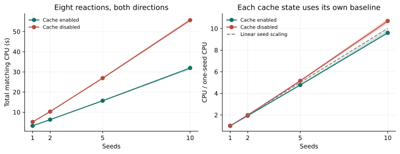
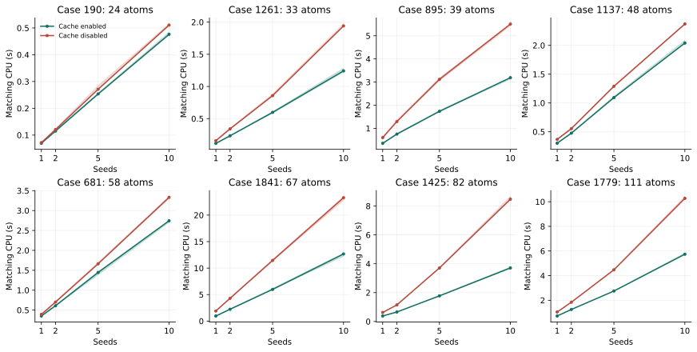

# Golden: ten seeds and cache scaling

This fresh study tests all **1,851 reactions / 3,702 directions** with ten
seeds, discovery tolerance 2 and branch cap 100. It starts with empty matching
results and caches, reusing only checksum-verified original endpoint/reference
inputs. The comparison is the [one-seed full run](../golden_tol2_cap100_20261105/README.md),
which recovered **1,834/1,851 reactions**. Source revision:
[`b51661d`](https://github.com/yunhzou/MAPPA-AAM/commit/b51661d766fc4549aece850a3e5f62e7c1ae230d).

**Status:** stopped at the user's request to repair observed overhead before
further benchmarking. All 3,702 directions completed matching and reduction.
Decoding produced 3,690 successful outputs and 12 memory-limit failures at the
unchanged 2 GiB guard. Reference verification published 3,701 of 3,702 checks;
the last check was interrupted. No retries were granted. The campaign is not
fully complete, and resource failures are not mapping absences. All 32 workers
registered in 6.05 seconds. The 384 cache-control runs and 192 paired scientific
checks are complete; their conclusions remain separate from this stopped run.

## Full-run protocol

| Setting | Value |
|---|---|
| Seeds / random seed | 10 / 42; stable prefixes of the original seed plan |
| Discovery tolerance / branch cap | 2 / 100 |
| Scope | Both directions; uncut plus full single-edge sweep |
| Input and event weights | Original prepared bond matrices |
| Graph/cut presence thresholds | 0.2 / 0.2 |
| Ordinary/metal event thresholds | 0.5 / 0.3 |
| Decoding window | Model minimum through minimum + 5 |
| Unique-fragment optimization allowance | Five seconds |
| Scheduling | Ten original seeds per cut task; cuts remain independently schedulable |
| Compute workers | 32 in one persistent pool; 40 allocated CPUs including overhead |
| Memory / compute allowance | 2 GiB per worker / 600 seconds per direction stage |
| Completed-fragment cache | 64 MiB per prepared worker session, with shared reaction snapshots |
| Expected work | 177,552 cut tasks; 1,775,520 seed searches |

Matching, reduction and decoding remain separate passes, with a global barrier
before decoding. Reference verification is external evaluation of the retained
catalogue. It does not establish reference membership inside the decoded event
window. Resource failures and unknowns remain in the full denominator.

The new logging retains each seed's original index, matcher CPU/wall time and
cache call/hit/dependency-check deltas. Small measurements accompany archived
task evidence, so analysis need not reload complete search graphs. Worker totals
also retain preparation, combination, publication, cache transport, sampled
memory and attempt intervals. Files are aggregated by worker, never per seed or
cut. Operational configuration stays private.

The execution change groups ten seeds on one worker for direct cache reuse and
avoids ten dispatches plus a cut-combination task. It does not change growth,
mapping permissions, pruning, seed orders or decoding. Grouped and separately
executed seeds were checked for exact graph equality. Three saved Golden point
cases also preserved their graphs against the preceding uninstrumented version;
raw timing repetitions are in [protocol.json](protocol.json).

## Controlled cache study

Eight reactions were selected before observing outcomes at explicit-atom size
quantiles 10%, 25%, 40%, 55%, 70%, 80%, 90% and 97%. The selection ranks maximum
endpoint atom count, then total atom count and case ID. Cases are **190, 1261,
895, 1137, 681, 1841, 1425 and 1779**, spanning maximum endpoint sizes **24–111
explicit atoms**. The full selection and input hashes are retained in the protocol
and private launch evidence.

Each case runs both directions at **1, 2, 5 and 10 seeds**, with the
completed-fragment cache enabled and disabled: **128 controlled direction runs**.
Every arm starts a fresh process and prepared session. Enabled retention is
64 MiB; disabled retention is zero. Other native preparation remains identical.
These controls measure the completed-fragment cache, not shared-file cache I/O.

The maintained `golden.py diagnose` runner measures matching, family reduction,
reference verification and audit costs separately. It compares complete catalogue
signatures, seed/cut scope and cap evidence between cache states, stopping on a
scientific mismatch. These controls do not repeat event decoding. The 2 GiB guard
and 600-second direction allowance remain explicit.

## Completed cache-control results

All **384 direction runs** completed. All **192 cache-on/off comparisons** agree
on complete catalogue signatures, seed/cut scope and cap evidence; those records
also agree across all three repetitions. Every directional reference was recovered.

| Seeds | Cache-on matching CPU (s) | Cache-off matching CPU (s) | Cache-on reduction CPU (s) |
|---:|---:|---:|---:|
| 1 | 3.258 | 5.169 | 1.250 |
| 2 | 6.315 | 10.308 | 2.633 |
| 5 | 15.679 | 26.904 | 6.538 |
| 10 | 31.958 | 55.665 | 13.746 |

Values are medians of totals across the 16 directions, measured three times.
At ten seeds, caching gives a **1.76× matching CPU speedup** (observed range
1.74–1.76×). One-to-ten-seed matching CPU increases **9.60×** with caching
(range 9.56–9.85×), versus **10.69×** without it (10.50–10.89×).
Including family reduction, the enabled ratio is **9.92×** (9.88–10.21×).
This shows useful absolute cache savings, but modest sublinear seed scaling.
The one-seed baseline already benefits from reuse across cuts.

All 66,376 ten-seed cache evictions in the first repetition came from case 1841;
the other seven cases fit within 64 MiB. A separate three-repetition capacity test completed all 144 arms under a 2 GiB
process guard, with every catalogue, scope and cap record equal to the original
64 MiB result. It changed no settings in the full benchmark. Each cold process constructs the
existing `SearchSession`, replaces its empty `FragmentRepair` with the requested
`cache_bytes`, then runs the same complete seed/cut plan and catalogue reduction.
The original compiled matcher is unchanged; no alternative algorithm is used.

| Cache limit (MiB) | Eight-case matching CPU (s) | Case 1841 CPU (s), both directions | Evictions per repetition |
|---:|---:|---:|---:|
| 64 | 31.892 | 13.023 | 66,376 |
| 256 | 31.205 | 12.402 | 2,070 |
| 1,024 | 31.266 | 12.371 | 0 |

Median matching CPU improves only about **2.2% at 256 MiB**. Eliminating every
eviction at 1 GiB gives no further aggregate improvement. Case 1841 improves
about 5%, but the larger cache adds only 546 hits across its 1.12 million
requests. Its maximum retained cache grows from 64 to 265.2 MiB. Most evicted
entries were not subsequently reused in these searches.

The original ten-seed sample's 92.5% request hit rate corresponds to **44.9% of
logical growth-extension steps reused**. Hits vary greatly in work avoided;
a high hit count does not imply that the same fraction of CPU is avoided.
[Capacity evidence](cache-capacity.json.gz) and its
[summary](cache-capacity-summary.json) retain every repetition and result check.

Lines show medians and shaded bands the observed three-repetition range, not
confidence intervals. [Raw control evidence](cache-controls.json.gz) retains
phase timings, cache counts, memory samples, caps and scientific signatures.
The [summary](cache-summary.json) and PDF/PNG figure versions are included.
These controls exclude event decoding and shared-file cache transport.

The full-run allocation was reduced before starting to avoid an estimated
two-hour queue. Its replacement uses one 32-worker pool with identical scientific
settings and resource limits. The original owner was confirmed unstarted and
cancelled before replacement; no work was duplicated.

The two reactions with the largest full-run matching CPU totals, **1654 and
1606**, also completed all 12 targeted capacity arms with identical exact
per-cut catalogue, scope and cap signatures. These are separate exploratory
point tests, one measurement per arm, not part of the prespecified sample.
They retain only one cut's comparison catalogue at a time while the native
fragment cache persists across cuts.

| Case, both directions | 64 MiB CPU (s) | 256 MiB CPU (s) | 1 GiB CPU (s) |
|---|---:|---:|---:|
| 1654 | 101.978 | 101.157 | 97.435 |
| 1606 | 94.149 | 92.208 | 87.985 |

The 1 GiB limit reduces observed matching CPU by **4.5% and 6.5%**, respectively.
Some evictions remain at 1 GiB. This does not support a large capacity-driven
speedup even on the two slowest matching reactions. It does not establish that
64 MiB is optimal for every possible reaction. [Raw evidence](cache-capacity-heavy.json.gz)
and [summary](cache-capacity-heavy-summary.json) preserve timings and memory.

## Completed full-run matching and reduction

All **177,552 cuts / 1,775,520 seed searches** and all 3,702 directional reductions
are independently audited complete, without retries or duplicate task ownership.
Peak observed task overlap was 32. Matching used **15,482.407 CPU-seconds**;
reduction used **14,952.539 CPU-seconds**. Publication consumed a further
4,816.026 and 1,412.124 CPU-seconds, respectively, recorded separately.

Against the completed one-seed run, matching CPU is **7.00×**, reduction **13.30×**,
and their combined CPU **9.13×**, for ten times as many seed searches. This is an
observed campaign comparison, not an isolated cache effect: worker count and seed
batching also differ. Use the controlled cache study for causal cache comparisons.

Shared-cache transport recorded **26.449 worker-seconds loading** and **2,804.822
worker-seconds saving**, with 272,840,403 bytes loaded and 36,340,548,247 bytes
written across the run. These summed worker times are not elapsed campaign time.
There were no cache-load/save errors or baseline-recovery loads. Increasing
capacity can add snapshot cost, which the isolated capacity timings exclude.

## Reduction repair

The [baseline profile](reduction-profile.json.gz) separates saved-graph loading
from catalogue construction. In case 1654 forward, loading used 15.04 of 26.98
unprofiled CPU-seconds. Instrumented profiles locate repeated relation
construction checks during loading, plus repeated fragment hashing and action
preparation during catalogue ingestion. Profiling adds overhead; its absolute
times are not used in the comparison below.

Revision [`cb2a400`](https://github.com/yunhzou/MAPPA-AAM/commit/cb2a4005a33749f4c9f9e1bf433f37e1449a40a2)
restores trusted binary scientific fields without rerunning constructor checks,
reuses immutable fragment hashes and prepares each referenced graph transition
once per ingestion. Required-edge records are constructed only for new families.
Public construction still validates input. Fragment permissions, action ordering,
deduplication identity and every provenance entry are unchanged.

| Case, forward | Before CPU (s) | After median CPU (s) | Observed speedup |
|---|---:|---:|---:|
| 190 | 0.234 | 0.119 | 1.97× |
| 1841 | 10.598 | 8.293 | 1.28× |
| 1561 | 38.913 | 30.371 | 1.28× |
| 1654 | 26.977 | 8.899 | 3.03× |

All **12 complete-record comparisons** pass: four directions, three repetitions
each, retaining exactly the original branches, fragment constraints, action
order and provenance. Case 1561 contains 94,717 input paths, 91,763 retained
families and 6,631 unique fragments. This repair removes redundant preparation;
processing its large retained output still has a cost.

The baseline has one unprofiled observation per case; the repair reports three
repetitions. Both use the same CPU model in separate allocations. Searches were
not repeated. The unchanged saved graphs were republished to exercise the new
binary transport; that conversion and complete-record auditing are outside the
timed reduction. Existing old snapshots still invoke their original constructor
restoration until republished. Raw process memory includes conversion and audit,
not just reduction. Every validation retained the 2 GiB guard and completed.
These point timings do not establish a full-campaign speedup.

[Raw repair evidence](reduction-repair.json.gz) and
[summary](reduction-repair-summary.json) record the measurements. Validation also
passed 169 affected checks and 26 smoke checks; these are reported test scopes,
not a claim of exhaustive chemistry validation. The benchmark remains stopped;
this reduction repair does not resolve its 12 decode memory failures.

### Completed full reduction rerun: unchanged scientific records

The earlier bookkeeping repair has now completed **all 3,702 directions** from
the saved ten-seed matching results. All 3,702 complete catalogue/provenance
comparisons passed, preserving 177,552 cuts and 1,775,520 seed searches. No
matching was repeated and the original ledger remained unchanged. This measured
revision `53006248`, with scientific revision `cb2a4005`; it precedes the atom-set
identity change described below.

Reduction CPU fell from **14,952.54 to 10,010.65 seconds (1.49×)**. Median
direction CPU fell from 2.027 to 1.367 seconds, p99 from 29.550 to 19.820 seconds,
and maximum from 64.732 to 47.159 seconds. There were 242 individually slower
directions. Reduction publication used a further 1,361.70 CPU-seconds.

All 32 workers registered, with peak task overlap 32. The reduction stage spanned
367.04 seconds; the whole pool took 1,099.35 seconds, including separate snapshot
conversion and full-record comparison passes. Every pass retained the 2 GiB
guard; there were no failures or retries. The largest sampled reduction process
used 1.64 GiB. There were 86 short reduction tasks without a memory sample.
[Summary](reduction-rerun-summary.json) and
[direction records](reduction-rerun-directions.json.gz) retain the audited scope.

### Completed fragment identity: atom-set pairs

Revision [`b26e2ee`](https://github.com/yunhzou/MAPPA-AAM/commit/b26e2ee103cb77c1d95bbfb54436170e5e0031ec)
interns each completed reactant/product atom-set pair once,
within the fixed problem, policy and explicit anchors. Branches share these
fragments. Growth witnesses, temporary locks and accepted-edge histories remain
in raw matching archives and no longer split completed fragments. Reduction
performs composition lookup and provenance aggregation without symmetry solving
or starting-map search. Ordered global placements retain joint occupancy; an
initial action already contained within local binary symmetries is omitted.

Decoding uses the existing bounded starting-correspondence improvement and
binary symmetry response. Its partial event bound now accounts for injective
occupancy, reducing redundant search. Catalogue verification can construct and
validate an annotated correspondence directly on completed atom sets; cases
requiring global placement still use the joint query.

This changes the saved relation: completed atom sets permit element-compatible,
explicit-anchor-preserving starting correspondences, without historical growth
edge constraints. Decoding still selects one bounded-best starting orbit. Thus
catalogue recovery and recovery inside the selected decoded window are separate
metrics; a catalogue hit alone is not a decoded accuracy result. The catalogue
schema is v4 and does not silently reinterpret older catalogue records.

Five local forward directions compare identical saved matching results against
revision `53006248`: cases **0, 44, 625, 1000 and 1361**. These are exploratory
point tests including a known slow case, not a full Golden accuracy study. Each
uses ten seeds, tolerance 2, branch cap 100, random seed 42, full single-cut sweep,
the original bond matrices, a five-second allowance per unique fragment and
decoder slack five. Matching was performed once and was not part of the paired
timings. Each revision has one cold observation, one compute thread and a
120-second process watchdog. Postprocessing had no process memory guard.

| Case, forward | Reduction before → after CPU (s) | Decoding before → after CPU (s) | Unique fragments before → after |
|---|---:|---:|---:|
| 0 | 4.459 → 2.950 | 4.387 → 5.042 | 2,134 → 1,840 |
| 44 | 0.696 → 0.521 | 3.884 → 2.138 | 1,171 → 892 |
| 625 | 0.006 → 0.005 | 0.129 → 0.042 | 84 → 31 |
| 1000 | 0.033 → 0.035 | 0.657 → 0.344 | 410 → 265 |
| 1361 | 0.561 → 0.549 | 52.921 → 30.710 | 2,460 → 1,463 |
| **Total** | **5.755 → 4.060 (1.42×)** | **61.978 → 38.277 (1.62×)** | **6,259 → 4,491** |

Reference recovery is **5/5 before and after**, both in the catalogue and under
exact annotated-index queries inside the selected decoded window. Reference
event counts remain **11, 4, 3, 3 and 7**, respectively; reported model minima
remain **9, 4, 3, 3 and 7**. All branch-composition hashes, 40,528 public branches
and 53,830 input paths are unchanged. Retained families decrease from 50,449 to
42,779. These checks do not establish equality of every decoded alternative.

Combined reduction/decoding CPU improves **1.60×**. Case 0 decoding remains
0.655 seconds slower (14.9%), while its combined reduction/decoding falls from
8.847 to 7.993 seconds. Case 1000 reduction is 0.002 seconds slower. All other
paired reduction/decoding observations are faster. Catalogue verification totals
1.143 versus 0.058 CPU-seconds; separate decoded-window queries total 0.326 versus
0.288 seconds. Decoding includes lazy window construction, while loading,
export, serialization and restoration are recorded separately.

The largest process lifetime RSS, including export and restored records, is
3.382 GiB before and 3.206 GiB after, both on case 1361. These measurements do not
demonstrate successful decoding under the campaign's 2 GiB guard. Full Golden
has not been rerun under the new fragment identity.

Validation passes **1,237 tests**, followed by 28 passing benchmark checks after
removing the last unused conversion hook. This includes 64 actual small greedy searches
whose previously represented mappings remain covered, four exhaustive event
oracles (triangle-tail, ring-chain, continuous weights and explicit anchors),
32 injective-bound oracles, joint placements, sweep handling, persistence and
work-pool checks. A test forbids symmetry solving and starting-map optimization
during reduction. Obsolete catalogue-conversion code and its fixture were
removed. [Paired evidence](atom-set-comparison.json) records source/engine hashes,
input checksums, policies and all phase timings. Cluster execution remains on
the earlier revision; no campaign was silently resumed.

## Compact reduction and publication

The next repair follows atom-set identity with integer fragment-ID compositions.
It projects each completed state's atom sets in one native call, shares prepared
fragment actions and keeps growth histories as parent links. Reduction and
publication no longer unfold those histories. Ordered global placements,
explicit anchors, sweep provenance and every scientific catalogue field remain
unchanged. The catalogue uses storage schema v5; saved raw matching graphs can
be reduced directly into this format.

The paired baseline is `1e4f384e4fba092479e769f3455ed2dfe4ca06b3`; the candidate
is `57aa2387c2f9b4b30c4360369d8da3ea6b6f69fb`. Source/engine identities are recorded in
[the comparison](compact-reduction-comparison.json). This is a local comparison
of five immutable saved matching results, **ten seeds, cap 100, tolerance 2,
forward directions**, with two repetitions in alternating order. Matching was
not repeated. Decoding keeps the same minimum-plus-five window and five-second
fragment allowance. Values below are mean CPU seconds across the repetitions.

| Golden case | Reduction before | Reduction after | Speedup |
|---|---:|---:|---:|
| 0 | 3.0668 | 1.8049 | 1.70× |
| 44 | 0.5029 | 0.3623 | 1.39× |
| 625 | 0.0056 | 0.0054 | 1.03× |
| 1000 | 0.0335 | 0.0312 | 1.07× |
| 1361 | 0.5506 | 0.4537 | 1.21× |
| **Total** | **4.1594** | **2.6576** | **1.57×** |

Reduction uses **36.1% less CPU**. Decoding totals 39.124 versus 39.247 seconds
(0.3% higher); this measurement does not show a decoding speedup. Export,
serialization and restoration together fall from 7.021 to 6.341 seconds.
The full phase breakdown, wall times and individual observations are saved.

A subsequent measurement separates reduction itself on the same five saved
seed-ten directions, using three alternating-order repetitions with and without
timing instrumentation. Five once-per-cut line boundaries are observed through
CPython's local monitoring API; callbacks on other lines are disabled. The core
source and algorithm are unchanged. Mean CPU totals across the five directions:

| Reduction operation | CPU seconds |
|---|---:|
| Extract atom sets and identify unique keys | 0.555 |
| Construct shared fragment records and translate composition IDs | 0.475 |
| Group/deduplicate branches and construct their records | 1.114 |
| Collect shared histories and ordered placement programs | 0.516 |
| Return and release temporary records | 0.012 |
| **Total** | **2.672** |

Thus collecting unique fragments including their records costs 1.031 seconds.
The branch stage includes composition construction, ordered placement handling,
family creation and provenance attachment; it is not an isolated hash-insertion
measurement. Loading, decoding, verification, publication and comparison hashes
are excluded. Uninstrumented controls total 2.722 seconds, versus 2.672 with
boundary timing; these small run differences do not establish negative timing
overhead. Branch hashes and all path/branch/family/fragment counts agree with the
earlier comparison in all 30 observations. Per-case stages, wall times and raw
observations are included in the same comparison evidence.

To isolate dictionary deduplication, capture the actual key sequence passed to
each of the reducer's three registries and replay it into a fresh dictionary,
checking membership and assigning an integer ID for each new key. Thirty repeats
per case give the following mean CPU totals across the same five directions:

| Lookup operation | Input keys | Unique keys | CPU milliseconds |
|---|---:|---:|---:|
| Fragment atom-set pairs | 18,767 | 4,491 | 2.920 |
| Branch fragment-ID compositions | 53,830 | 40,528 | 10.740 |
| Compositions with ordered placement variants | 53,830 | 42,779 | 50.432 |

These use actual emitted keys, including production sharing and prepared hashes,
with a fresh dictionary on every repetition. They exclude constructing keys,
scientific records, provenance, loading and publication. The captured run retains
the earlier branch hashes and path counts; replay yields the original registry
sizes. All three lookup kernels total approximately 64 milliseconds. This shows
that dictionary deduplication itself is a small part of the measured reduction
cost. It does not establish a 64-millisecond runtime for the complete stage:
producing keys and output records remains necessary work in the current dataflow.
The lookup measurements and individual repetitions are saved in the same evidence.

All catalogue-content hashes match in both repetitions after normalizing only
the storage schema and compact history encoding. This includes fragment values,
representative mappings, action order, branch membership and every original
provenance record. Counts remain 53,830 input paths, 40,528 branches, 42,779
families and 4,491 unique fragments summed across the five directions. Reference
recovery remains **5/5** both in the catalogue and in the decoded window.
Reference event counts remain 11, 4, 3, 3 and 7; model minima remain 9, 4, 3, 3
and 7. These checks do not exhaustively compare every decoded query answer.

A critical test represents **1,048,576 growth histories with one final branch**.
It forbids history unfolding during reduction, binary/JSON publication,
restoration and decoding, while retaining the full count and compact references.
Its serialized catalogue stays below 10 KB. Additional tests compare native
atom-set projection with independent set grouping, preserve joined and explicitly
selected histories, and check placement order and distributed transport.
The final full suite passes **1,256 tests** in 245.20 seconds.

This comparison does not replace the full Golden timing results above. The
earlier complete seed-ten workload contains 27,936,113 raw paths and 19,194,449
final branches across 3,702 directions; it is larger than a one-million-key
set-insertion example. Full Golden has not been rerun under this repair, and
seed-one versus seed-ten scaling is not remeasured here. The largest measured
process RSS is 3.209 GiB before and 3.199 GiB after, including explicit output
audits. These local checks do not establish operation under a 2 GiB guard.

### Reusing shared state during projection

Revision `a6bb8bb1b41a470f9f446edef27085a5bec49aef` reads immutable search-state
blocks directly in native projection, converting each shared block or sequence
once per input graph. Its temporary conversion table is released when projection
returns. Combined branch mappings use the existing fragment witness pieces with
a compiled iterator. Matching, fragment identity, placement order, provenance,
catalogue schema and decoding are unchanged.

The initial experiment found that flattening and sorting prepared witness pieces
for case 0's 31,106 compositions took 0.097 CPU seconds; the compiled iterator
took 0.072 seconds. Mapping assembly alone therefore offers a small saving.
Lazy construction was not adopted: the decoder's inventory reads every family's
mapping, so deferral would move that work downstream.

Against `4958d5d285e43a023fc2d714717fb3f231e0217d`, two repetitions in alternating
revision order on the same five saved ten-seed directions give these mean CPU
seconds. Loading, decoding, publication and audit hashing are excluded from
reduction. Full observations and source identities are in the existing
[comparison evidence](compact-reduction-comparison.json), under
`shared_state_projection`.

| Golden case | Reduction before | Reduction after |
|---|---:|---:|
| 0 | 1.2543 | 1.1136 |
| 44 | 0.2575 | 0.2409 |
| 625 | 0.0034 | 0.0034 |
| 1000 | 0.0203 | 0.0213 |
| 1361 | 0.3248 | 0.3128 |
| **Total** | **1.8603** | **1.6921** |

Reduction uses **9.0% less CPU** (1.10× speedup). Case 1000 averages one
millisecond slower, with the timing difference reversing between repetitions.
Decoding totals 27.628 versus 27.416 seconds; this small difference does not
establish a decoding speedup. Reduction plus decoding totals 29.488 versus 29.108
seconds, so the whole measured pipeline gain is modest. Export, serialization
and restoration total 4.506 versus 4.477 seconds. These paired timings should not
be compared directly with the earlier, separately measured timings above.

Every complete catalogue hash, branch hash, count, serialized size, model minimum
and minimum-proof status matches across both revisions and repetitions. All five
references remain recovered in both the catalogue and decoded window, with
unchanged event counts. Peak process RSS, including explicit output auditing, is
3.202 GiB before and 3.201 GiB after. This is not a full Golden rerun or a test
under a 2 GiB guard.

Validation passes **26 smoke tests and 157 affected tests**, including an explicit
test that native projection handles shared, unsorted, partial states without
expanding their Python sequences. Thirteen pool tests initially encountered
sandbox restrictions on local sockets/process monitoring; those tests passed
with the required permissions. No scientific test failed.

## Paper analysis

At the stop, saved verification establishes **1,843/1,851 reactions (99.57%)**
recovered in at least one direction, versus 1,834 with one seed: nine gains and
no losses. The interrupted check is 1351 reverse, whose forward direction already
recovered the reference, so it cannot change this reaction-level result. This
does not resolve the 12 decoding failures or establish recovery inside the event
window. The eight unrecovered reactions are 7, 19, 590, 986, 1285, 1358, 1377 and
1475. Directional checks remain 3,676 recovered, 25 not recovered and one unfinished.

The [stopped summary](stopped-summary.json) and
[direction records](stopped-directions.json.gz) retain phase CPU, publication,
memory and original seed measurements. Failed compute observations remain separate
from complete timings. The 44 distinct worker identities include replacements
after memory failures; they do not mean 44 concurrent workers. Pool capacity was
32 throughout.

Report reaction-level recovery, gains/losses from one seed, all failures/unknowns,
and the full denominator. Compare matching plus reduction separately from
decoding and external verification; retain CPU totals and per-reaction timing
distributions, including maxima. Report actual worker readiness and overlap,
not submitted capacity as utilization.

Plot CPU versus seed count for the size-stratified controls, with cache-on and
cache-off curves and a linear tenfold-work reference. Record cache hits, misses,
retained bytes, dependency checks and shared-snapshot I/O for the full run.
Compare only completed common scopes and show censored arms explicitly. Cache
hit rates alone do not establish a speedup, and scheduling/batching changes
prevent attributing the full-run wall-time difference solely to caching.

Validation before launch: **50 search/campaign tests**, **95
transport/cache/Golden tests**, **26 smoke tests** and **12 Linux seed tests**
passed. Cluster hosts, accounts, raw scheduler identifiers and paths are excluded
from public evidence.

## Reproducibility and interpretation

The full campaign archives every task and attempt, original seed/cut plan,
source/engine identity, stage handoff and reference answer. Per-seed measurements
are stored in the same aggregated task evidence as the matching results. The
public report contains sanitized summaries; original operational records remain
in the private campaign. A compute limit never becomes a negative mapping result.

For the cache control, each reaction/direction/count/cache arm starts a fresh
process, executes its entire cut sweep, reduces the resulting families and checks
reference membership. The reported matching CPU excludes preparation, family
reduction, signature auditing and reference verification; their separate times
remain in the raw records. The enabled and disabled arms share the same seeds,
original inputs, cap and compiled matcher. Their sole cache difference is
completed-fragment retention. Repeat measurements use the same fixed eight-case
sample; no case is added or removed based on speed or recovery.

The full run uses shared reaction snapshots and a persistent pool, whereas the
controls use a private in-memory cache within each fresh direction process.
Report these as distinct experiments. Full-run cache-hit counts alone do not
quantify how much CPU the snapshots saved.
