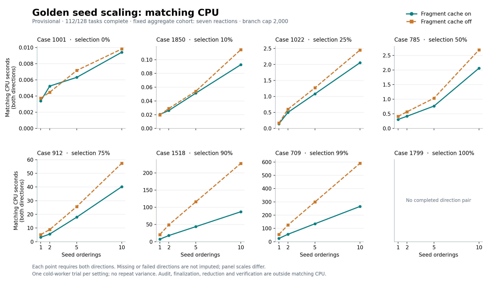

# Golden seed scaling — provisional local results

Snapshot: 2026-11-02T08:10:24+00:00. **112/128 requested direction tasks are complete.** The seven completed reactions have a balanced grid; case 1799’s 16 trials remain pending. All 56 cache-on/off pairs have identical catalogue and scope hashes, per-cut records, graph counts, cap evidence and verification outcomes. Missing cells are not imputed.

The eight reactions were selected at recorded matching-cost quantiles using [selection.json](selection.json). Selection costs came from the earlier one-seed, cap-100 study; these measurements use cap 2,000. This cost-stratified sample does not estimate benchmark-wide speed or accuracy.

## Fixed seven-case comparison

Cases **1001, 1850, 1022, 785, 912, 1518 and 709** have all 16 requested settings complete. Every row sums the same seven reactions and both directions. There is one trial per setting, with no repeats or uncertainty estimates.

| Seeds | Matching on CPU s | Matching off CPU s | Off/on | Through reduction on CPU s | Through reduction off CPU s | Off/on |
|---:|---:|---:|---:|---:|---:|---:|
| 1 | 35.022 | 81.170 | 2.32× | 149.255 | 194.869 | 1.31× |
| 2 | 79.929 | 183.974 | 2.30× | 322.000 | 424.598 | 1.32× |
| 5 | 198.384 | 443.270 | 2.23× | 782.807 | 1024.824 | 1.31× |
| 10 | 396.839 | 880.683 | 2.22× | 1531.983 | 2026.124 | 1.32× |

The cache reduces matching CPU by **2.22–2.32×**, and matching plus saved-symmetry finalization and family reduction by **1.31–1.32×** in this completed cohort. These ratios compare the same algorithm and requested work, with completed-fragment retention on or off. They exclude preparation, external reference verification and audit. **No event decoding was run.** Millisecond-scale points remain sensitive to one-run timing noise.

All seven reactions and all 14 directions recover their references at every completed seed/cache setting. Cap evidence remains present: completed work does not establish exhaustive mapping coverage.

## Work across seed counts

Cache-on matching CPU grows by 1.00×, 2.28×, 5.66×, 11.33× at 1, 2, 5 and 10 seeds. More seeds still execute more searches even when cache hits are common.

| Seeds | Fragment calls | Full hits | Logical extensions | Reused extensions | Evictions | Saved states | Families |
|---:|---:|---:|---:|---:|---:|---:|---:|
| 1 | 5,678,515 | 97.03% | 2,459,295 | 82.06% | 96,665 | 958,444 | 245,953 |
| 2 | 12,399,940 | 97.30% | 5,403,975 | 83.93% | 248,382 | 1,977,113 | 494,553 |
| 5 | 30,476,642 | 97.70% | 12,963,418 | 85.58% | 589,173 | 4,906,678 | 1,186,799 |
| 10 | 56,934,197 | 97.78% | 24,706,626 | 86.24% | 1,119,778 | 9,504,322 | 2,304,520 |

Counts sum the same fixed cohort. Saved states and families are summed across directions, not deduplicated across different reactions. High hit fractions do not remove the cost of cache calls, new seed orders, finalization or reduction. These measurements do not establish eviction as a bottleneck.

## Timing boundaries

The cache-on stage totals below use the same seven cases. CPU values sum worker execution; summed direction wall times in the JSON are not parallel reaction latency. Verification and fingerprinting are external to the matching-through-reduction comparison.

| Seeds | Preparation CPU s | Matching CPU s | Finalization CPU s | Reduction CPU s | Verification CPU s | Audit CPU s (excluded) |
|---:|---:|---:|---:|---:|---:|---:|
| 1 | 0.046 | 35.022 | 45.320 | 68.913 | 8.216 | 51.121 |
| 2 | 0.041 | 79.929 | 92.227 | 149.845 | 11.332 | 96.971 |
| 5 | 0.039 | 198.384 | 208.072 | 376.351 | 173.868 | 240.880 |
| 10 | 0.043 | 396.839 | 395.438 | 739.707 | 523.181 | 465.310 |

## Scope and checks

- Hardware: Apple M4 Pro. Every case/direction/seed/cache setting starts in a fresh worker. The fragment cache stays resident across that direction’s cuts and seeds. There is no cross-task cache import.
- Seeds: 1, 2, 5 and 10; random seed 42; branch cap 2,000; full single-edge cut sweep; graph and cut floors 0.2; isomorphism tolerance 1. Cache-off disables completed-fragment retention, not every internal prepared structure.
- Reference verification checks the exact heavy-atom relation including unmatched atoms, modulo endpoint chemical symmetry. This selected cohort does not replace the separate 21-miss follow-up study.
- Only the five named scaling result groups below are included. Preflight, startup-only and recovery runs are excluded. The first two groups drained normally before their remaining work continued in separate groups. No completed grid task was repeated or overwritten.
- Local resource protocol: 105 completed tasks used 4 GiB and 600 s per direction; the remaining seven used 16 GiB and 1,800 s. No task reached its guard. Case 709, five seeds, forward is the one cache pair with unequal guards: on used 4 GiB/600 s, off used 16 GiB/1,800 s. Their catalogue and work-scope evidence still match. The other 55 pairs have equal guards. These local limits do not alter cluster reservations or scientific settings; the enabled fragment-cache budget remains 64 MiB.
- All groups have the same scientific source identity, configuration and overlapping input hashes, with two fingerprint formats and three runner hashes. V2 hashes compact catalogue records; the later runner adds task-selection controls. Equality is checked within each cache pair’s fingerprint format; cross-format hash equality is not asserted.
- Audit CPU is excluded from matching and the other scientific stages. Whole-worker time and RSS include verification and audit, and the older audit can increase them. Whole-worker peaks are not matching-only memory measurements or clean cross-runner comparisons. RSS is sampled every 0.2 s alongside process-lifetime peaks; an unsampled short phase is not zero memory.

## Provenance

- Scientific source identity: e210faf401a2d33d679c8194a47137237478bbb7074532e4b827b14eeee9d1ca.
- Selection SHA256: 23efb3e68c513b4e345a1aaf65902fb2adba295f30336fc8f8e977bcef83ae68.
- scaling_first5: runner 15aa015b06ad77235075db050206ebea773a30a335fafd6c065699cf079aa7bc; catalogue-signature/v1; result snapshot d44e4af66de33d231aef87caaab0e5426b3742c8f479aa5e7cf8664f4d71dae1.
- scaling_remaining3: runner 4b46f2d7b2a55b8f902defac80b19d2a6f033628327dd31412a7a5995705e043; catalogue-signature/v2; result snapshot dfa415b87a4a983b4a64493b714cb2d1b49da9e5e83a348fe98f64be003140bf.
- scaling_709_seed5_on_reverse: runner af0c5d4c5e4c82f0f8b745201f56c3c1bafdd99a574b0b0fb805ca15fef49b19; catalogue-signature/v2; result snapshot 688e13812c991cb0dc9400d93e0e09fb70bbd7f030284ce739dcd1ebb357c9e8.
- scaling_709_seed5_off: runner af0c5d4c5e4c82f0f8b745201f56c3c1bafdd99a574b0b0fb805ca15fef49b19; catalogue-signature/v2; result snapshot 586476ea23df3e3abb121e13d09e2c0763b36809c4757d3833ffd8b91000d077.
- scaling_709_seed10: runner af0c5d4c5e4c82f0f8b745201f56c3c1bafdd99a574b0b0fb805ca15fef49b19; catalogue-signature/v2; result snapshot af63ad14e50a2be3d67c3427ca250b517b6b7c83ad8ba2bdd7073cf9777bab66.

[summary.json](summary.json) preserves all 128 requested cells, per-direction stage measurements, cache counters, completed scope, caps, catalogue signatures, reference outcomes, actual guards and source-input hashes. [scaling.svg](scaling.svg) is the vector plot. The report remains provisional until case 1799’s trials finish.
