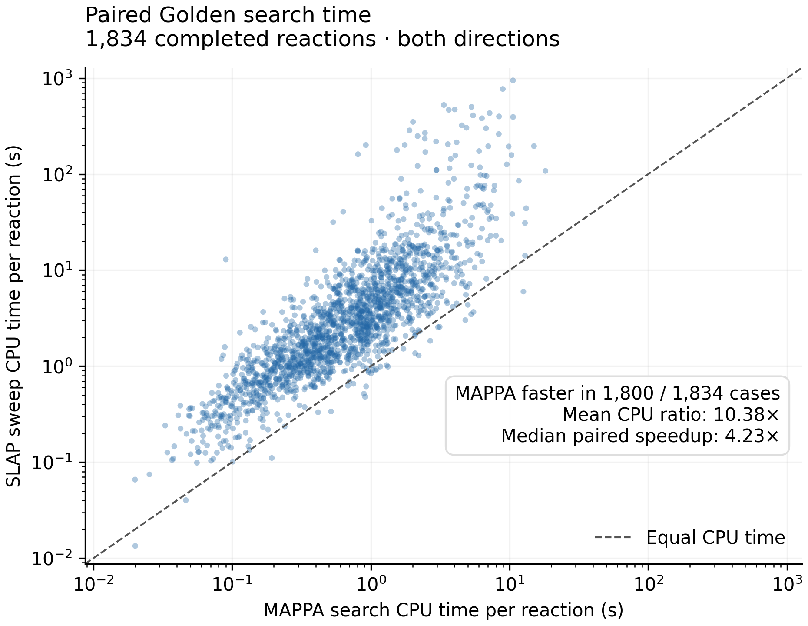

# Current MAPPA versus SLAP on Golden

Completed paired study of all **1,851 Golden reactions**, with both directions
and the full uncut plus single-edge sweep. On the **1,834 reactions where both
methods completed both directions**, MAPPA used **10.38× less mean search CPU
time** than the pinned SLAP sweep. MAPPA was faster on **1,800/1,834 reactions
(98.15%)**. This is a comparison of the stated full-sweep protocols on the same
CPU model, not of MAPPA against a single default SLAP call.

## Paired CPU times

Each value sums both directions of one reaction. Search includes graph
preparation, matching and reduction. Input loading, publication, bookkeeping and
external reference verification are excluded from this table and retained
separately in the evidence.

| Operation | Mean CPU s/reaction | Median | 95th percentile | Maximum |
|---|---:|---:|---:|---:|
| MAPPA search | **1.202** | **0.699** | **4.156** | **18.139** |
| SLAP sweep search | 12.475 | 2.658 | 36.777 | 947.584 |
| MAPPA decoding, minimum + 5 | 1.617 | 0.905 | 5.090 | 98.751 |
| MAPPA search + decoding | **2.819** | **1.645** | **8.952** | **106.091** |

The ratio of mean search times is **10.38×**; the ratio of medians is **3.80×**.
Computing the speedup separately for each reaction gives a median of **4.23×**
and a geometric mean of **4.52×**. Thus the mean advantage is amplified by SLAP's
slow tail, but is not confined to a few outliers. MAPPA's mean search comprises
0.003 s preparation, 0.894 s matching and 0.304 s reduction.

Even including MAPPA's additional event decoding, its mean compute cost is
**4.43× lower** than the SLAP sweep search alone. These outputs differ: MAPPA
retains compressed mapping families and queryable event responses; SLAP supplies
its saved mapping candidates. This is not an assertion of identical output
products. There is one timed trial per reaction, not a repeated microbenchmark.

Each point is one reaction completed by both methods; points above the dashed
line favor MAPPA. Both axes are logarithmic. The 17 reactions with an incomplete
SLAP search are excluded from this paired timing plot, not counted as fast
completions. [Vector figure](paired-search.pdf).

Across **all 1,851 reactions**, MAPPA averaged **1.262 CPU s** for search and
**1.649 CPU s** for decoding, or **2.912 CPU s combined**. All 3,702 MAPPA
matching and decoding directions succeeded. The slowest single decoding direction
was case 590/forward at **90.467 CPU s**. The parallel decoding pass lasted
128.21 s; this elapsed duration is separate from summed CPU time.

## Reference coverage

Coverage means the reference is present among retained mappings, allowing chemical
endpoint symmetry and preserving unmatched atoms. A positive result in either
direction recovers the reaction. It is not top-1 accuracy.

| Method | Recovered / 1,851 | Not recovered | Unresolved |
|---|---:|---:|---:|
| MAPPA matching catalogue | **1,839 (99.352%)** | 12 | 0 |
| SLAP saved mapping candidates | **1,794 (96.921%)** | 52 | 5 |

Both methods recover 1,793 reactions. MAPPA additionally recovers 41 that SLAP
completed without a reference match and all five with unresolved SLAP coverage.
SLAP alone recovers one reaction. The five unresolved SLAP reactions are **575,
1503, 1665, 1723 and 1776**; resource exhaustion is not proof of absence.

The separate MAPPA decoded-window audit uses **exact annotated heavy-atom
indices**, rather than endpoint-equivalence normalization. It confirms
**1,830/1,851**, with **13 absent and 8 unknown**, using its original ten-second
query allowance per direction and no targeted follow-up. These unknowns are
bounded membership-query outcomes, not failed decoding. This stricter metric
must not be compared directly with the catalogue coverage table or merged with
historical targeted-query results.

## Failures and scope

All **18,510 required stage records** are terminal:

- MAPPA: 3,702 successful matching, 3,702 decoding and 3,702 verification tasks.
- SLAP: 3,683 successful matching tasks and **19 failed directions**: 14 timeouts,
  four memory limits and one upstream empty-result exception on 836/reverse.
- SLAP verification: 3,683 successful tasks; the 19 failed-search directions are
  explicitly blocked. There were no verification execution failures.

Every worker had the same **4 GiB** guard and **600-second** allowance per
method/direction/stage. No failed task was retried and no budget was replenished.
The failed SLAP attempts consumed approximately **9,524 sampled CPU seconds
(2.65 CPU hours)**, reported separately from completed-search timings. Memory
measurements are sampled process-tree peaks. Complete task classifications and
excluded reaction IDs are in [summary.json](summary.json).

The full matching span was 55.40 minutes, including drained continuations and
waiting; it is not a mapper CPU measurement. The decoding and verification spans
were 128.21 s and 276.19 s. Operational logs and accounting remain private.

## Reproducible protocol

Both methods consumed identical prepared explicit-hydrogen Golden endpoint
matrices and atom indices, with presence threshold 0.2. Reference labels entered
only external verification. Computation used **Intel Xeon Gold 6442Y** processors
and one numerical-library thread per task; the persistent pools used 16 and then
32 workers. Every matching and decoding record reported the same CPU model.

MAPPA used discovery tolerance **2**, branch cap **100**, **one seed**, random
seed **42**, both directions and every single-edge cut plus the uncut graph.
The current indexed fragment cache starts empty for each direction, retains
fragments across its cuts and has a 64 MiB allowance. Decoding uses the original
weights, a minimum + 5 window, event thresholds 0.5/0.3 and the existing
five-second unique-fragment improvement allowance.

[SLAP](https://github.com/shin1koda/slap-mapper) is pinned to
`ea248fd9494f52f4865193e87a98cc92c62b5f9e`, with both binary and weighted modes,
heavy-atom symmetry breaking, random seed 20260910 and the identical directed
cut plan. Its upstream isolated element-balancing placeholders are retained;
prepared weights use SLAP's half-integer conversion. Native heavy labels must
be unique: repeated labels are rejected, never expanded into free assignments.
Chemical reference comparison uses canonical paired heavy graphs, preserving
joint connectivity, chemical attributes and unmatched atoms.

The maintained runner is [compare_slap.py](../../bench/compare_slap.py).
Initial benchmark revision: `0d567abbe938306f687bdf4e145b24c8ab4d6b49`.
Final benchmark orchestration: `6e8ef6a7be9f0edbe7bfeb9c0af72345aa110938`.
The source/engine identity is
`ba841d410beb9356c1bf1d86c9c34467a42e06d9e82a66cfd45c4aa65fa92e6b`.
The continuation changes only how the benchmark proceeds after comparator
failures. AST comparison establishes that graph adaptation, matching, decoding
and verification operations remained unchanged; no core algorithm was edited.

Six adapter tests passed locally and on Linux: upstream parity for balanced,
aromatic and unbalanced reactions; repeated-label rejection; joint connectivity
and unmatched-atom reference checks; and real publication followed by decoding
and verification. The final local run passed all six tests again.

Independent audit checked all 18,491 actual attempts, full input membership,
identical completed cut scope, budgets, stage barriers, unique ownership and
zero retries. All prior stage-row hashes and the initial 3,389 saved results
were preserved. The global matching barrier preceded decoding, and decoding
preceded verification. This study is terminal with explicit SLAP failures, not
an all-successful benchmark.

[summary.json](summary.json) contains settings, source and dependency hashes,
paired distributions, coverage, exclusions and audit results.
[directions.json.gz](directions.json.gz) contains sanitized per-direction CPU,
wall, memory, scope and verdict records. [pilot.json](pilot.json) retains the
separate eight-case launch check; pilot timings are not included in the full
comparison. Older same-Mac measurements remain historical evidence: their
hardware, paired cohort, implementation and timing boundaries differ, so the
change in speedup cannot be attributed solely to code changes.
